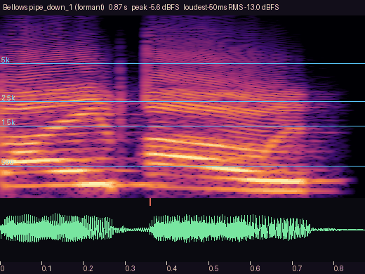
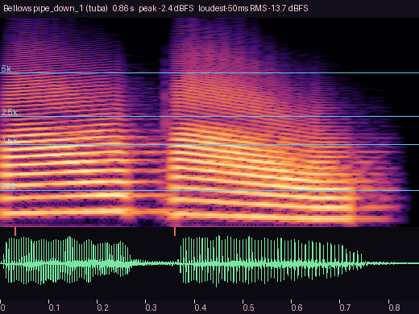
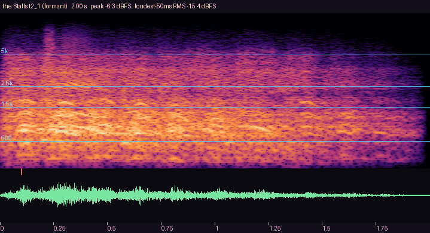
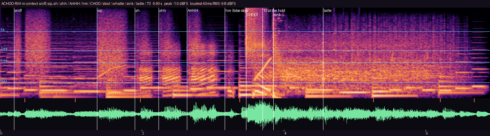
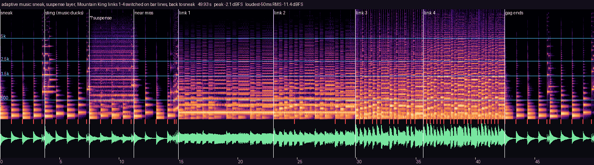
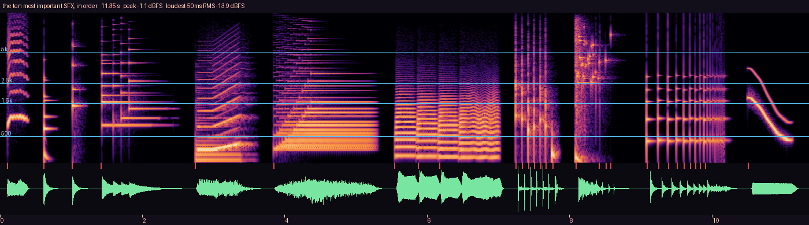
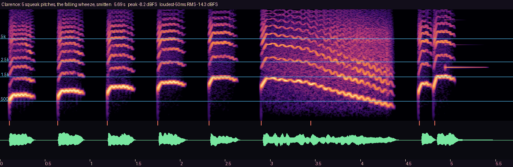
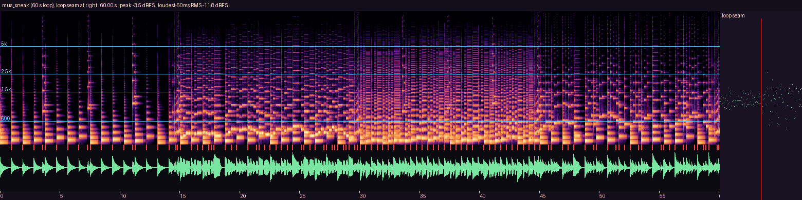
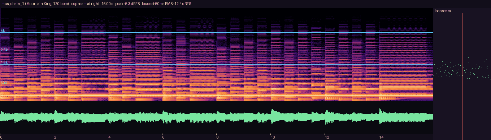
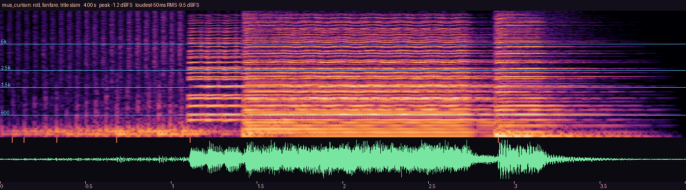

# Audio review — Gate 0 (task `audio`)

Everything here is synthesised by `tools/audio` (numpy, no samples). The WAVs in `ab/` are copies
for listening (≈ 5 MB); the game's own files live in `game/audio/`. Rebuild this folder with
`tools/scripts/gen_audio.sh --pack`. **Listen on a phone speaker held sideways**, then on earbuds.

## 1. The two A/B choices (GDD §10.5 R5) — the owner picks

In game: `Audio.set_voice_style("formant" | "tuba")`, `Audio.set_crowd_style("formant" | "fallback")`.
The loser of each pair is deleted after Gate 0 (it is budgeted separately until then).

### Bellows' voice: formant baritone vs talking tuba (same score, same pitch and rhythm)

| Line | Formant | Talking tuba | Judge |
|---|---|---|---|
| PIPE DOWN! | [formant](ab/voice_pipe_down_1_formant.wav) | [tuba](ab/voice_pipe_down_1_tuba.wav) | reads as "PIPE DOWN!" without subtitles? funny, not grating? |
| Aria (after Bizet's Toreador) | [formant](ab/voice_aria_1_formant.wav) | [tuba](ab/voice_aria_1_tuba.wav) | pompous, "fourth most famous in the county"? |
| Warm-up cracking into a yodel | [formant](ab/voice_crack_1_formant.wav) | [tuba](ab/voice_crack_1_tuba.wav) | the Prologue's first player laugh: is the crack clear? |
| The Lecture (sung scolding) | [formant](ab/voice_lecture_a_formant.wav) | [tuba](ab/voice_lecture_a_tuba.wav) | finger-wag rhythm audible; scolding, not scary |
| …the pipes. | [formant](ab/voice_the_pipes_1_formant.wav) | [tuba](ab/voice_the_pipes_1_tuba.wav) | hoarse and sorry for himself |
| hmph | [formant](ab/voice_hmph_1_formant.wav) | [tuba](ab/voice_hmph_1_tuba.wav) | |
| WHA! | [formant](ab/voice_wha_1_formant.wav) | [tuba](ab/voice_wha_1_tuba.wav) | the take |
| WHO SQUEAKED?! | [formant](ab/voice_who_squeaked_formant.wav) | [tuba](ab/voice_who_squeaked_tuba.wav) | the Livid rage aria |

 

`voice_pipe_down_1_*.png`: both follow the same pitch contour; the formant version shows the a→i
("PIPE") and a→u ("DOWN") diphthongs as moving harmonic emphasis, the tuba shows the same moves as
a brighter/darker plunger wah. `voice_crack_1_*.png`: the scale, then the break at the top note —
the formant singer flips to a thin, breathy falsetto (the harmonics above 2 kHz vanish), the tuba
overblows a partial. `voice_aria_1_*.png`: scooped attacks; the held last note carries the 5.5 Hz
±40-cent vibrato (measured: ±39 cents at 5.6 Hz on `vo_bellows_warmup_1`).

### The Stalls: formant laughter vs fallback (applause, whistles, a kazoo "ha-ha" choir)

| Tier | Formant | Fallback | Judge |
|---|---|---|---|
| T0 titter (rig done) | [formant](ab/crowd_t0_1_formant.wav) | [fallback](ab/crowd_t0_1_fallback.wav) | quiet, a nudge, not a laugh |
| T1 chuckle (a bit) | [formant](ab/crowd_t1_1_formant.wav) | [fallback](ab/crowd_t1_1_fallback.wav) | |
| T2 laugh + one "HA!" | [formant](ab/crowd_t2_1_formant.wav) | [fallback](ab/crowd_t2_1_fallback.wav) | **creepy or human?** — the R5 risk |
| T3 laugh + applause | [formant](ab/crowd_t3_1_formant.wav) | [fallback](ab/crowd_t3_1_fallback.wav) | |
| T4 roar, whistles, stomps | [formant](ab/crowd_t4_1_formant.wav) | [fallback](ab/crowd_t4_1_fallback.wav) | a standing ovation for a pratfall |
| relief (near miss) | [formant](ab/crowd_relief_1_formant.wav) | [fallback](ab/crowd_relief_1_fallback.wav) | |
| curtain cheer | [formant](ab/crowd_cheer_1_formant.wav) | [fallback](ab/crowd_cheer_1_fallback.wav) | |

The fallback re-voices only the laughter and laugh-like specials; gasp, shh, "BEHIND YOU!", the
"PIPE-DOWN!" chant and "BOW! BOW!" have no laughter in them and play from the formant set either way.

`crowd_t2_1_formant.png`: the crowd bursts out together (loudest 50 ms reached in < 0.1 s), the
"ha-ha" syllables show as ~5 Hz pulses in the waveform with falling pitch streaks between 400 and
1500 Hz, the standout "HA!" is the broadband burst at ≈ 0.25 s, then a decaying tail.
`crowd_t4_1_formant.png` adds three finger whistles (the rising/falling lines near 2.5 kHz),
applause and stomps. `crowd_*_fallback.png`: the kazoo choir's harmonic stacks, then applause.

## 2. Demos (how it sounds in play)

| Demo | What to judge |
|---|---|
| [demo_sneeze_sequence.wav](ab/demo_sneeze_sequence.wav) | ACHOO-RIA! **in context** (Stage 2, `tools/audio/gate0.py`): the tea's sniff and sip, then `rx_sneeze_blast_a`'s clip events at their frames — ah f0 … ahh f20 … AHHH f44 … a relieved "hm." f76 … **CHOO** f94 (+ the 5-f hit-stop), stool scrape, slide whistle over the flight, the sink crash f112 → 350 ms of silence → one ladle spinning to rest → drips — and the Stalls' T3 laugh at the hold. Each "ah" is louder and higher than the last (−17.5 / −15.5 / −13.5 → CHOO −10.5 dB). The Gate-0 A/B pages are in [`docs/review/s2-sound/gate0/`](../s2-sound/gate0/index.md). |
| [demo_tiptoe_walk.wav](ab/demo_tiptoe_walk.wav) | Hush tiptoes: one pizzicato note per footfall, walking up the E-minor scale. |
| [demo_adaptive_music.wav](ab/demo_adaptive_music.wav) | sneak → a sting (music ducks −6 dB) → the suspense layer fades in during a "?" → near miss → Running Gag links 1–4 switch Mountain King sections **on bar lines** at 120 / 140 / 168 / 210 bpm → the gag ends, back to sneak. |

## 3. The ten most important SFX

| # | Sound | Why it matters |
|---|---|---|
| 1 | [clarence_squeak_3](ab/sfx_clarence_squeak_3.wav) | the core comic verb (5 pitches follow the press; see `clarence.png`) |
| 2 | [woodblock_bonk](ab/sfx_woodblock_bonk.wav) | Treg-Brown: on every contact frame |
| 3 | [freeze_clack](ab/sfx_freeze_clack.wav) | FREEZE — Hush becomes a statue |
| 4 | [sting_rigged](ab/sfx_sting_rigged.wav) | ding + three rising pizz: the setup is armed |
| 5 | [sting_spot](ab/sfx_sting_spot.wav) | the "?" — a questioning rising clarinet |
| 6 | [sting_near_miss](ab/sfx_sting_near_miss.wav) | harp glissando of relief |
| 7 | [sting_caught](ab/sfx_sting_caught.wav) | sad trombone |
| 8 | [door_jiggle](ab/sfx_door_jiggle.wav) | the 1.5 s entry warning |
| 9 | [crash_tail](ab/sfx_crash_tail.wav) | crash → 300 ms silence → one pan spinning to rest |
| 10 | [slide_down](ab/sfx_slide_down.wav) | slide whistle, falls only |

## 4. Music

`mus_sneak.png`: a sparse first cycle (pizz on beats 1 and 3, silence between), then the clarinet,
bassoon and tiptoe-pizz cycles; the seam strip on the right is continuous (sample-exact loop).
`mus_chain_1.png`: the Mountain King theme on bassoon + pizz over a horn pedal; seam continuous.
`mus_curtain.png`: timpani roll crescendo, the fanfare and held chord at 1.1–2.8 s, the title slam at 2.9 s.

Full loops to listen to: `game/audio/music/mus_sneak.wav` (60 s) + `mus_suspense.wav` (7.5 s, plays
on top, 8× per sneak loop), `mus_chase.wav` (after Offenbach's Galop infernal), `mus_chain_1..4.wav`,
`mus_curtain.wav`, `mus_results.wav` (curtain-call waltz).

## 5. Checks behind this page

- `tools/scripts/gen_audio.sh --check`: 329 files, peak ≤ −1 dBFS everywhere, loudness within target,
  loops sample-exact, stem sum ≤ −1 dBFS, every content / cue id resolves, slice 14.73 MB WAV (+ 4.4 MB A/B
  alternates, + 0.8 MB later-Night squeaky lines), ≈ 4.1 MB after Godot's QOA import.
- `tools/scripts/test_game.sh audio -- audio/`: 24 tests (autoload API, no-repeat banks, buses,
  ducking, music state machine, bar-synced chain switches, cues ⊆ TECH §3.8, ids resolve).
- Re-rendering is byte-identical (deterministic seeds).
