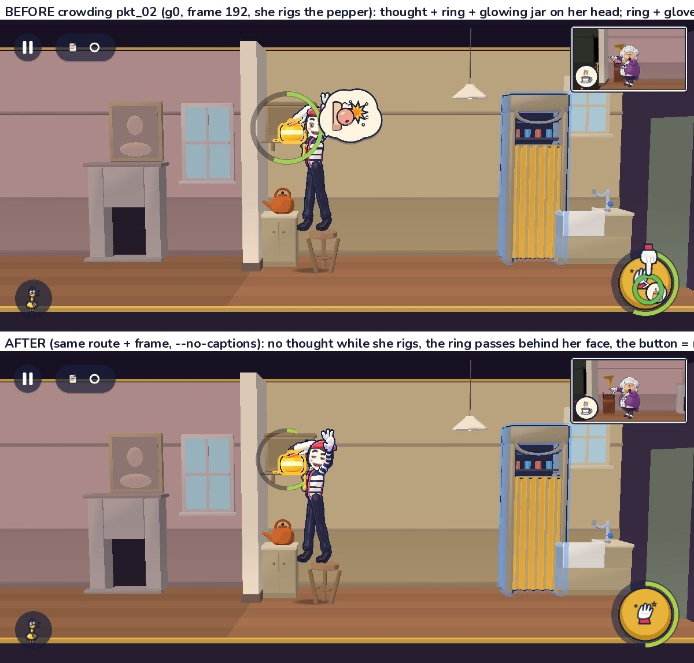
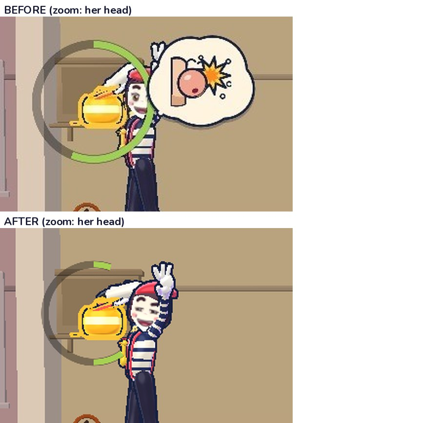
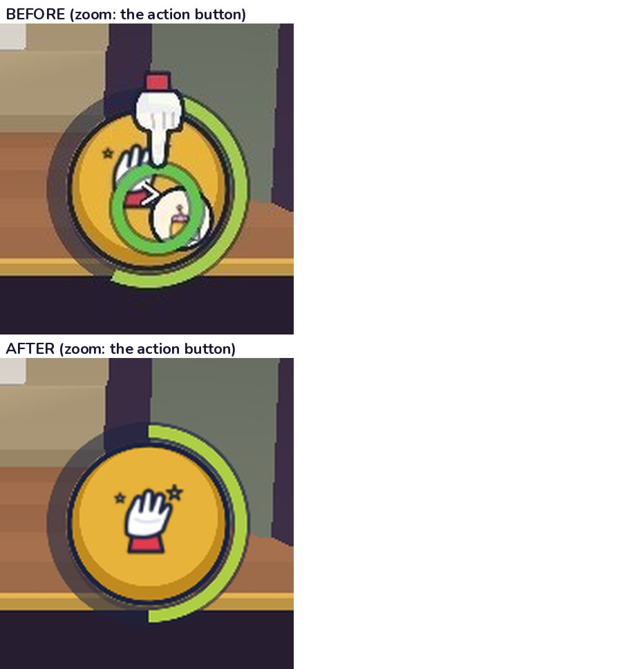
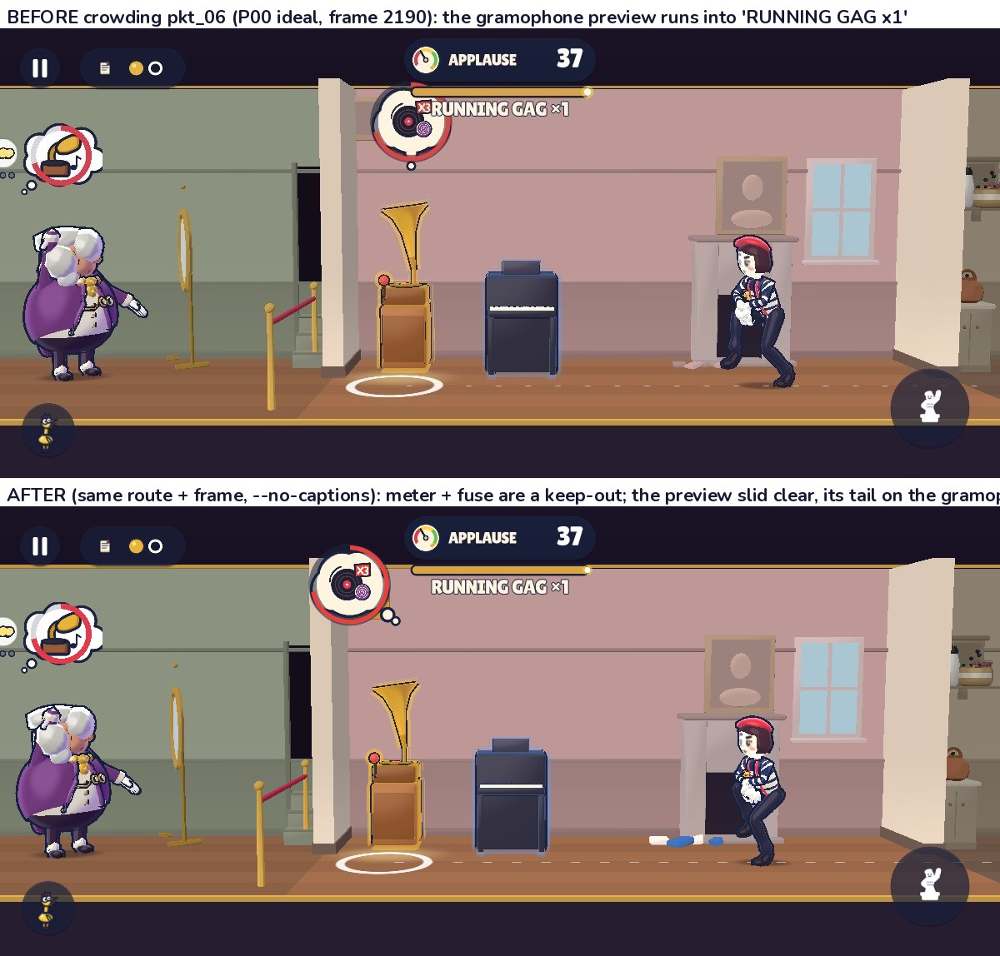
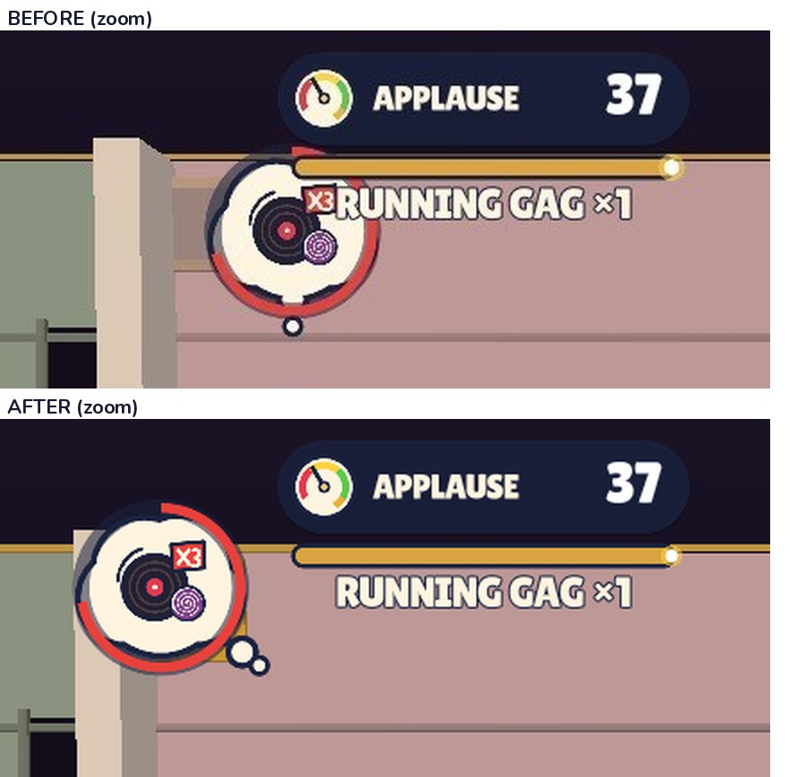
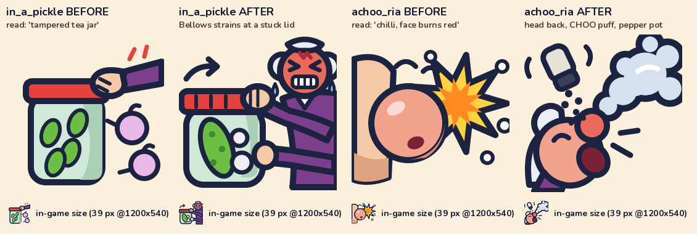
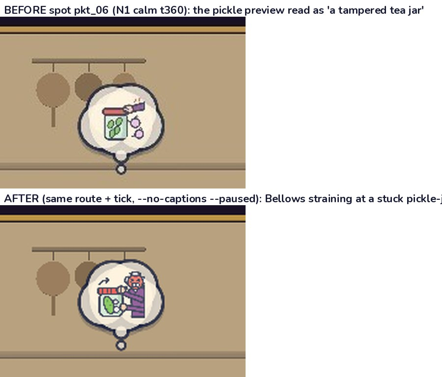
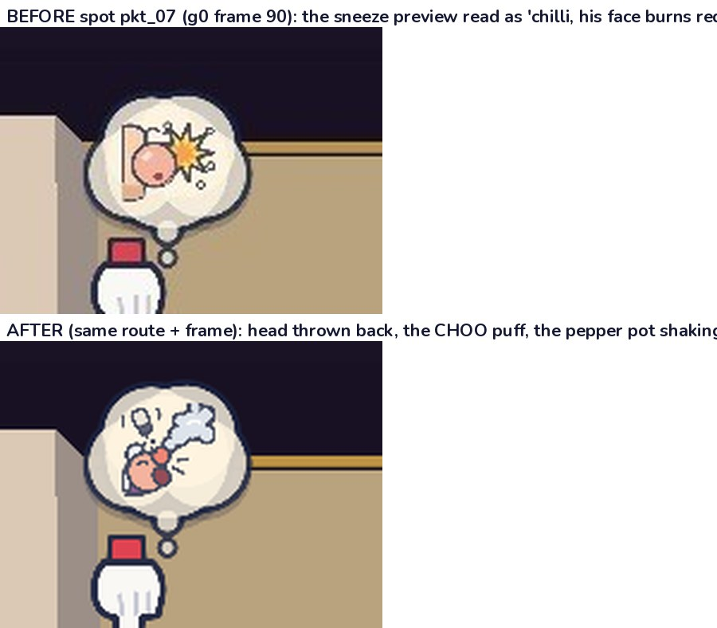

# r3d-fix-hud: QA round 1, fix round 1 (Q-C1, Q-C2, Q-S1, Q-S2, plus the Hud's D17 spikes)

QA round 1 marked two crowding frames "yes, crowded" (bar ≤ 1/8) and two spot previews were read wrong at the bar (`docs/review/r3d-qa/readability.md` §3–§4). This page re-shoots each of those moments with the same route and the same frame, at 1200×540 with `--no-captions`. Every **before** image is the packet frame the fresh reviewer judged (`docs/review/r3d-qa/packets/`). Every **after** image comes from this tree.

How the frames were shot:
- Crowding frames: `tools/scripts/e2e.sh <route> --shot-seq … --seq-from=<frame>` with `E2E_MSAA=off -- --no-captions`. The routes are `g0_sneeze` and `prologue_ideal --fixed --e2e-hold-s=12`, the same commands as r3d-qa's `shoot_chain.sh`. The DevShot frame number counts from launch, so `g0:64` is frame 192 and `p00i:730` is frame 2190.
- The N1 spot frame: `shot.sh NightScene --episode=n01_throat_tea --cmds=<r3d-qa n01_qa_calm> --seek-tick=360 --paused --no-captions --msaa=off`, the same as r3d-qa's `shoot_n1.sh`.

## Q-C1: the rig moment (g0 frame 192; crowding pkt_02)

The reviewer said: "The progress ring, the glowing jar and a thought bubble all pile onto the mime's head, and the bottom-right button stacks a ring, a tap-hand and a small icon."

| | |
|---|---|
|  |  |
|  | after (full frame): `crowd_g0_f192_after.png` |

What changed:
- **Hush's thought goes once she rigs.** The joke is already being set up, so the ring at the prop is the one loud thing. The thought still shows while she stands at the rig point (V1) and comes back if she lets go (`OverlayRules`).
- **Face boxes are hard keep-outs.** A face box runs from the head anchor up to the head top, with 0.6 of that span to each side (`WorldOverlays.face_box`). No cloud, preview, marker or item may cover one, and the anchor exemption does not apply. Her thought is now requested beside the face box, not beside the head point.
- **The rig ring stays on the prop but passes behind the face.** When the ring would run into a face box it is drawn at 0.85×, and the part of the arc inside the face box is not drawn (`RigRing.set_occluders`). It reads as the ring around the pepper pot with her head in front of it.
- **The action button shows one loud thing.** While the hold is on, the button shows its ring and a single centred icon: no target disc, no arrow, no verb tag (`ActionButton.is_holding`).
- **The teaching glove leaves the button once the hold starts.** It comes back if she lets go before the ring completes (`Hud.ghost_yields`).
- The jar's 3D glow (D10 halo) is r3d-view3d's and is unchanged.

Paused seek shots taken while iterating (the glove is still visible there because the 400 ms grace for a rising ring runs out while the game is paused; `HudModel.holding` closes this gap, see request R2): `crowd_g0_t192_paused_before.png` and `crowd_g0_t192_paused_after.png`.

## Q-C2: P00 frame 2190 (crowding pkt_06)

The reviewer said: "The red-ringed record bubble and its 'x3' badge run into the 'RUNNING GAG ×1' text, and the old man's thought bubble is cut off at the left edge with a second bubble only half visible."

| | |
|---|---|
|  |  |

What changed:
- **A keep-out band round the meter and fuse while they show.** `Hud.transient_rects()` returns the APPLAUSE meter (including its "+n" stamp) and the RUNNING GAG fuse whenever they are on screen. The world overlays treat them as hard keep-outs with 24 px of padding. The gramophone preview slides clear and its tail still points at the gramophone; with his ring round the cloud, the tail now starts outside the ring.
- **Cloud boxes cover what they draw.** The placer was told 112×90, but the cloud draws 142×128, or 146 with his ring. That gap is how two "clear" overlays still overlapped on screen.
- **One thought cloud at a time.** The rule is in `OverlayPlacer`. When both his bubble (`Pri.BUBBLE`) and her thought (`Pri.THOUGHT`) are requested, only the one nearest the action shows: the rig point she is at, else her head. With no focus, his bubble wins.
- **Every item is clamped into the safe rect.** That was already true, and it is now tested at 20:9, 16:9 and 4:3.
- **Not fixed here: his bubble's left-edge clip.** The clipped "second bubble" is FxThoughtBubble's awareness-glyph disc and ear pips, drawn 153 px left of the bubble's centre. `Overlays3D` clamps the centre to 120 px from the edge, so the disc starts at x = −33. His bubble is drawn and positioned by r3d-view3d's `Overlays3D` and `FxThoughtBubble`. The placer already computes its clamped rect and its one-cloud visibility, but `Overlays3D` never reads them back: request **R1**.

The same run at frame 1056, a calm tea frame with no meter: `p00_f1056_after.png`. Phase 1 saw the honey preview under the meter at about t1059; this run shows no meter at that frame, so the keep-out has nothing to act on there. The rule is covered by the tests.

## Q-S1 / Q-S2: the two pictograms

- **`in_a_pickle`** (read as "a tampered tea jar"): Bellows is red-faced, with gritted teeth and sweat, his purple coat and cravat showing. Both hands are on a stuck red lid, a twist arrow sits over it, and the green-glass jar holds a big gherkin and two pickled onions.
- **`achoo_ria`** (read as "chilli, his face burns red"): his head is thrown back with the mouth wide and a red nose. A pale-blue CHOO puff blasts out of the nose, the same cotton-wool shape as in the game. The white pepper pot hangs upside down over his nose, shaking out black pepper.
- Both keep the icon style: a 128 px canvas, 5 px navy `#1B2340` ink, flat look-A fills, no text. Their `<desc>` ids are unchanged, so the previews.json test still matches.

| spot | before / after |
|---|---|
| pickle (N1 calm t360, spot pkt_06) |  — full frames: `spot_n1_full_board.jpg` |
| sneeze (g0 frame 90, spot pkt_07) |  |

## D17: the Hud's spikes

The QA run measured the Hud at max 1.85 ms (Prologue, rendered). I made three **headless** profiler runs of `prologue_ideal` (`--view3d-prof`):

| Run | Hud max | At profiler frame |
|---|---|---|
| baseline tree | 2.09 ms | 2529 |
| this tree, run 1 | 4.15 ms | 352 |
| this tree, run 2 | 4.08 ms | 2906 |

In all three runs the Hud's p50 is 0.024–0.034 ms and its p95 is 0.055–0.071 ms.
- The spike never repeats at the same frame.
- The same headless runs show `root:Settings` and `root:Save` (trivial autoloads) over 1 ms, and 5–20 ms in eight other nodes. The shared 4-core box preempts headless runs too.
- A scripted bench of every Hud transition the Prologue drives (1,800 frames) measured the worst Hud-subtree frame at 0.48 ms. The bench file was removed after the run; a copy is in the work directory.
- **Verdict: noise under D17.** The Hud spike is not deterministic.

One real cold cost turned up. An activity icon rasterises on its first sight in `Hud.apply` (≈ 1 ms, counted under NightScene). Tonight's loop and trigger activity icons are now rasterised under the curtain (`WorldOverlays.warm`).

## Tests and lint

- New: `game/tests/ui/test_crowding_qa.gd` (9 tests).
- Added to `game/tests/ui/test_overlay_placer.gd` (5 tests): face-box keep-out, banner keep-out, safe-rect clamp and the one-cloud rule, each at 20:9, 16:9 and 4:3, plus no allocation with hard rects.
- `ui/`: 269/269 pass. The full suite and `lint.sh --strict` results are in the task report.
