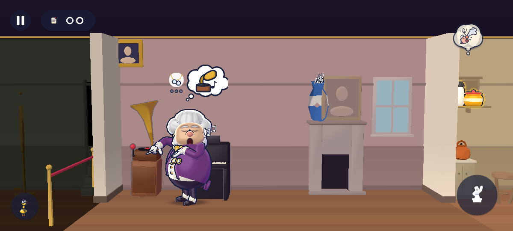
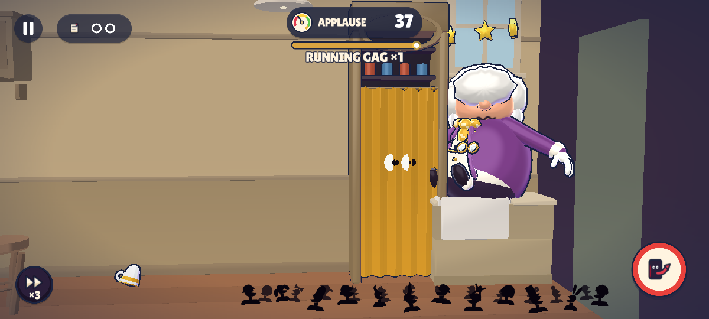

# r3d-fix-hud2 — the two HUD perf requests from r3d-fix-perf (RQ1, RQ2)

Route: `tools/scripts/e2e.sh prologue_ideal --perf-log [--headless] -- --view3d-prof=/abs.json`, 1200×540, MSAA off.
Each side ran on a frozen snapshot of the tree. **Before** is HEAD 5f0092b. **After** is HEAD plus this task's files.
Each side had 1 headless and 2 rendered runs.

Every run shared the 4-core box with one other Godot process: a probe, the suite or the lint. Both sides had the same load.

The phase numbers are NightScene's own HUD-pass split (`night_phase_frames` / `night_phase_stats`), in ms.

## RQ1: the t1447–1450 spike is not the meter or banner show. It is a cold activity icon.

A scratch probe split `Hud.apply` by section and logged every `UiIcons` cache miss in PLAY. Its findings:

- **The meter and banner tail is cheap.** `_tick_contextual` takes 7–24 µs on that frame, and `banner.set_values` takes under 10 µs.
- **The cost is in the edge-badge section.** It took 971–1660 µs, through `set_next_icon(_activity_icon(…))`.
- **The cause:** his next activity after the knock-on is the fix-up `fixup_mirror`. Its SVG was rasterised on first sight, at 0.84 ms (`ICONMISS f=1453 res://art/icons/activities/fixup_mirror.svg`).
  - Tonight's routine icons are warmed with the overlays. His detours were not.
- **The same cause makes a second deterministic spike, at t3237.** That is his exit: `exit.svg`, 0.92 ms.
  - It hit 3 of 3 runs before: 1.72 / 1.18 / 1.04 ms. fix-perf had filed it as "3237–3241, 2 of 3, noise".

**Fix**

`NightWarmer._warm_ui_icons` now rasterises every detour icon in the data under the curtain, through `Hud.warm_activity_icons(NightWarmer.detour_ids())`.
- That is the `activities.json` "detours" list: the 4 fix-ups, curious, herd_beryl, search and exit. It comes to 8 icons and about 0.9 MB.

As requested, the warmer also calls `Hud.warm_contextual()`:
- the meter, the Running Gag fuse (with its real text) and the edge badge are shown and drawn for 2 frames under the curtain, then restored from the model;
- a glyph primer draws the pieces' glyph sets at their sizes and outlines: APPLAUSE 36, digits 60/56, ENCORE 48, "RUNNING GAG ×…" 44.

| `Hud.apply` at the tick (ms) | headless | rendered 1 | rendered 2 |
|---|---|---|---|
| t1447–1450, before | 1.16 | 1.15 | 1.33 |
| t1447–1450, after | < 0.30 (not in the slow-frame list) | 0.15 | 0.11 |
| t3230–3238, before | 1.42 + 1.72 | 1.18 | 1.04 |
| t3230–3238, after | < 0.30 | < 0.30 | < 0.30 |
| `Hud.apply` p95 / max, before | 0.056 / 1.72 | 0.064 / 1.82 | 0.060 / 1.33 |
| `Hud.apply` p95 / max, after | 0.044 / 0.38 | 0.063 / 5.58* | 0.054 / 0.45 |

\* t510 in one rendered run only. No other run, before or after, has anything there, so under D17 it is noise.

A second after set, with the same Hud code (`after_*`), also had t1447 and t3237 clean in all 3 runs.

Warm-up cost:
- `warm_ms`: 200 / 483 / 364 before, 187 / 375 / 337 after.
- `tex_mb_peak`: 129.2 → 130.1 MB.

## RQ2: the OverlayPlacer solve is dirty-flagged, but the solve was not the cost

**The fix**

`OverlayPlacer.solve()` now re-places only when an input changed since the last real solve. A change is any of:
- the active set, or an item's priority, fixed or exempt flag;
- an active item's `want` or `anchor` moving more than `EPS` (1 px);
- any protected or hard rect, the safe rect or the focus moving more than 1 px.

Placement is a pure function of those inputs, so on a clean frame the last results stand.

On a clean frame, an item whose own `want` drifted by 1 px or less follows that drift, re-clamped into the safe rect. A slow camera pan therefore never shows a 1 px step.

Other details:
- `invalidate()` forces the next solve;
- `solves` / `placed` count the calls and the real solves;
- the inputs are copied into fixed pools, so there are no per-frame allocations and the allocation tests stay green.

**What the probe measured**

A scratch probe split `phase_us` in headless runs (p50 / p95 µs):

| phase | p50 / p95 µs |
|---|---|
| protected (`WorldView3D.protected_rects`) | 144 / 277 |
| hard (face boxes) | 71 / 168 |
| requests | 29 / 90 |
| **solve** | **22 / 82** |
| nodes | 31 / 77 |

- The solve is 7 % of `WorldOverlays.apply`.
- In the Prologue the dirty flag skips only 2.3 % of solves: 977 of 1000 frames have a face, anchor or protected rect moving more than 1 px.
- The steady cost is the anchor queries. Each `project_aabb` is 8 `CameraDirector3D.project` calls, about 3 µs each.

**A second fix in my file**

The face box gated on `actor_screen_rect` (an 8-corner AABB projection per actor per frame) only to learn "is the character shown". With WorldView3D it now asks `character(id).visible` and whether a camera exists. Those are exactly the conditions under which `actor_screen_rect` returns empty. FakeAnchors keeps the old gate.

| `WorldOverlays.apply` p50 / p95 (max) ms | headless | rendered 1 | rendered 2 |
|---|---|---|---|
| before | 0.308 / 0.576 (4.64) | 0.359 / 0.578 (2.92) | 0.374 / 0.620 (3.94) |
| dirty flag only (`after_*`) | 0.296 / 0.490 (3.90) | 0.367 / 0.564 (7.34) | 0.350 / 0.569 (3.83) |
| dirty flag + face-box gate (`after2_*`, final) | 0.279 / 0.467 (3.52) | 0.355 / 0.578 (1.60) | 0.338 / 0.538 (2.67) |
| t2960–2980 (fix-perf's 2.7–3.1 ms) | before: nothing ≥ 0.3; after: 0.30–0.60 | before: nothing | before: nothing |

**The > 1.5 ms WorldOverlays frames**

They land at a different tick in every run, before and after. Examples: before headless t221 / 514 / 2069 / 2543; after headless t256 / 1135 / 1755 / 2191 / 3217. None repeats across runs, so they are noise under D17.

The probe put the big ones in `_build_protected` and `_build_hard` (2–4.6 ms), that is in the WorldView3D / CharacterView3D anchor queries. A skeleton pose update forced by `socket_global` or `head_world` is the likely cost.

**Request to r3d-view3d**

Cache `actor_screen_rect` / `project_aabb` per frame. Bellows' AABB is projected 3× per frame: twice in `protected_rects`, once in `bellows_on_screen`. Caching would cut the protected phase, which is 144 µs p50 and half of `WorldOverlays.apply`.

## D17 cluster tables (fix-perf's `clusters.py`: > 1 ms at the same tick ± 2 profiler frames in both rendered runs)

**Before:** 12 clusters. These include t1449 NightScene 2.08 / 2.25 (RQ1) and the other NightScene ticks 125, 1342, 2510, 2874, 3334 and 3401.

**After:** 4 clusters, none of them in `Hud.apply`:

| ticks | site | r1 | r2 | headless | reading |
|---|---|---|---|---|---|
| 287–290 | NightScene | 1.16 | 1.02 | – | sum of phases each < 0.75 (ov_apply 0.70 / 0.72); not in the before set |
| 403–409 | NightScene | 1.21 | 1.22 | – | sum of phases each < 0.75; not in the before set |
| 1451–1456 | NightScene + bellows_apply | 1.29 + 1.66 | 2.99 + 3.87 | – | Bellows' clip switch at the knock-on under render contention. Hud.apply is 0.10–0.15 here. |

The NightScene ~1.0–1.2 ms sums move from tick to tick between run sets: before they were at 125, 1342, 2510, 2874, 3334 and 3401; after, at 287 and 403. No headless run repeats them, so they read as load noise.

## Overall (perf3d view + HUD p50 / p95 ms)

| | before | after (final) |
|---|---|---|
| headless | 2.25 / 4.06 | 2.10 / 3.35 |
| rendered | 3.13–3.25 / 5.00–5.27 | 2.95–3.12 / 4.45–4.67 |

Raw data: `<SP>/work/r3d-fix-hud2/runs/{base,after,after2}_{h1,r1,r2}.{e2e,prof}.json`, `probe{2,3,4}_h.log`.

## Frames looked at

The Prologue, `--fixed`, `--no-captions`, MSAA off:

 

- **Frame 60** (just after the rise): no leftover meter, fuse or edge badge from the warm-up.
- **Frame 1450** (the knock-on lands): the APPLAUSE meter (37) and the fuse show as before. The fuse reads "RUNNING GAG ×1", the model's text and not the warm-up's "×1.5". The edge badge is off because Bellows is on screen.

  The shot run used `--max-s=26`, so its route "FAIL: 3 laughs by 60 s" comes from the truncated run, not from this change. The full route PASSed in all 6 profiler runs.
