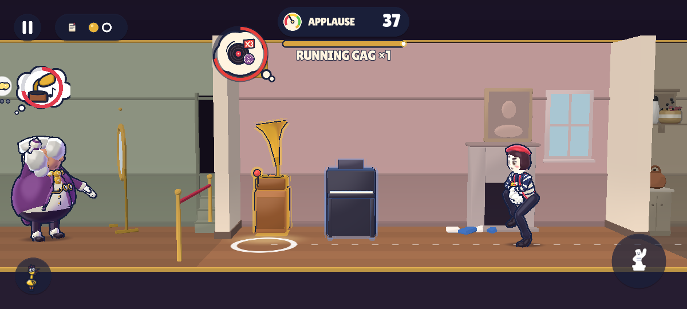
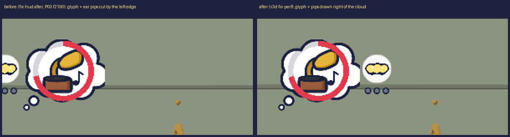
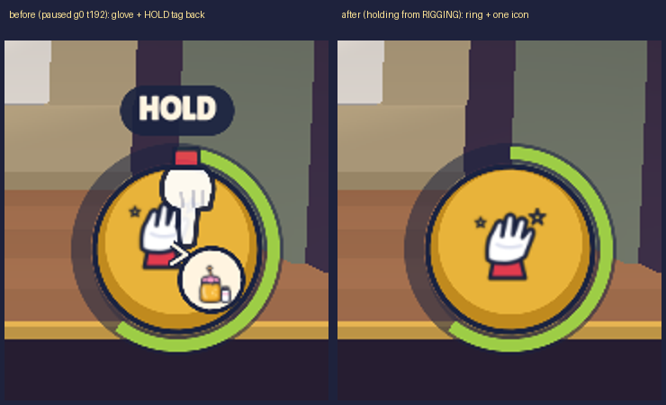
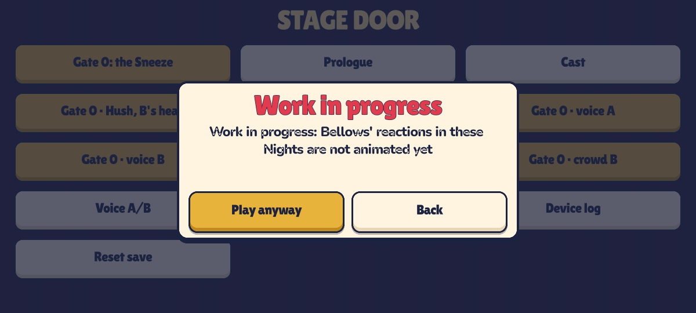

# r3d-fix-perf — fix round 1 review page

Every after frame comes from the same route and frame as the judged one: 1200×540, `--no-captions`, MSAA off.
The runs used a frozen snapshot of the tree: HEAD ca8f838 plus this task's files. That way the other fixers' edits in progress could neither break nor skew them.

## R1 (b): his bubble's awareness glyph at the left edge (P00 frame 2190, crowding pkt_06)
Route: `e2e.sh prologue_ideal --fixed --shot-seq … --seq-from=2172 --every=6 --count=6 -- --e2e-hold-s=12 --no-captions`. The fourth frame is frame 2190.

| before | after |
|---|---|
|  |  |

Zoom: 

- **Before** (fix-hud's after frame): the screen edge cut the glyph disc and its three ear pips. Reviewers called this "a second bubble half visible".
- **After:** `FxThoughtBubble` draws the glyph and pips on the right of the cloud, which is the inside of the screen, whenever the left side would clip.
  - The left placement returns once there is 24 px of slack, so it does not flicker.
  - The cloud, the ring and the tail are unchanged.
  - The new API is `glyph_right`, `local_span()`, `screen_span()` and `waiting`. r3d-fix-gags' `Overlays3D` already reads `glyph_right` for its clamp and `_bubble_rect`, and `waiting` for the one-cloud fade.

## R2: the hold comes from the sim (g0 frame 192, crowding pkt_02)
`HudPresenter.fill` now sets `HudModel.holding` to whether Hush is in the `RIGGING` state. The Hud no longer infers the hold from the rising ring, which has a 400 ms grace that ran out on paused or slow frames.
Shot with `shot.sh NightScene --episode=g0_sneeze --cmds=res://tests/view/fixtures/cmds/g0_sneeze_ideal.cmds.json --seek-tick=192 --paused --no-captions --msaa=off`, which is fix-hud's paused seek, on the live tree.

| before (`../r3d-fix-hud/crowd_g0_t192_paused_after.png`) | after (`g0_t192_paused_after.png`) |
|---|---|
| the teaching glove, the HOLD tag and the item badge are back on the held button | the held face: the ring and one centred icon, with no glove |

## Q-N1: the Prologue's Next ▶ with the N1/N2 previews hidden
`BootRouting.after_next` changes where Next ▶ goes. In a debug build with `show_previews` off, Next ▶ to N01 or N02 now opens the stage door with its "Work in progress" card on that Night, offering Play anyway or Back. Before, it opened Night 1 directly.
- A release build has no stage door and plays the Night, as before.

The e2e `curtain_call` flow presses Play anyway through the card. The report records this as `p00_next_wip` and `n01_next_wip`.

## D17: deterministic spikes, before and after
The full tables are in `<SP>/work/r3d-fix-perf/spikes.md`. Each side had 3 rendered and 2 headless `prologue_ideal --view3d-prof` runs.

| | before | after |
|---|---|---|
| repeats in both headless runs at the same tick | 5 (NightScene at t376, t1376, t1447, t2659, t3102) | 0 |
| t376: the action button's RIG icons rasterised on first sight | Hud.apply 1.9–2.4 ms in all 5 runs | gone: warmed under the curtain |
| t1376 / t2659 / t3102: the edge badge's tier face (a portrait PNG) loaded on first sight | Hud.apply 2.4–3.3 ms in all 5 runs | gone: warmed under the curtain |
| t1447: Hud.apply tail (`_tick_contextual`, the first meter or Running Gag show) | 1.1–1.45 ms | unchanged (r3d-hud's file; request) |
| view + HUD p50 / p95, rendered | 3.30–3.48 / 5.20–5.62 ms | 3.12–3.33 / 4.60–4.86 ms |
| profiler frame total p95, rendered | 4.90–5.40 ms | 4.34–4.61 ms |

The rig clip-start path was benched on every clip of both rigs, headless, after `RigPlayer3D.warm`. Results:
- `play()` takes at most 0.26 ms.
- The first advance after a switch takes at most 0.29 ms.
- The steady advance takes 0.03–0.06 ms.
- The first and second passes are equal, so nothing cold is left in RigPlayer3D.

The 1–6 ms `rig_advance` frames seen in 2 of 3 rendered runs never repeat headless. They are render contention, not script cost.
