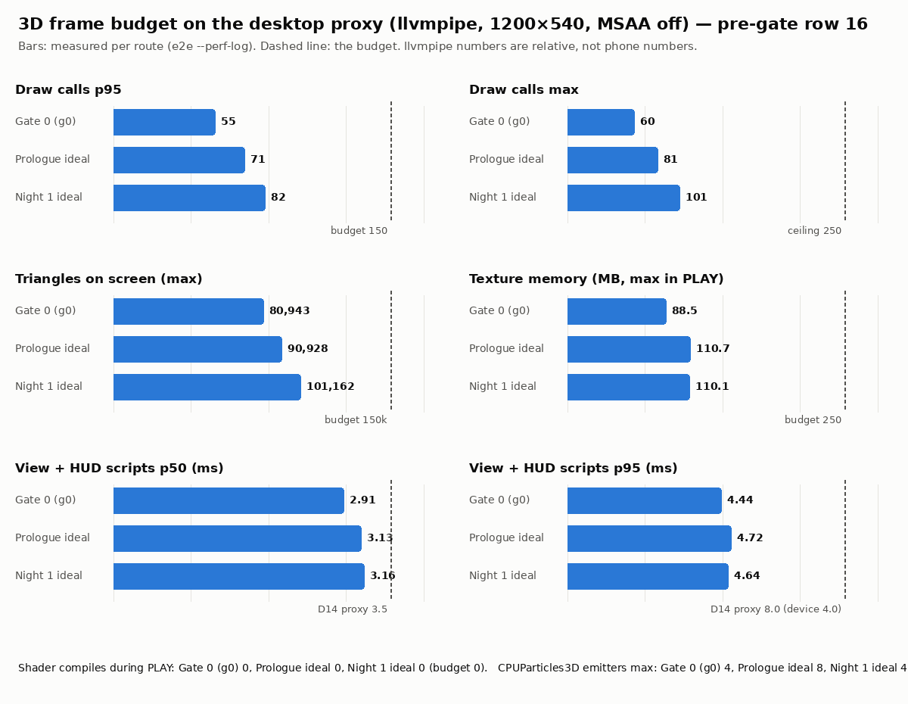
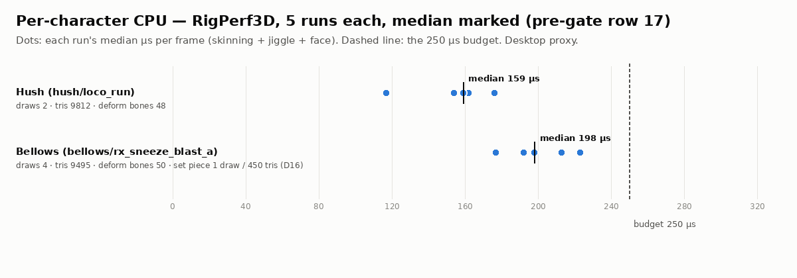

# r3d-qa — the R3D pre-gate, the slice tests, perf evidence, the APK and the row-19 packets

Branch `r3d` at `5b5a135` plus the r3d-qa working-tree changes (the orchestrator commits them). Pre-gate content hash
`910d23a982ac1d19`. Box: 4 CPU cores, llvmpipe (software GL), 1200×540, MSAA off; the timing rows ran with no other Godot or
Blender process on the box.

## R3. QA round 2, phase 3: row 19 scored, row 19 re-run, the owner pack refreshed (2026-10-01, 16:47–17:10Z)

**Verdict: FAIL** on rows 9, 16 and 19. Every other row passes (§R2).

**Row 19, round 2** ([`readability.md`](readability.md), section "Round 2"): three new fresh reviewers answered the
rebuilt packets `set_f` / `set_g` / `set_h`. Every answer is pasted verbatim with its key.

| test | round 2 | bar | |
|---|---|---|---|
| spot (`set_f`) | 6/8 | ≥ 6 | PASS (the sneeze preview now reads; pickle jar → "vase"; needs-kettle → "honk") |
| crowding (`set_g`) | 2/8 yes | ≤ 1 | **FAIL** (P00 t2190: two countdown rings for one target, badge far from its prop; N1 t6768, a borderline frame that round 1 called "no") |
| gags (`set_h`) | 1 of 9 at bar | sneezes / dizzy ≥ 4/4, rest ≥ 3/3, fresh ≥ 3 | **FAIL** (picture 3/4/3 passes; sneezes 3/3/3 with an unchanged clip; dizzy 3/4/3; vase 2/3/2; bonk 2/3/1; curtain call 2/2/2; relief 1/2/2; squeak bit 1/2/1) |
| verb, 2D vs 3D | 7/8, 8/8 | | carried from round 1 |

- **Scoring:** `packets.py score` with the round-2 keys (`<SP>/work/r3d-qa/p4/verdict_*.md`), then the gist by hand
  after looking at every packet image and strip page. The requests are Q2-C1/C2, Q2-G1…G8 and Q2-S1/S2
  (`readability.md` §R2.5).
- **The pre-gate:** `tools/scripts/pregate3d.sh --rows=19` re-ran alone at 17:03Z → FAIL; the record is archived as
  [`pregate_r2.json`](pregate_r2.json), with a `qa_note`.
  - The record's table marks rows 1–4, 9–18 and 20a STALE. That is only because the tree hash moved
    (`bd0fb2503d06829a` → `d55aea4ce348f930`) when phase 1 fixed `pregate3d.sh` after its run.
  - No file under `game/`, `tools/ci`, `tools/art3d/review` or `tools/audio` changed after 13:58Z (mtime scan), so their
    results stand.
  - Rows 9 and 16 had no fix since phase 1, so they were not re-run.
- **Perf charts** [`perf/budgets.png`](perf/budgets.png) and [`perf/rigs.png`](perf/rigs.png) are regenerated from
  this run's record.
- **Owner pack** (`docs/review/r3d/index.md`, still held): re-shot from this build at the 2D-reference ticks, captions
  off, live, in sandbox `r3d-qa-shot`:
  - `hud_2d_vs_3d.jpg` (P00 slow t415), `tinker_2d_vs_pepper_rig.jpg` (P00 ideal t400) and `pip_2d_vs_window.jpg`
    (P00 ideal t445);
  - `kitchen_before_after.jpg` (r3d-sets' board, with its 3D panel replaced by the t415 frame from this build);
  - `rig_ring_g0_t192.jpg` (round 1's crowded frame, fixed) and `still_crowded_r2.jpg` (the two round-2 "yes" frames).

## R2. QA round 2, phase 1: the full pre-gate and three rebuilt row-19 packets (2026-10-01, 13:58–16:30Z)

Tree: `5f0092b` (fix round 1) plus r3d-fix-hud2's uncommitted changes. Pre-gate content hash `bd0fb2503d06829a`,
sim tree `838f39fc9f4d1a85`. `tools/scripts/pregate3d.sh --rows=1-7,9-18,20a` ran alone (no other Godot or Blender
process), then `--rows=8 --force`, which is sim-only, beside the packet shots. Row 16 now implements D17 (§R2.2). The
record is [`pregate_r2.json`](pregate_r2.json).

**Verdict: FAIL** on rows 9 and 16. Row 19 was not scored in this phase: its packets were rebuilt (§R2.3) and wait
for new fresh reviewers.

| # | Row | Result | Key numbers |
|---|---|---|---|
| 1 | Import metadata | PASS | 1010 .import, 412 .uid |
| 2 | Full suite | PASS | 1312/1312, 0 skipped, 138 files incl. 2 `tests/slice`; 336 s |
| 3 | Lints --strict | PASS | 72 clips strict, 0 errors / 0 warnings / 0 missing; coverage 72; 0 lints failed |
| 4 | Validators | PASS | 5 |
| 5 | Every route | PASS | 13 routes, every expect OK |
| 6 | Dead air (D1) | PASS | worst ⏩ ideal 8.1 % / required 4.8 % / slow 5.9 %; gap 5.47 s; edge 0.221 |
| 7 | Planner proofs + g0 | PASS | 143 s |
| 8 | Fuzz | PASS | 2400 runs (12 episode × bot groups × 200), 0 invariants, 0 soft-locks, 0 struck-hotspot commands; 6045 s in 3 parallel processes |
| 9 | Set lint | **FAIL** | 2 errors, new: P00 parlour `parlour_vase` [dressing] C* 42.7 (> 30) and \|ΔL*\| 20.8 vs the wall (> 15). r3d-fix-gags Q-G4 made the vase ×1.5 blue-and-white but left `"dressing": true` on it in `house3d.json`. 1 warning (N02 hall negative space 0.68 m, D13) |
| 10 | Screen-rect lint | PASS | 0 errors, 1 warning (N02 hall clock at 16:9) |
| 11 | HUD lint | PASS | 0 errors, 2 warnings: middle band `pip` 0.0 s on p00_ideal / p00_slow (the escalated window punch, within D9/D10's 5 s) |
| 12 | C8 | PASS | 26 route × mode runs, 0 violations; sim window share max 35.0 % (was 39.0 %) |
| 13 | Gate 0 in 3D | PASS | g0_done; accent f94; zoom 1.14 / 1.59 max; hit-stop 83 ms; ACHOO-RIA!; flipped; sink; tag 1/1; C8 0; Again ▶ 272 ms |
| 14 | Prologue in 3D | PASS | ideal 7 laughs by 60 s, 4 cues, crowd ≤ 0.268 s, 0 doubles, C8 0; slow first laugh 6.63 s / first prank 27.58 s launch-relative |
| 15 | Other routes in 3D | PASS | 13/13; g0 + P00 0 fallbacks; N01 / N02 14–60 (info) |
| 16 | Frame budget | **FAIL** (D17) | counts PASS: draws p95 ≤ 82 / max ≤ 101, tris ≤ 101,162, emitters ≤ 8, tex ≤ 110.7 MB, 0 compiles in PLAY; view + HUD p50 2.91–3.16 / p95 4.28–4.72 ms (bars 3.5 / 8.0). D17: 11 call sites > 1 ms at the same tick in ≥ 2 of 3 rendered runs, and 20 headless hits repeated in another run |
| 17 | Per character | PASS | Hush 0.159 ms, 2 draws, 9812 tris, 48 bones; Bellows 0.198 ms (177–223 µs), 4 draws, 9495 tris, 50 bones, + stool 1 / 450 apart (D16) |
| 18 | Flow / touch | PASS | retry 632 ms; tap feedback 1 f; pause / back OK; tap accuracy min 20/20 on 5 slice hotspots, 0 neighbours; g0 Again ▶ 260 ms; P00 Next ▶ live frame 1 |
| 20a | APK (local) | PASS | 73.47 MB (73,468,995 B), sha256 `9478f00dc5dec2dca1c17a38beb8dc00652091b5997d089dac81c237e6446316`, 3277 entries, 77 clip .res, 80 sidecars, excluded paths absent, boot_config stage_door / 3d / previews off / sim / render defaults, VIBRATE only, minSdk 24; **exported pack: 197 scripts, 0 failures, Night OK (view 3d, world_view Node3D)** |

### R2.1 Row 8, and the record's summary
- **Row 8** ran `--force` beside the packet shots (sim-only, seeded, no timing): PASS, 200/200 OK in every group.
- **The record's own `summary.pass: true` is wrong.** It came from the final `--rows=8` invocation, whose old rule
  counted only the rows it ran. `pregate3d.sh` now fails the summary on any failing row. The archive adds a
  `qa_note` with the true status: FAIL on rows 9, 16 and 19.

### R2.2 Row 16 under D17: how it is judged now, and what it found
- **The runs:** 3 rendered + 2 `--headless` `prologue_ideal --perf-log --view3d-prof` runs (`build/r3d/prof/`). Each
  e2e report maps every profiler frame to its sim tick (`prof_frame_ticks`).
- **Call sites:** the profiler leaves row 16 always read (our nodes; WorldView3D's phases).
- **"Same tick (±2 f)":** a profiler frame simulates ticks (t[f−1], t[f]]; two frames match when those spans, widened
  by 2 ticks, overlap.
- **Headless:** a hit counts when it repeats at the same tick in another run. Headless one-offs are listed: box
  preemption hits headless runs too, which r3d-fix-hud saw as well.
- **Info:** the fixers' looser window (±2 profiler frames) gives 12 clusters. A chance baseline (the same matching
  with the other runs shifted −120 / +120 ticks) gives **9 / 18 clusters, against 11 unshifted**. So most 2-of-3
  rendered matches are coincidence on this box; a lead ruling is requested.
- **The sites that look truly deterministic** (3 of 3 rendered, both headless, or rendered + headless):

| ticks (P00 ideal) | site | evidence | where (route step) | owner |
|---|---|---|---|---|
| t255–263 | NightScene `ov_apply` = WorldOverlays.apply | 0.88 / 1.09 / 1.11 ms rendered (3 of 3) + 4.37 / 0.77 headless | she walks to the honey rig (step 3) | r3d-hud |
| t995–996 (r1 at t977) | Hush CharacterView3D.apply, phase `mine` | 3.91 (r2), 2.33 (h2), 2.36 (r1 t977) | hidden in the pantry (step 5) | r3d-view3d |
| t2846–2847 | Hush CharacterView3D.apply (ctx 1.66 + mine 1.74) | 1.98 (r3), 1.98 (h1); NightScene `ov_apply` 3.15 h2 t2842 | behind the piano, the near miss (step 10) | r3d-view3d / r3d-fix-gags |
| t1572–1574 | NightScene `ov_apply` | 4.68 (h2), 1.22 (h1) | before the doorframe bonk | r3d-hud |

### R2.3 Row 19: three rebuilt packets (not scored here)
Each packet was rebuilt from this tree with `tools/art3d/review/packets.py`, from the real game at 1200×540 with
`--no-captions` and MSAA off. Each has a new shuffle seed and a new key. The keys are outside the repo:
`keys/r2_<packet>_key.json` in the r3d-qa scratch dir. Round 1's keys and answers are untouched. The moments and ticks
are round 1's, checked side by side.

| packet | test | items | seed | bar |
|---|---|---|---|---|
| [`packets/set_f`](packets/set_f/prompt.md) | spot: "what will happen if the neighbour uses the circled object?" | 8 frames (round 1's set_b moments; the pickle and sneeze pictograms were redrawn since) | 89 | ≥ 6/8 the gist |
| [`packets/set_g`](packets/set_g/prompt.md) | crowding: "is this screen crowded or confusing?" | 8 frames (round 1's set_c moments and ticks) | 97 | ≤ 1/8 yes |
| [`packets/set_h`](packets/set_h/prompt.md) | gags: one sentence + funny / readable / fresh 1–5, with the TECH §11 rubric | 9 strips: every Prologue gag + the g0 sneeze, at round 1's set_e windows | 113 | the sneezes and the dizzy spin ≥ 4 on funny and readable, the rest ≥ 3, fresh ≥ 3 |

Round 1's verb result (7/8 PASS, set_a) and its 2D-vs-3D preference (8/8 PASS, set_d) stand. Those packets were not
rebuilt.

## 0. Phase 3 — the final pre-gate run and row 19 (2026-10-01, 09:43–10:36Z, alone)

**Verdict: FAIL.** `tools/scripts/pregate3d.sh --rows=1-7,9-18,20a`, then `--rows=19`, run alone under content hash
`eee8a789f5e192c7` (the sim tree `c31a69aac4e0f8dd` is unchanged, so row 8 keeps its 08:38Z result). This run also
exercises phase 1's evaluator fixes live:
- row 2 sees the 2 `tests/slice` files;
- rows 11 and 12 record the window share and C8 numbers;
- row 16 reads the profiler's real layout and FAILs on its own.

The record is [`pregate.json`](pregate.json), copied from `build/r3d/pregate.json`. The phase-1 copy is kept in the r3d-qa scratch dir.

| # | Row | Result | Key numbers |
|---|---|---|---|
| 1 | Import metadata | PASS | 1010 .import, 409 .uid |
| 2 | Full suite | PASS | 1270/1270, 0 failed, 0 skipped, 135 files incl. 2 `tests/slice` files; 322 s |
| 3 | Design lints --strict | PASS | 72 clips strict, 0 errors / 0 warnings / 0 missing; coverage 72; content / hotspot / IP 0 failed |
| 4 | Art + audio validators | PASS | 5 validators incl. gen_audio --check |
| 5 | Every route | PASS | 13 routes OK, 0 invariants, 0 catches on ideal; N01 ideal ★★★ 116.3, N02 ideal ★★★ 117.5 |
| 6 | Dead air (D1) | PASS | worst ⏩ ideal 8.1 % / required 4.8 % / slow 5.9 %; worst gap 5.47 s; edge share 0.221; N02 first prank 19.4 s |
| 7 | Planner proofs + g0 | PASS | --auto n01 6 / n02 5 / p00 2 lines; g0 ideal 23.6 s → g0_done |
| 8 | Fairness fuzz | PASS (08:38Z, sim tree unchanged) | 2400 runs, 0 invariants, 0 soft-locks |
| 9 | Set lint | PASS | 0 errors, 1 warning (N02 hall negative space 0.68 m, D13) |
| 10 | Screen-rect lint | PASS | 0 errors, 1 warning (N02 hall clock under the window at 16:9) |
| 11 | HUD lint | PASS | 0 errors, 1 warning: window share 38.1 % on P00 required (R15) |
| 12 | Visibility C8 | PASS | 26 route × mode runs, 0 violations in sim (shipped), 0 in lean; sim window share max 39.0 % (P00 required) |
| 13 | Gate 0 in 3D | PASS | g0_done; accent f 94; zoom 1.14 at the accent / 1.59 max; hit-stop 83 ms; ACHOO-RIA!; flipped bouffant; sink landing; tag 1/1; C8 0; draws p95 57; 0 compiles; Again ▶ 234 ms |
| 14 | Prologue in 3D | PASS | ideal: 7 laughs by 60 s, 4 cues, crowd ≤ 0.269 s, 0 doubles; slow: first laugh 6.63 s / first prank 27.58 s launch-relative |
| 15 | Other routes in 3D | PASS | 13/13, 0 script / engine errors; g0 + P00 0 fallbacks; N01 / N02 14–60 (info) |
| 16 | Frame budget (proxy) | **FAIL** | counts pass (draws p95 ≤ 82 / max ≤ 98, tris ≤ 101,392, 4 emitters, tex ≤ 103.4 MB, 0 compiles); view + HUD p50 2.78–3.12 / p95 4.07–4.61 ms (D14 3.5 / 8.0 met); **D14 spikes: 14 of our nodes / phases over 1 ms in the 60 slowest Prologue frames** (NightScene 4.33, AudioDirector 2.77, hush_apply 2.61, hush_view.mine 2.19, FxFreezeFrame 2.17, CameraDirector3D 2.13, bellows_apply 2.12, bellows rig_advance 1.87, Hud 1.85 ms …); whole-frame script time p50 3.03 / p95 4.39 / max 8.66 ms over 882 frames |
| 17 | Per-character budget | PASS | Hush 0.195 ms (runs 168–214 µs), 2 draws, 9812 tris, 48 bones; Bellows **0.240 ms** (runs 213–263 µs: 2 of 5 over 250), 4 draws, 9495 tris, 50 bones, + stool 1 draw / 450 tris apart (D16) |
| 18 | Flow, feedback, touch | PASS | retry 621 ms; tap feedback 1 frame; pause / back OK; tap accuracy 20/20 on 6 slice hotspots (25 tested), 0 neighbours; g0 Again ▶ live, P00 Next ▶ live frame 1 |
| 19 | Readability | **FAIL** | verb 7/8, spot 6/8, **crowded_yes 2/8** (bar ≤ 1), prefer_3d 8/8; gags: g0 + P00 sneeze 4/4/3, curtain call 3/3/3, **dizzy spin 3/3/4** (bar 4/4), picture 1/1/1, bonk 2/2/2, vase 1/2/1, squeak bit 1/3/1, relief 1/3/1 ([`readability.md`](readability.md)) |
| 20a | APK (local) | **FAIL** | 73.42 MB (73419843 B), sha256 `e60c5e7a9997711bb3f48e5c380b706f1ae83ab3c7387bee8c29e477e3d2ff19`, 3277 entries, 77 clip .res, 80 sidecars, excluded paths absent, boot_config OK, VIBRATE only, minSdk 24; **exported pack: 13 script errors (`ScriptProf3D`), Night does not build** (P0 unchanged, §5) |
| 20b | APK (CI) | pending the push | — |

The P0 (§5) is not applied: `game/view3d/world/world_view_3d.gd` still declares `var _prof: ScriptProf3D`. The owner pack is drafted in [`../r3d/index.md`](../r3d/index.md), with its "not ready to send" banner. Its images are:
- the stage door, shot on this tree;
- a new 2D-vs-3D cast board;
- the four complaint boards, the head check, the sneeze strips and the perf charts, all looked at.

The rows in §1 below are phase 1's run (09:29Z, hash `910d23a982ac1d19`). They are superseded by this table.

## 1. Pre-gate — `tools/scripts/pregate3d.sh` (r3d-index §6)

**Verdict: rows 1–15, 17 and 18 PASS · 16 FAIL on lead ruling D14's spike clause (every count and the p50 / p95 rule
pass; §3) · 20a FAIL (the exported APK does not boot the 3D game, §5) · 19 pending (the packets are built, not
scored).** `tools/scripts/pregate3d.sh [--rows=…] [--no-render] [--force] [--fresh]` runs the rows in
sandbox `r3d-qa`, one Godot process at a time, and writes `build/r3d/pregate.json` (copied here as `pregate.json`):
per row the command, pass, numbers, wall time and the content hash of its inputs (a row kept from an earlier run whose
inputs changed is reported STALE and fails the table).

| # | Row | Result | Key numbers | Wall |
|---|---|---|---|---|
| 1 | Import metadata | PASS | 1010 .import, 409 .uid sidecars | 0.0s |
| 2 | Full suite | PASS | 1270/1270 passed, 0 failed, 0 skipped, 135 files (tests/slice: 2 files) | 333.0s |
| 3 | Design lints --strict | PASS | 3D anim lint strict: 72 clips, 0 errors, 0 warnings, 0 missing; coverage3d 72 clips; content/hotspot/IP 0 failed | 13.0s |
| 4 | Art + audio validators | PASS | 5 validators OK (art, review toolset tests, gen_audio --check) | 18.0s |
| 5 | Every route | PASS | 13 routes all OK, 0 invariant violations, 0 catches on ideal; N01/N02 ideal n01 3★ 116, n02 3★ 118; g0 ideal g0_done | 26.0s |
| 6 | Dead-air gate (D1) | PASS | worst ⏩ dead air ideal 8.1 % / required 4.8 % / slow 5.9 % (bars 20/25/30), worst gap 5.47 s (≤ 12), edge share 0.221 (≤ 0.33), N02 first prank 19.43 s (≤ 25) | 0.0s |
| 7 | Planner proofs + g0 route | PASS | solve --auto: n01 script OK (6 lines), n02 script OK (5 lines), p00 script OK (2 lines); g0 ideal 23.6 s, ends g0_done | 151.0s |
| 8 | Fairness fuzz | PASS | 2400 runs (200 per bot × 4 bots × 3 final episodes), all OK, 0 invariant violations, 0 soft-locks | 5829.0s |
| 9 | Set lint | PASS | 0 errors, 1 warnings (n02_something_fishy hall negative_space x 6.82–7.50 m: 0.68) | 52.0s |
| 10 | Screen-rect lint | PASS | 0 errors, 1 warnings (n02_something_fishy hall window_overlap hall_clock: 572.7882) | 18.0s |
| 11 | HUD lint | PASS | 0 errors, 1 warnings (p00_curtain_up  window_share p00_required: 38.4 %) | 9.0s |
| 12 | Visibility C8 | PASS | 0 errors; C8 on every tick of 26 route×mode runs (13 solver routes × sim + lean): 0 violations in the shipped mode (sim), 0 in the other; window share in sim max 39 % | 182.0s |
| 13 | Gate 0 in 3D | PASS | ends g0_done; CHOO accent clip f 94.0 (94), punch-in zoom max 1.59, hit-stop 83.0 ms, caption ACHOO-RIA!, bouffant flipped, lands in the sink True, tag → Script pip 1/1, C8 0; window share 28 % (longest 6.4 s); draws p95 57.0, tris max 67533.0, tex 81.2 MB, shader compiles in PLAY 0 | 152.0s |
| 14 | Prologue in 3D | PASS | ideal (strict): 7 laughs by 60 s (≥ 6), 4 cues staged, crowd ≤ 0.27 s, 0 doubles, window 30 %; slow: first laugh 6.63 s / first prank 27.58 s launch-relative (≤ 10 / ≤ 30); required: 4 laughs by 60 s (info); every route ends prologue_done, C8 0 | 292.0s |
| 15 | Other routes in 3D | PASS | 13/13 scenarios OK, 0 script/engine errors; g0 + P00 0 fallbacks; N01/N02 fallbacks (info, R9): n01_ideal 34, n01_required 18, n01_slow 18, n02_ideal 60, n02_required 22, n02_slow 24, n01_caught 27, n01_chase 14, n01_meltdown 16 | 480.0s |
| 16 | Frame budget (proxy) | FAIL | g0: draws p95 57.0 / max 65.0, tris 67533.0, emitters 4, tex 81.2 MB, compiles 0, view+HUD p50 2.81 / p95 4.08 ms; n01_ideal_perf: draws p95 82.0 / max 99.0, tris 101392.0, emitters 4, tex 102.1 MB, compiles 0, view+HUD p50 3.04 / p95 4.56 ms; p00_ideal: draws p95 73.0 / max 81.0, tris 91215.0, emitters 4, tex 103.4 MB, compiles 0, view+HUD p50 3.02 / p95 4.57 ms; p00_required: draws p95 73.0 / max 83.0, tris 91115.0, emitters 4, tex 103.4 MB, compiles 0, view+HUD p50 2.96 / p95 4.65 ms; p00_slow: draws p95 73.0 / max 82.0, tris 92192.0, emitters 4, tex 103.4 MB, compiles 0, view+HUD p50 2.99 / p95 4.43 ms; perf3d.sh's own ≤ 4.0 ms line FAILs by design (D14 judges p50 ≤ 3.5 / p95 ≤ 8.0 on the proxy); **FAIL (D14 spike rule, re-evaluated from build/r3d/view3d_prof.json — the run's evaluator read an older profiler layout and passed it vacuously; fixed in pregate3d.sh):** 20 of our nodes / phases over 1 ms in the 60 slowest Prologue frames, worst NightScene 10.23 ms, WorldView3D.bellows_apply 7.28 ms, WorldView3D.bellows_view.rig_advance 7.16 ms, WorldView3D.props_cues 6.63 ms, WorldView3D.overlays 4.85 ms, WorldView3D.rest 4.47 ms, WorldView3D.caught_recorder 4.28 ms, StallsView 3.90 ms | 811.0s |
| 17 | Per-character budget | PASS | hush (hush/loco_run): CPU median of 5 0.160 ms (≤ 0.25), 2 draws, 9812 tris, 48 deform bones; set piece apart 0 draws / 0 tris; bellows (bellows/rx_sneeze_blast_a): CPU median of 5 0.234 ms (≤ 0.25), 4 draws, 9495 tris, 50 deform bones; set piece apart 1 draws / 450 tris | 186.0s |
| 18 | Flow, feedback, touch | PASS | retry 634 ms (wall 707 ms) vs max(1500, one frame 74 ms); tap feedback 1 frame(s); pause/back all OK; tap_accuracy min 20/20 on 6 slice hotspots, 0 neighbour hits; g0 Again ▶ live True, P00 Next ▶ live on frame 1 True | 192.0s |
| 20a | APK (local) | FAIL | debug APK 73.42 MB (≤ 150), sha256 8c4c4e2482869c64c85ce36099fe24c21892ae51d705f9ae1518f50e5c1e03d2, 3277 entries, 77 3D clip .res, 80 clip sidecars, excluded paths absent, boot_config start stage_door / view 3d / show_previews False / bellows_window sim / render {"msaa_3d": true, "render_scale": 1.0, "outline": true}, permissions android.permission.VIBRATE, minSdk 24; exported pack: 197 scripts, night FAIL view=3d world_view=null tick=-; **FAIL:** the exported pack: 13 script / parse errors, first ['SCRIPT ERROR: Parse Error: Could not find type "ScriptProf3D" in the current scope.', 'SCRIPT ERROR: Parse Error: Identifier "ScriptProf3D" not declared in the current scope.', 'SCRIPT ERROR: Compile Error: Failed to compile depended scripts.']; the exported pack does not build a 3D Night: [apkprobe] night FAIL view=3d world_view=null tick=- | 41.0s |
| 19 | Readability review | FAIL | verdicts pending (packets built, not scored): no readability.md; **FAIL:** docs/review/r3d-qa/readability.md missing (the reviewer run is pending) | 0.0s |

Notes on the numbers:
- Row 8 ran as three parallel per-episode processes (`fuzz.sh <episode> --runs=200`, merged): the serial `fuzz.sh all`
  was projected at ~3.5 h. Seeds 1–200 per bot are a superset of CI's `--runs=20`.
- Row 16 judges the view + HUD script time by lead ruling D14: on the proxy p50 ≤ 3.5 ms AND p95 ≤ 8.0 ms (met on
  every route: p50 2.8–3.0, p95 4.1–4.7 ms) AND no single node / phase of our code over 1 ms in the profiler's 60
  slowest frames (**not met**, §3); the ≤ 4.0 ms p95 of index row 16 is judged on the owner's device. The run's own
  evaluator read an older profiler layout and passed the spike clause vacuously; the table applies it to
  `build/r3d/view3d_prof.json` and `pregate3d.sh` now does too.
- Row 17 reports a borrowed set piece apart (`set_piece_draw_calls` / `set_piece_tris`, D16).
- Rows 11 and 12 carry the Bellows-window share per route (R15): the shipped `sim` mode peaks at 39 % on the Prologue
  `required` route (HUD-lint WARNING above 35 %; the owner-pack number). `d1_lean` (the lean-mode dead-air re-run) fails
  on several routes (edge share above ⅓) — the data behind shipping `sim`.
- Rows 9 / 10 warnings: the N02 hall's negative space (D13, a room at the 5-live-prop cap) and the N02 hall clock under
  the Bellows window at 16:9 — both N02, hidden in this build.

## 2. Slice integration tests — `game/tests/slice/` (§3.2)

Two files, 8 tests, ≈ 2.1 min headless, in the suite (row 2) and in CI:

- `test_slice_manifest.gd` — `SliceClips.build3d(["g0_sneeze","p00_curtain_up"])` lists the slice set (69 rows as built:
  r3d-integrate A30 / A32 dropped the clips g0 / P00 cannot play and added `freeze_5..8`), two rigs, no Figgis rows;
  every clip (+ the `rig_high / mid / low` bands) has its baked `.res` and v2 sidecar and matches the manifest's length
  (a loop only where the manifest allows one); every room of g0, P00 (errors) and the N01 / N02 previews keeps the
  REDESIGN §3.4 counts through the set lint's own facts (live ≤ 5, dressing ≤ 4, one hiding spot per room in Act I).
- `test_slice_routes.gd` — `g0_sneeze` ideal and the Prologue's ideal / required / slow routes, dumped by the solver's
  executor and replayed through the real NightScene with the 3D world stepped by hand (g0 at 60 fps with C8 checked on
  every frame in the shipped `bellows_window` mode; P00 at 30 fps): each ends by its own reason, 0 view fallbacks per
  clip id, 0 script / engine errors, exactly the four always-on HUD pieces on every sampled PLAY frame, the sneeze and
  ACHOO-RIA! / the dizzy spin and ALLEGRO-GO-GO! clips played.

`allowed_skips.md` lists every skip the suite may print (none today); an unlisted skip fails row 2.

## 3. Perf evidence (§3.4)

The charts are regenerated from the phase-3 run (§0); the profiler numbers in the paragraphs below are phase 1's.

**llvmpipe frame rates are not phone numbers.** The proxy renders on the CPU (one render thread per process, R11):
its frame times (≈ 90–100 ms p95) say nothing about a phone's GPU. What the proxy does measure fairly are the
counts (draw calls, triangles, emitters, texture memory, shader compiles during PLAY — all inside budget on every
route) and the script time of the view + HUD (D14). **60 fps is judged on the owner's device** — the device log the
game writes shows it.

**The D14 spike clause fails.** ScriptProf3D on the Prologue ideal route (880 frames; whole-frame script time p50
3.04 / p95 4.94 / max 14.5 ms) finds 20 of our nodes or WorldView3D phases over 1 ms in its 60 slowest frames. The
recurring ones (frames over 1 ms of the 60 / worst): NightScene's own time 26 / 10.2 ms, `hush_apply` 20 / 3.1 ms,
`bellows_apply` 17 / 7.3 ms (`bellows_view.rig_advance` 6 / 7.2 ms, `bellows_view.mine` 6 / 3.3 ms),
`hush_view.rig_advance` 8 / 2.9 ms, `overlays` 7 / 4.9 ms; once or twice: `props_cues` 6.6, `rest` 4.5,
`caught_recorder` 4.3, StallsView 3.9, CameraDirector3D 2.5, Audio 2.2, `decals_fx` 1.9, Hud 1.7, House3D 1.6 ms. D14
says spikes are fixed at the source, not averaged away — request to r3d-view3d / r3d-integrate (the clip-start path in
`RigPlayer3D` advance / `set_look`, NightScene's per-frame measurement, the overlay placer, the caught recorder, the
cue / caption start).

## 4. The APK — row 20a (§3.5)

`tools/scripts/export_android.sh --sandbox r3d-qa --out build/r3d/mischief-debug.apk`: debug APK, **73.42 MB**
(73419843 bytes), **sha256 `8c4c4e2482869c64c85ce36099fe24c21892ae51d705f9ae1518f50e5c1e03d2`**. Contents: `art3d/`, `data/rigs3d/`, the 3D sidecars and the baked
`.res` clips present; `tests/ tools/ scenes/dev/ view3d/sandbox/ view3d/probe/ ui/demo/ _src/` absent;
`boot_config.json` = `start: stage_door`, `view: 3d`, `show_previews: false`, `bellows_window: sim`, `render:
{msaa_3d: true, render_scale: 1.0, outline: true}` (BootConfig defaults, no perf-probe answer); permissions VIBRATE
only; minSdk 24 (Android 7); landscape; `verify_android: OK` (the debug APK is re-signed on every export, so its
sha256 changes from run to run; the contents list does not). **But the exported pack fails** — see §5. Row 20b (the CI
artefact after the push) is the orchestrator's post-push confirmation.

## 5. P0 found by row 20a — the exported APK cannot build the 3D game

Row 20a unzips the APK's `assets/`, loads every shipped script headless and builds g0 in 3D. Result: 13 `SCRIPT ERROR`s
and `[apkprobe] night FAIL view=3d world_view=null` (`build/r3d/logs/row20a_probe.log`).
`game/view3d/world/world_view_3d.gd:136` declares `var _prof: ScriptProf3D` and `:171` calls
`ScriptProf3D.maybe_attach(self)`; `ScriptProf3D` lives in `game/view3d/probe/script_prof_3d.gd`, which the export
filter excludes (rightly — `view3d/probe/` must stay out of the APK). In the exported pack `WorldView3D` does not
compile, and the failure cascades to `character_view_3d.gd`, `caught_stager_3d.gd`, `night_scene.gd`,
`night_warm(er).gd`, `curtain_call.gd`, `curtain_apron.gd`, `curtain_bows_3d.gd` and `scenes/boot/boot.gd`: **the APK
would not start the game.** The source-tree suite cannot see this (the probe script is present there). The CI
android-preview APK of the pushed head would carry the same break.

**Fix (verified):** a soft load in `world_view_3d.gd` — `var _prof: Object = null`, and `if
ResourceLoader.exists(_PROF_PATH): _prof = load(_PROF_PATH).call("maybe_attach", self)` with `_PROF_PATH :=
"res://view3d/probe/script_prof_3d.gd"`. Exported from a scratch copy with that patch: 0 script errors, `[apkprobe]
night OK view=3d world_view=Node3D tick=112`. Owner: r3d-view3d / r3d-integrate (not r3d-qa's file). After the fix every
pre-gate row must be re-run (the inputs of every row change). TECH §12 now states the rule (shipped code reaches
dev-only scripts by soft load only).

## 6. Row 19 — the reviewer packets (§3.3) — scored in phase 3: [`readability.md`](readability.md) (FAIL: crowding 2/8, gags 3/9 at bar)

Built with `tools/art3d/review/packets.py` from the real game at 1200×540, captions off (NightScene `--no-captions`,
MSAA off), shuffled, opaque ids; **not scored and not shown to anyone yet**. The prompts and how to run them:
`reviewer_prompts.md`. The answer keys are outside the repository (r3d-qa's scratch directory).

| Folder | Test | Items | Pass |
|---|---|---|---|
| `packets/set_a/` | what is the player character doing | 8 frames | ≥ 7/8 |
| `packets/set_b/` | what happens if the neighbour uses the circled object | 8 frames | ≥ 6/8 (the gist) |
| `packets/set_c/` | is this screen crowded or confusing | 8 frames | ≤ 1/8 yes |
| `packets/set_d/` | the same moment drawn two ways (2D `r3d-ref2d` vs 3D, same ticks) | 8 pairs | 3D preferred ≥ 6/8 |
| `packets/set_e/` | every Prologue gag strip + the g0 sneeze, captions off | 9 strips | sneeze + dizzy spin ≥ 4 funny and readable, the rest ≥ 3, fresh ≥ 3 |

Choices made while building them: the verb question names the character by her look ("black-and-white striped top and
red beret" — the brief's "purple-and-white" describes the neighbour); the spot frames from Night 1 come from paused
NightScene shots on a crafted calm route (all four kitchen previews up) and from a real-time route that sees the
CONFISCATED box without taking the squeaker (the needs cloud only appears after the container was seen, which a
`--seek-tick` jump skips); two Night-1 3D sides of the 2D-vs-3D pairs are shot on the r3d Night-1 ideal route at the
same tick (the 2D route hides under `kitchen_table`, which the 3D set replaced with the pantry curtain); the g0 sneeze
payoff is left out of the pairs (its 2D frame shows the pun caption the 3D packets hide).

## 7. CI (§3.7)

`.github/workflows/ci.yml` (on `main`, `r3d`): import metadata → the suite (incl. `tests/slice/`) → `lint.sh --strict`
→ `lint3d.sh --screen --no-render --aspects=20x9,16x9,4x3` and `lint3d.sh --set --no-render --all-nights` (headless;
JSON uploaded with the solver reports) → `solve.sh all --route=all` → `fuzz.sh all --runs=20`; the Python job runs
`lint_all.sh --no-godot`. Every command was run locally on this tree: the suite (row 2), `lint.sh --strict` (row 3),
`lint3d --screen --no-render` (OK, 0 errors, 1 warning, 9 s) and `--set --no-render --all-nights` (OK, 0 errors,
1 warning, 2 skips — the render measures, 8 s), `solve.sh all` (row 5), the fuzz (row 8's seeds include CI's),
`lint_all.sh --no-godot` (row 4, incl. `gen_audio.py --check`), `check_import_meta.sh` (row 1). The last CI run on
`r3d` is the pre-flight (`9ca1db7`, CI + Android preview green); GitHub lists no run for the later heads — the run on
the next pushed head is the confirmation.

## 8. What the frames showed (requests for other tasks)

- **P0** — §5 (the APK).
- **D14 spikes** — §3 (row 16).
- Overlays over transient HUD: the gramophone's preview sits on the RUNNING GAG label (P00 ideal ~t 2190) and the
  honey's preview under the APPLAUSE meter during the squeak (t ~1050). OverlayPlacer should keep clear of the meter /
  fuse rects (r3d-hud / r3d-view3d).
- ACHOO-RIA! rig: the thought cloud covers her face, the ring sits over her arms, her feet hover above the stool seat
  (g0 ≈ t 180–200) (r3d-anim-hush-b / r3d-view3d).
- `act_dive` leaps away from the pantry toward the sink before she appears inside (g0 ≈ t 312–336) (r3d-anim-hush-b).
- Hush under the action button after the climb-in (P00 ≈ t 78–140) and during the squeak (r3d-view3d framing).
- Curtain call: the title sign covers Hush; Bellows wanders on behind "Night 1 ▶"; the Gag Reel inset still shows its
  pun caption with `--no-captions` (r3d-night).
- Weak gags to expect from the reviewers: the vase (tiny on screen), the squeak bit (mostly inside the window), the
  picture frame (muted), the relief (unclear).
- In the needs-cloud route the kitchen renders dark and desaturated for a few frames when Hush enters from the parlour
  (camera / room-light hand-off), then lights normally.

## 9. Deviations

- Row 8 split into three parallel per-episode fuzz processes (sim only) and ran while the packet frames were shot
  (two to three Godot processes at once); rows 1–7, 9, 10, 12 and 20a first ran with `--force` beside the last fuzz
  process, then **every row except 8 was re-run alone** for the table above.
- `pregate3d.sh` fixes after that run (the numbers above are unaffected): row 2 now requires the `tests/slice` files in
  the suite log; rows 11 / 12 record the C8 and window-share numbers (row 12's are read from
  `build/r3d/lint3d_visibility.json` above); row 16 applies D14's spike clause to the profiler's real layout (the
table above re-evaluates it from `build/r3d/view3d_prof.json`). The next full run records all three under the new
content hash.
- The two slice test scripts' `.uid` sidecars were added (row 1 caught them).
