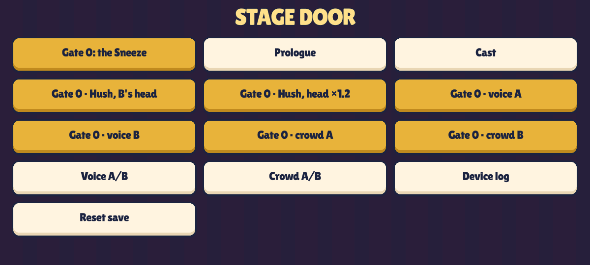
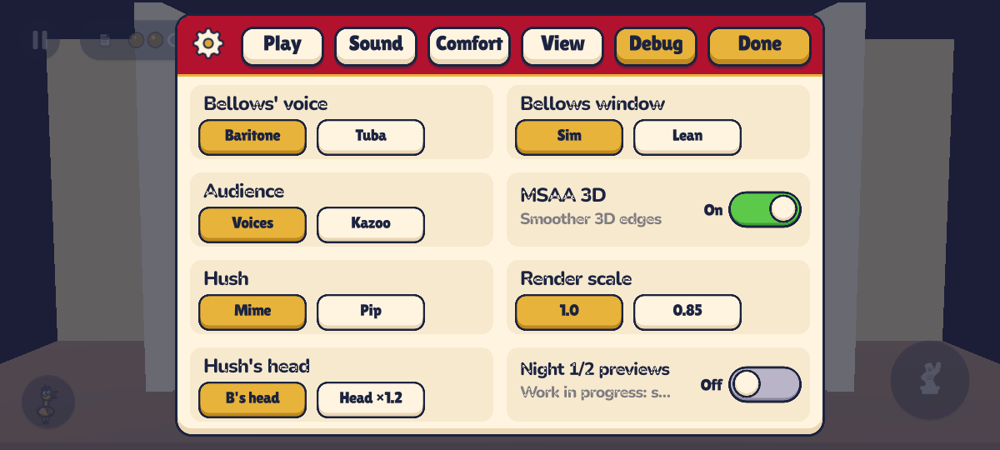
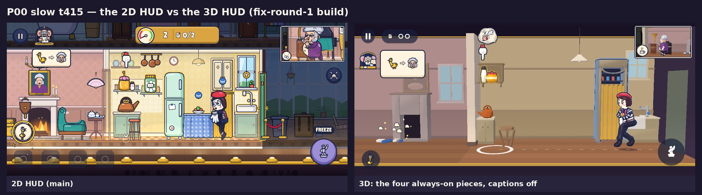
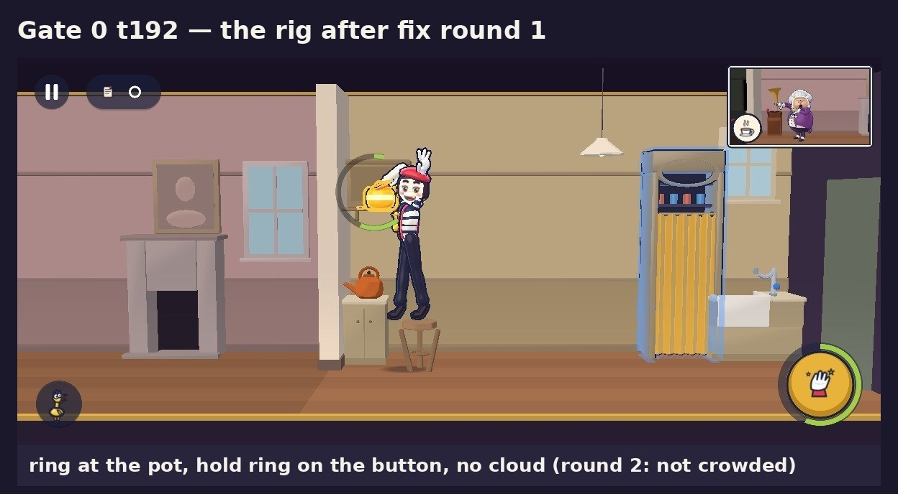
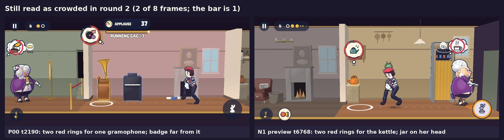
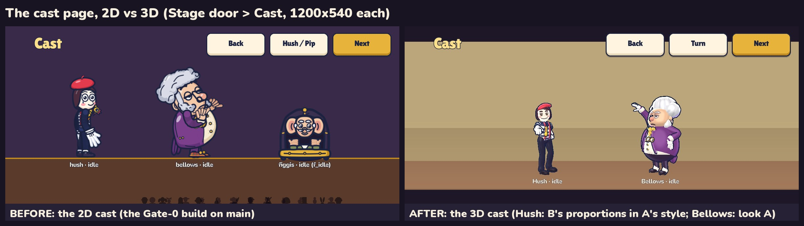
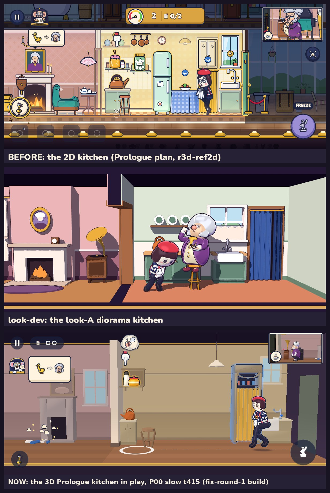
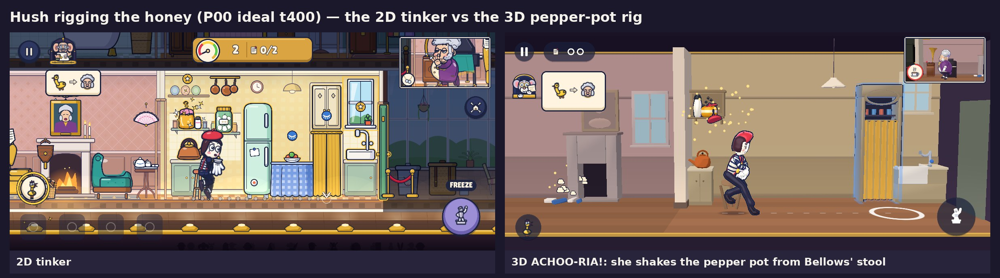
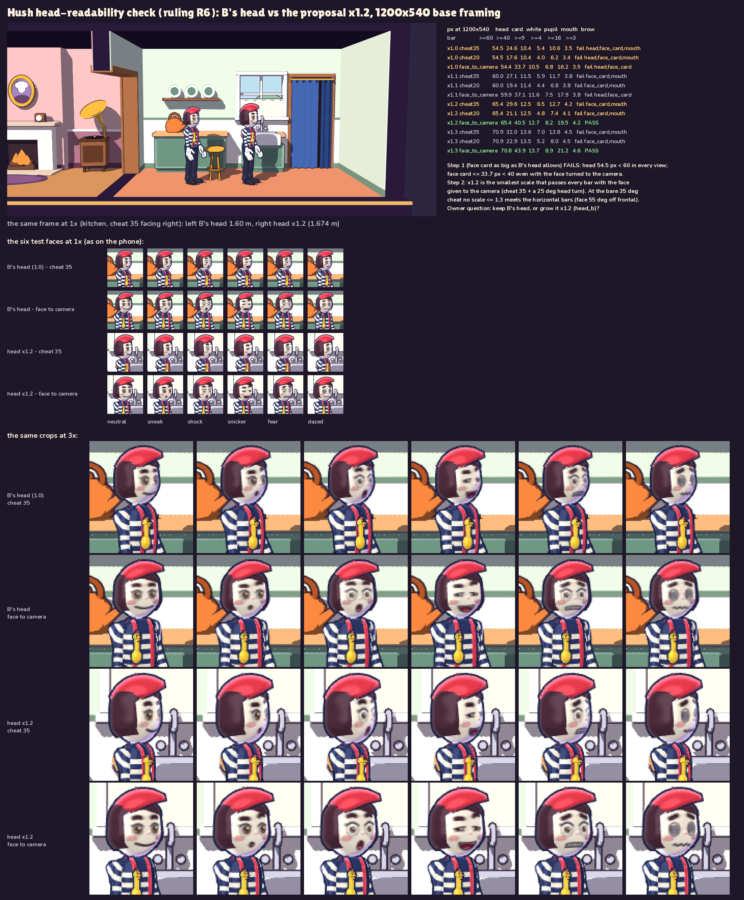

# R3D: the 3D slice — Gate 0 and the Prologue in 3D

This page is for the owner. Everything below comes from the build. All shots are 1200 × 540, the shape of a 20:9
phone held sideways.

> **Status (r3d-qa round 2, 2026-10-01 17:05Z): not ready to send.** The pre-gate is still not green. Three rows fail:
> - **9, set lint:** one data flag. The Prologue's vase was made bigger and blue-and-white so its gag reads, but it
>   is still marked as background dressing, and dressing must stay pale. A one-line fix in `house3d.json`.
> - **16, frame budget:** every count is inside the budget. A few script calls still cost over 1 ms at the same moment
>   in repeated runs on the desktop proxy (D17).
> - **19, fresh reviewers:** two bars are missed: "is this screen crowded?" (2 of 8, the bar is 1) and the Prologue's
>   gags (1 of 9 at its bar).
>
> **20a now passes:** the APK below starts and plays the 3D game. The request tables are in
> `docs/review/r3d-qa/readability.md` (Round 2) and in the r3d-qa report. When the fixes land, the pre-gate is re-run,
> the APK line gets its new sha256, and 20b is confirmed after the push.

## The build

- **APK:** `build/r3d/mischief-debug.apk`, a debug build. **73.47 MB (73,468,995 bytes), 3277 entries.**
  - sha256 `9478f00dc5dec2dca1c17a38beb8dc00652091b5997d089dac81c237e6446316`. A debug APK is re-signed on every export,
    so the sha256 changes each time; the size and the contents list do not.
  - It starts: the exported pack loads all 197 of its scripts with 0 failures and builds a 3D Night.
  - Android 7 or later (min SDK 24), landscape only.
  - The only permission is VIBRATE.
  - The CI copy (android-preview on the pushed `r3d` head, row **20b**) is **pending the push**.
- **Install:** `adb install -r mischief-debug.apk`, or copy the file to the phone and allow "install unknown apps".
- **What opens:** the stage door (`boot_config.json`: `start: stage_door`, `view: 3d`, `show_previews: false`,
  `bellows_window: sim`, render `{msaa_3d: true, render_scale: 1.0, outline: true}`).

## What to play

| What | Where | What to judge |
|---|---|---|
| **Gate 0: the Sneeze (3D)** | Stage door → **Gate 0: the Sneeze**. The 3-icon card shows first: tap the honey, hold to rig, hide. Then you play. The sneeze comes about 20 s after the curtain rises. In the curtain call, tap **Again ▶** to replay or **Stage door** to leave. | The same set-up → wait → payoff as the 2D Gate 0, now in 3D. Is it clear what to do? Does the sneeze still land? |
| **Prologue (3D)** | Stage door → **Prologue**. Two pranks: ACHOO-RIA! (the pepper pot over the honey, in the kitchen) and ALLEGRO-GO-GO! (the gramophone lever, in the parlour). The Night ends with the curtain call. | The first minute: about 7 laughs by 60 s on the ideal route. Does it read without the captions? |
| **Cast (3D)** | Stage door → **Cast**. **Next** cycles idle → snicker → freeze (marble on the plinth) → take (the CHOO frame). **Turn** rotates both characters 45°. | Do you like the two characters? |
| **Gate 0 · Hush, B's head** / **Gate 0 · Hush, head ×1.2** | Stage door, row 2 | The head question, below. |
| **Gate 0 · voice A / B**, **Gate 0 · crowd A / B**, **Voice A/B**, **Crowd A/B** | Stage door | Still open: **D3** (voice) and **D4** (crowd), as in Gate 0. The defaults are unchanged. |

**Night 1 and Night 2 are hidden in this build.** They are work-in-progress previews (R9). To show them:
1. Start Gate 0.
2. Tap ⏸ (top left) → **Settings** → **Debug** → **Night 1/2 previews** → On → **Done**.
3. Resume and play to the end (Gate 0 takes about 25 s), then tap **Stage door** in the curtain call.
4. The stage door now lists **Night 1 (preview)** and **Night 2 (preview)**. Each opens behind a "Work in progress" card: tap **Play anyway**.

**Next ▶** at the end of the Prologue now opens the same "Work in progress" card (Play anyway / Back), not Night 1
directly (fixed in fix round 1: [`q_n1_wip_card_after.png`](../r3d-fix-perf/q_n1_wip_card_after.png)).

What falls back in the previews: every Bellows clip that is not made in 3D yet. This is counted per clip over the 9
N1/N2 routes (`e2e.sh slice_all`), and he never drops into a rest pose:

| Kind of clip | Missing in N1 / N2 (times played over the 9 routes) | What you see instead |
|---|---|---|
| Reactions (the payoffs) | `rx_drench_a` 5, `rx_strain_slip_a` 5, `rx_sing_crack_a` 4, `rx_jackhammer_cling_a` 4, `rx_avalanche_helmet_a` 3, `rx_fish_slap_a` 3, `rx_launch_ceiling_a` 1, `rx_blind_bumble_b` 1 | Bellows' **double take** (`st_double_take`), held for the reaction's length, **plus the pun caption** |
| His routine (activities) | `act_paper` 35, `act_pickles` 20, `act_fixup_dry` 19, `act_rinse` 15, `act_snack` 12, `act_clock` 8, `act_fire` 8, `act_phone` 8, `act_mirror` 7, `act_fixup_sink` 6 | His **idle** loop at the station, without the business |
| Micro-gags (emotes) | `mg_chuckle_at_own_photo` 8, `mg_tut` 8, `mg_steam_sideburns` 5, `mg_gargle_hum` 4, `mg_warm_hands` 4, `mg_sniff_jar` 3, `mg_kiss_reflection` 3, `mg_scrub_nose` 3, `mg_lick_lips` / `mg_pompous_laugh` / `mg_twirl_cord` 1 each | The gesture is skipped. His base clip keeps playing. |
| Bits, meltdown, lecture, catch | `bit_paper` 4, `melt_a` 6, `melt_exhausted` 3, `st_chase` 4, `lec_a` / `st_door_slam` / `st_search` / `st_wheeze` / `st_bump` / `sig_mirror_mirror` 1 each; Hush `lec_dangled`, `loco_door`, `st_busted`, `st_doorstep`, `act_wink` 1 each | The idle, or the locomotion the sim is in |

Totals per route (this build, row 15): N01 ideal 34, required 18, slow 18, caught 27, chase 14, meltdown 16; N02
ideal 60, required 22, slow 24. Gate 0 and the three Prologue routes have **0**.

## Settings you may want (all under ⏸ → Settings)

| Setting | Where | This build | Why |
|---|---|---|---|
| **Bellows window** (Sim / Lean) | Settings → Debug | **Sim** | "Sim" shows the window whenever the sim says he can be seen: you are one room away, he is coming, or a payoff is running. "Lean" keeps only his face badge at the screen edge while he is merely next door. Lean was not chosen because the lean dead-air check (`d1_lean`) fails the ⅓ edge-share cap on **7 of 9** routes (edge share 0.37–0.62). In Sim, every Prologue and Gate-0 route is now at or under 35 % of play (P00 *required* 34.6 %; it was 39 % before fix round 1). The share per route is in the verification section. Your call if you prefer Lean. |
| **MSAA 3D**, **Render scale** (1.0 / 0.85) | Settings → Debug | **MSAA on, 1.0** | **Unchanged — no probe answer.** The O2 perf-probe run on your phone never came back, so the defaults stand. Turn MSAA off or try 0.85 if the phone runs hot or stutters. The device log (Stage door → Device log) records `perf3d:<episode>` per Night. |
| **Hush's head** (B's head / Head ×1.2) | Settings → Debug | **B's head** (your pick) | The head question, below. The two Gate-0 stage-door buttons set it for you. |
| **Night 1/2 previews** | Settings → Debug | Off | See above. |
| **Previews** (Always / When idle / Off) | Settings → View | Always | The joke bubble above each lit spot. |
| **Room dimming**, **Outline +50 %** | Settings → View | On / off | Rooms Hush is not in are lit lower; thicker outlines. |

## What to judge — your four complaints (REDESIGN §6.4, R1 + R2)

Fresh reviewers who did not know the game answered on opaque frames, with captions hidden (pre-gate row 19,
`docs/review/r3d-qa/readability.md`). Round 2 used new reviewers on frames re-shot from this build, at the same moments
as round 1. Their verdicts sit next to each complaint. Each packet had one reviewer, so a score can move by a point
between reviewers.

**1. "The UI is too crowded."** The 2D HUD vs the four always-on pieces: pause, the Script chip, Clarence and the action button.

- In side-by-side pairs, the reviewer preferred the 3D frame **8 of 8** times (round 1). Every reason named fewer HUD
  pieces and fewer props.
- Asked "is this screen crowded?" of single 3D frames, the round-2 reviewer said **yes on 2 of 8**. The bar is 1.
  - **Fixed since round 1:** while Hush rigs, the joke bubble no longer sits on her head. The ring stays on the pot,
    and the hand hint is off the button. Round 2 called this frame "no".

    

  - **Still crowded:** at the gramophone (Prologue) and in the Night-1 kitchen (a hidden preview). In both, his
    countdown ring is drawn twice for one target, once in his thought and once on the prop's badge. The badge is also
    pushed away from its prop, so "it is unclear which icon goes with which object". **Fix requested.**

    

**2. "The characters don't look good — 3D would be more appealing."** The 2D cast vs the 3D cast.

- **Hush:** look **B**'s body (1.60 m, the lanky limbs, B's head) in look **A**'s style (vinyl toy, painted face, beret and stripes).
- **Bellows:** look **A**, with the board's fixes: a bigger face in the bouffant, a readable teacup, the face turned to camera on every face beat (D8).
- Do you like them? Judge in **Cast** and in play.

**3. "The house is too crowded — simplify it."** The 2D kitchen vs the Prologue kitchen in 3D.

- Per room: at most 5 live props, at most 4 dressing pieces, one hiding place (the set lint, row 9).
- The reviewers' 8/8 preference above names "a calm, open room" every time.
- The vase on the parlour mantel (left edge) is new in fix round 1: it is now ×1.5 and blue-and-white, because its gag
  needs it seen. In this shot it has already smashed. Row 9's one failure is that the vase is still flagged as pale
  dressing.

**4. "The actions are not obvious."** The 2D generic tinker vs the 3D pepper-pot rig: Hush climbs Bellows' own stool and shakes the set's pepper pot over the honey.

- **What she is doing:** named right in **7 of 8** frames (round 1; the bar is 7). Sneak, run, reach high on the
  stool, reach the gramophone, dive, statue and bow were all read. The squeak was read as "fiddling with something
  small and yellow".
- **What each lit spot will do:** the joke was read from its bubble in **6 of 8** (round 2; the bar is 6).
  - The sneeze bubble now reads as a sneeze; round 1 read it as "chilli". The tap, the kettle, the gramophone, the
    recliner and the box were read too.
  - The pickle jar was read as "a vase that falls on his head".
  - The kettle that still needs the squeaker was read as "a honk that startles him".

**And: "is the sneeze funny in 3D?"** The Gate-0 sneeze is in [`g0_sneeze.jpg`](../r3d-integrate/strips/g0_sneeze.jpg)
(the build-up) and [`g0_sneeze_2.jpg`](../r3d-integrate/strips/g0_sneeze_2.jpg) (the CHOO at t1163, the flight on the
stool, the sink, the Stalls), numbered by sim tick, with captions. Fix round 1 did not change it.
- Three earlier fresh reviewers scored it **funny 4 / readable 4 / fresh 3** (round 1 and both D15 rounds). The
  round-2 reviewer scored both sneezes **3/3/3**, under the 4/4 bar. That reviewer named the two faults round 1 also
  named:
  - nothing on screen shows the pepper causing it;
  - in the dazed hold in the sink, his face is hidden under the flipped bouffant and the jabot.

  Both are requested fixes.
- **The Prologue's smaller gags** (round 2, after fix round 1; strips in
  [`r3d-fix-gags/after/`](../r3d-fix-gags/after/)):

  | Gag | Round 2 (funny / readable / fresh) | Round 1 | Bar |
  |---|---|---|---|
  | the picture | 3/4/3 (**passes**) | 1/1/1 | 3/3/3 |
  | the dizzy spin | 3/4/3 ("music makes him dance is close to the obvious version") | 3/3/4 | 4/4/3 |
  | the vase | 2/3/2 (cause and crash now read; he never reacts) | 1/2/1 | 3/3/3 |
  | the door-frame bonk | 2/3/1 (the hit now reads; "the most obvious version") | 2/2/2 | 3/3/3 |
  | the curtain call | 2/2/2 (the pelmet bonk is small and the menu covers it) | 3/3/3 | 3/3/3 |
  | the relief beat | 1/2/2 (the near miss reads; no payoff) | 1/3/1 | 3/3/3 |
  | the squeak bit | 1/2/1 (his answer is only in the small window) | 1/3/1 | 3/3/3 |

The Bellows window (the 2D PiP's replacement) is in [`pip_2d_vs_window.jpg`](pip_2d_vs_window.jpg) (P00 ideal t445, this build).

## The head question (R6)

- At game size, B's head (×1.0) gives a face card that fails the phone-scale bars in every view: the head is 54.5 px, under the 60 px bar.
- **×1.2 is the smallest scale that passes**, with the face given to the camera.
- In the blind face test (6 fresh reviewers each):
  - B's head passed only with the face turned to the camera;
  - ×1.2 passed **6/6** both turned to the camera and at the 35° idle cheat.
- **This build keeps B's head (your pick)** and offers both on the stage door: **Gate 0 · Hush, B's head** and **Gate 0 · Hush, head ×1.2**.
- **Recommendation: ×1.2.** The neck, the body and B's proportions are unchanged. Only the head grows, about the neck joint.

## Known rough edges (honest, short)

**Weak spots that are known and accepted for this slice:**
- **The tea is a routine, not a gag** (D15: 2/2/2 — "sits, fidgets with the teapot and cup … idle everyday routine").
- **The snicker** can read as "bending down" at 64 px (D12: 12/13).
- **The N02 hall** is too full: 0.68 m of free floor against 1.5 m (D13). That is Night 2, hidden here, and R3 must re-space it.

**The Prologue's gags** (above): fix round 1 put the cause and the contact on screen, and the picture now passes.
The rest still lack a payoff or a fresh twist:
- the vase: he never reacts;
- the relief beat: no "phew";
- the squeak bit: his answer is inside the small window;
- the bonk: a camera cut 6 frames before the hit;
- the dizzy spin: it reads as dancing;
- the curtain call: the pelmet bonk is small and slow, beside the buttons.

**Busy overlays** (above):
- At the gramophone, his countdown ring shows twice (in his thought and on the prop's badge), and the badge floats away
  from its prop.
- At the door-frame bonk his thought bubble touches the RUNNING GAG bar for a moment.
- While she rigs on the stool, her feet hover just above the seat.

**Framing and flow:**
- The N1 kitchen renders dark for a few frames when she enters from the parlour.
- In the N1 kitchen preview, her head passes in front of the pickle jar's shelf, so the jar looks like a hat.
- The "Work in progress" card repeats its title in its first line.

**Curtain call:**
- The title sign covers Hush for its 1.2 s hold.
- Bellows walks on behind the "Night 1 ▶" button.
- With captions off, the gag-reel inset still prints its pun captions.

**The Bellows window** shows him for at most **35 % of play** on the Prologue and Gate 0 routes in this build
(P00 required 34.6 %, ideal 25.8 %, Gate 0 30.4 %).

**Night 1 / 2 previews:** Bellows' missing clips fall back as described above.

**Figgis** is the 2D bust restyled flat in look A's palette, without its idle animation. His 3D-style sprite is R3.

**Draft clips: none.** All 80 slice clip sidecars are final.

**Performance (desktop proxy):**
- Every count is inside the budget: draw calls p95 ≤ 82, triangles ≤ 101k, at most 8 particle emitters, texture
  ≤ 111 MB, 0 shader compiles in play. View + HUD scripts: p50 2.91–3.16 ms, p95 4.28–4.72 ms.
- A few script calls still take over 1 ms at the same moment in repeated runs (row 16, D17). For example, the overlay
  layout when Hush first walks to the honey, and Hush's view while she hides in the pantry and behind the piano.
- The proxy renders on the CPU, so its frame rate is **not a phone number**. 60 fps is judged on your phone; the device log shows it.

**Other:**
- The app icon is still Godot's default.
- Your O1 answer ("is this the Hush and Bellows you picked?") never came, so nothing from it is pending.

## Decisions requested

- [ ] **R1 / R2 verdict.** Is it uncrowded? Can you tell what Hush is doing and what each spot will do? Do you like the two characters? Is the sneeze funny in 3D?
- [ ] **The head:** keep B's head, or ×1.2 (recommended)?
- [ ] **Bellows window:** Sim (shipped) or Lean, if you disagree.
- [ ] **D2–D4** if you want to answer them now: mime or Pip (Pip still falls back to the mime), voice A/B, crowd A/B.

## Verification of this build (desktop CPU proxy, 2026-10-01, QA round 2)

`tools/scripts/pregate3d.sh` (index §6) was run alone on the CPU box, on `5f0092b` plus r3d-fix-hud2's working tree
(content hash `bd0fb2503d06829a`, sim tree `838f39fc9f4d1a85`). Rows 1–7, 9–18 and 20a ran at 13:58–14:59Z, row 8 at
15:00–16:40Z, and row 19 at 17:03Z. The record is `docs/review/r3d-qa/pregate_r2.json`, with details in
`docs/review/r3d-qa/index.md`.

The record's own table marks rows 1–4, 9–18 and 20a "STALE". This is only because the pre-gate script itself was
edited after those rows ran. No game file changed, so their results stand (the record's `qa_note`).

| # | Check | Result | Numbers |
|---|---|---|---|
| 1 | Import metadata | PASS | 1010 `.import`, 412 `.uid` sidecars |
| 2 | Full test suite | PASS | **1312 / 1312**, 0 failed, 0 skipped, 138 files incl. `tests/slice/` (2 files) |
| 3 | Design lints `--strict` | PASS | 3D anim lint strict on 72 clips: 0 errors, 0 warnings, 0 missing; 3D coverage 72; content / hotspot / IP 0 failed |
| 4 | Art + audio validators | PASS | 5 validators incl. `gen_audio.py --check` |
| 5 | Every route (solver) | PASS | 13 routes, every route's own expect OK, 0 invariant violations, 0 catches on ideal; g0 ends `g0_done` |
| 6 | Dead air (D1, ⏩) | PASS | worst ideal 8.1 % / required 4.8 % / slow 5.9 % (bars 20 / 25 / 30); worst gap 5.5 s (≤ 12); edge share 0.22 (≤ ⅓) |
| 7 | Planner proofs + g0 route | PASS | `--auto` proofs; g0 ideal → `g0_done` |
| 8 | Fairness fuzz | PASS | 2400 runs (200 per episode × bot group), 0 invariants, 0 soft-locks, 0 struck-hotspot commands |
| 9 | Set lint | **FAIL** | 2 errors, both on the P00 parlour vase: flagged `dressing`, so it is judged by the dressing colour rule (C* 42.7 > 30, \|ΔL*\| 20.8 > 15 vs the wall). It is now a ×1.5 cue prop; the fix is to drop the flag. 1 warning: N02 hall negative space 0.68 m (D13) |
| 10 | Screen-rect lint (20:9, 16:9, 4:3) | PASS | 0 errors, 1 warning: N02 hall clock under the Bellows window at 16:9 |
| 11 | HUD lint | PASS | 0 errors, 2 warnings: the Bellows window's 0.0 s punch into the middle band on P00 ideal / slow (allowed ≤ 5 s, D9/D10) |
| 12 | Visibility C8 | PASS | 26 route × mode runs: **0 violations** in the shipped `sim` mode, 0 in `lean`; window share max 35.0 % (was 39.0 %) |
| 13 | Gate 0 in 3D | PASS | `g0_done`; CHOO accent clip f 94; zoom 1.14 at the accent, 1.59 peak; hit-stop 83 ms; caption ACHOO-RIA!; bouffant flipped; lands in the sink; Script tag → pip; C8 0; draw calls p95 55; texture 88.5 MB; 0 compiles; Again ▶ live in 272 ms |
| 14 | Prologue in 3D | PASS | ideal: **7 laughs by 60 s** (≥ 6), 4 cues staged, crowd ≤ 0.27 s after each, 0 doubled sounds, C8 0; slow: first laugh **6.6 s**, first prank **27.6 s** from launch (≤ 10 / ≤ 30) |
| 15 | Other routes in 3D | PASS | 13 / 13 scenarios, 0 script / engine errors; g0 + P00 0 fallbacks; N01 / N02 fallbacks 14–60 per route (info, R9) |
| 16 | Frame budget (desktop proxy) | **FAIL** (D17) | counts inside budget: draw calls p95 ≤ 82 / max ≤ 101 (150 / 250), triangles ≤ 101,162 (150k), emitters ≤ 8 (8), texture ≤ 110.7 MB (250), **0 shader compiles in PLAY**; view + HUD p50 2.91–3.16 ms / p95 4.28–4.72 ms (proxy bars 3.5 / 8.0 met). **Spikes (D17):** 11 call sites over 1 ms at the same tick in ≥ 2 of 3 rendered runs (a chance baseline gives 9–18, so most are coincidence), and 20 headless hits repeated in another run. The repeatable ones: the overlay layout at t255–263, Hush's view at t995 (pantry) and t2846 (piano), NightScene at t1572 |
| 17 | Per-character budget | PASS | Hush 0.159 ms, 2 draws, 9,812 tris, 48 bones; Bellows 0.198 ms (177–223 µs over 5 runs), 4 draws, 9,495 tris, 50 bones (+ the borrowed stool 1 draw / 450 tris, D16) |
| 18 | Flow, feedback, touch | PASS | retry 632 ms (≤ 1.5 s); tap feedback in 1 frame; pause / back / focus OK; tap accuracy 20 / 20 on each of the 5 slice hotspots tested, 0 neighbour hits; g0 Again ▶ live (260 ms), P00 Next ▶ live on frame 1 |
| 19 | Readability (fresh reviewers) | **FAIL** | verb 7/8 (round 1) · spot **6/8** · crowded **2/8** (bar ≤ 1) · 3D preferred 8/8 (round 1); gags: picture 3/4/3 passes; both sneezes 3/3/3 (bar 4/4), dizzy spin 3/4/3 (bar 4/4), vase 2/3/2, bonk 2/3/1, curtain call 2/2/2, relief 1/2/2, squeak bit 1/2/1 — `docs/review/r3d-qa/readability.md`, Round 2 |
| 20a | APK (local) | PASS | 73.47 MB, 3277 entries, 77 clip `.res` + 80 sidecars, `tests/ tools/ scenes/dev/ view3d/sandbox/ view3d/probe/ ui/demo/ _src/` absent, `boot_config` as listed above, VIBRATE only, min SDK 24; the exported pack loads 197 scripts with 0 failures and builds a 3D Night |
| 20b | APK (CI, android-preview on the pushed head) | **pending the push** | `gh run list --branch r3d --workflow android-preview.yml -L 1` and its artefact's contents vs 20a, after the fixes are pushed |

**The Bellows-window share per route** (R15; the HUD lint warns above 35 %):

| Route | **Sim (shipped)**: share of PLAY · longest stretch | Lean: share · edge-badge frames | In the game (sim, e2e) | `d1_lean` (the lean dead-air check) |
|---|---|---|---|---|
| Gate 0 ideal | **30.4 %** · 7.2 s | 16.8 % · 283 | 28.0 % (rendered; longest 6.4 s) | — |
| Prologue ideal | **25.8 %** · 7.7 s | 9.4 % · 597 | 26.4 % (rendered; longest 2.0 s) | FAIL (edge 0.44) |
| Prologue required | **34.6 %** · 15.7 s | 8.3 % · 1075 | 35.0 % (rendered; longest 4.0 s) | FAIL (edge 0.62) |
| Prologue slow | **29.2 %** · 10.1 s | 9.6 % · 758 | 29.7 % (rendered; longest 2.6 s) | OK (edge 0.16) |
| Night 1 (preview) ideal | **17.8 %** · 6.7 s | 5.7 % · 1095 | 17.2 % (headless) | FAIL (edge 0.37) |
| Night 1 (preview) required | **35.0 %** · 9.1 s | 12.8 % · 1143 | 33.3 % (headless) | FAIL (edge 0.62) |
| Night 1 (preview) slow | **31.5 %** · 13.6 s | 11.8 % · 1227 | 30.6 % (headless) | FAIL (edge 0.49) |
| Night 1 (preview) caught | **27.9 %** · 8.4 s | 11.4 % · 979 | 26.9 % (headless) | info (edge 0.73) |
| Night 1 (preview) chase | **20.5 %** · 8.0 s | 0.2 % · 1018 | 19.7 % (headless) | info (edge 0.55) |
| Night 1 (preview) meltdown | **10.0 %** · 5.3 s | 7.4 % · 171 | 8.5 % (headless) | info (edge 0.34) |
| Night 2 (preview) ideal | **20.0 %** · 9.2 s | 10.5 % · 879 | 20.2 % (headless) | FAIL (edge 0.49) |
| Night 2 (preview) required | **15.6 %** · 8.6 s | 9.9 % · 188 | 15.6 % (headless) | FAIL (edge 0.57) |
| Night 2 (preview) slow | **15.1 %** · 8.4 s | 9.7 % · 182 | 15.2 % (headless) | OK (edge 0.29) |

The sim column is the visibility lint over every tick of the solver route (row 12); "in the game" is the e2e run of the same route (rows 13–15). `d1_lean` fails the ⅓ edge-share cap on 7 of the 9 final routes (ideal / required / slow × 3 Nights) — the reason `sim` ships (R15, K3).

Perf charts (this run): [`budgets.png`](../r3d-qa/perf/budgets.png) (row 16) and [`rigs.png`](../r3d-qa/perf/rigs.png) (row 17).
