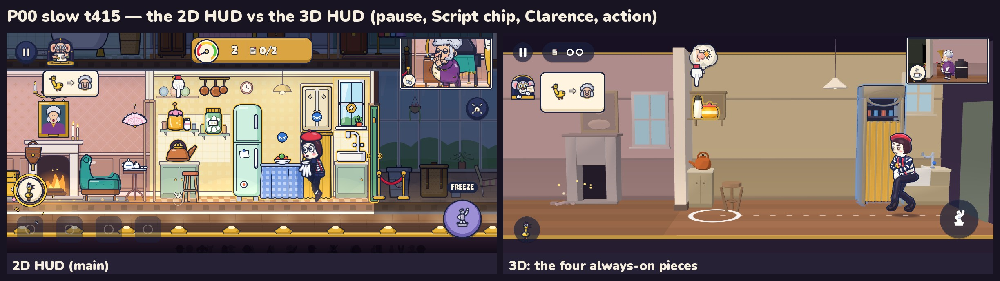
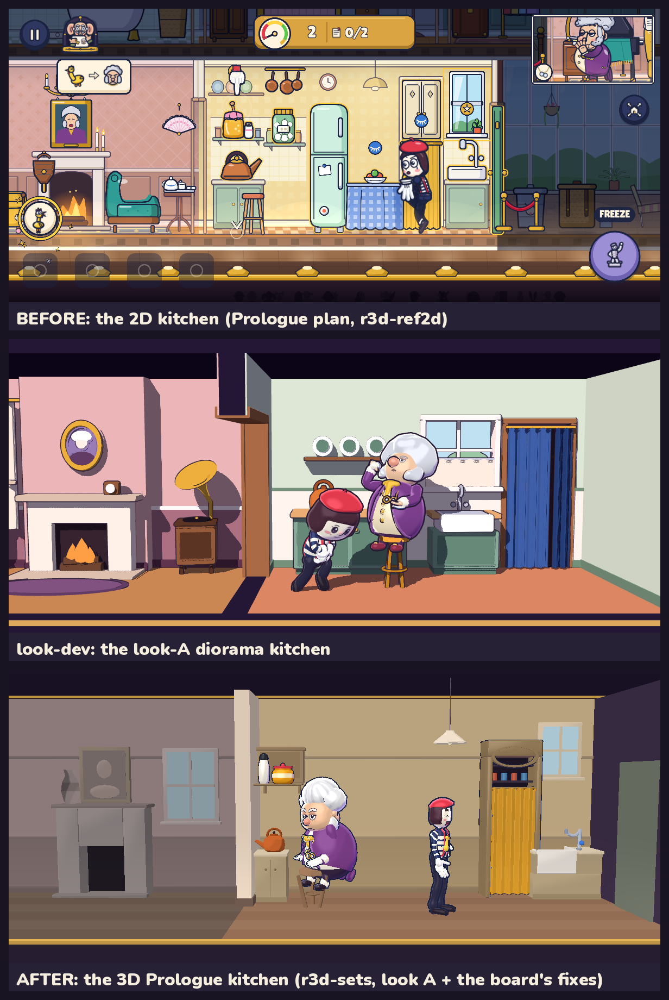
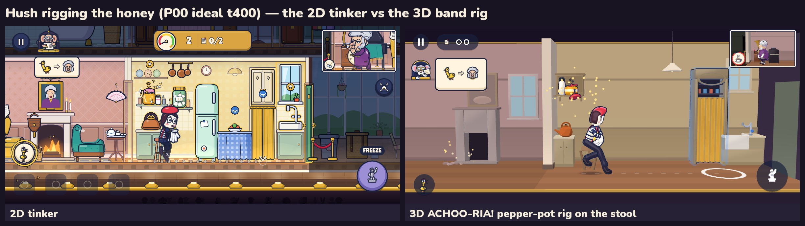

# R3D: the 3D slice — Gate 0 and the Prologue in 3D

This page is for the owner. Everything below comes from the build. All shots are 1200 × 540, the shape of a 20:9
phone held sideways.

> **Status (r3d-qa, 2026-10-01): not ready to send.** The pre-gate is not green. Three rows fail:
> - **20a:** the APK built from this tree does not start the game. One line in the 3D view names a dev-only profiler
>   that the export leaves out. The fix is verified in a scratch export: 0 script errors, Night OK.
> - **16:** script-time spikes on the desktop proxy (D14).
> - **19:** two fresh-reviewer bars are missed: "is this crowded?" and the smaller Prologue gags.
>
> The request table is in `docs/review/r3d-qa/readability.md` §7 and in the r3d-qa report. When the fixes land, the
> pre-gate is re-run, the APK line below gets its new sha256, and 20b is confirmed after the push. **Do not install the
> APK listed here.**

## The build

- **APK:** `build/r3d/mischief-debug.apk`, a debug build. **73.42 MB (73,419,843 bytes), 3277 entries.**
  - sha256 `e60c5e7a9997711bb3f48e5c380b706f1ae83ab3c7387bee8c29e477e3d2ff19`. **This build does not start (20a). Do not install it.** A debug APK is re-signed on every
    export, so the sha256 changes each time; the size and the contents list do not.
  - Android 7 or later (min SDK 24), landscape only.
  - The only permission is VIBRATE.
  - The CI copy (android-preview on the pushed `r3d` head, row **20b**) is **pending the push**.
- **Install:** `adb install -r mischief-debug.apk`, or copy the file to the phone and allow "install unknown apps".
- **What opens:** the stage door (`boot_config.json`: `start: stage_door`, `view: 3d`, `show_previews: false`,
  `bellows_window: sim`, render `{msaa_3d: true, render_scale: 1.0, outline: true}`).

## What to play

| What | Where | What to judge |
|---|---|---|
| **Gate 0: the Sneeze (3D)** | Stage door → **Gate 0: the Sneeze**. The 3-icon card shows first: tap the honey, hold to rig, hide. Then you play. The sneeze comes about 20 s after the curtain rises. In the curtain call, tap **Again ▶** to replay or **Stage door** to leave. | The same set-up → wait → payoff as the 2D Gate 0, now in 3D. Is it clear what to do? Does the sneeze still land? |
| **Prologue (3D)** | Stage door → **Prologue**. Two pranks: ACHOO-RIA! (the pepper pot over the honey, in the kitchen) and ALLEGRO-GO-GO! (the gramophone lever, in the parlour). The Night ends with the curtain call. | The first minute: about 7 laughs by 60 s on the ideal route. Does it read without the captions? |
| **Cast (3D)** | Stage door → **Cast**. **Next** cycles idle → snicker → freeze (marble on the plinth) → take (the CHOO frame). **Turn** rotates both characters 45°. | Do you like the two characters? |
| **Gate 0 · Hush, B's head** / **Gate 0 · Hush, head ×1.2** | Stage door, row 2 | The head question, below. |
| **Gate 0 · voice A / B**, **Gate 0 · crowd A / B**, **Voice A/B**, **Crowd A/B** | Stage door | Still open: **D3** (voice) and **D4** (crowd), as in Gate 0. The defaults are unchanged. |

**Night 1 and Night 2 are hidden in this build.** They are work-in-progress previews (R9). To show them:
1. Start Gate 0.
2. Tap ⏸ (top left) → **Settings** → **Debug** → **Night 1/2 previews** → On → **Done**.
3. Resume and play to the end (Gate 0 takes about 25 s), then tap **Stage door** in the curtain call.
4. The stage door now lists **Night 1 (preview)** and **Night 2 (preview)**. Each opens behind a "Work in progress" card: tap **Play anyway**.

Known gap: **Next ▶** at the end of the Prologue opens Night 1 straight away, with no work-in-progress card (request to r3d-night).

What falls back in the previews: every Bellows clip that is not made in 3D yet. This is counted per clip over the 9
N1/N2 routes (`e2e.sh slice_all`), and he never drops into a rest pose:

| Kind of clip | Missing in N1 / N2 (times played over the 9 routes) | What you see instead |
|---|---|---|
| Reactions (the payoffs) | `rx_drench_a` 5, `rx_strain_slip_a` 5, `rx_sing_crack_a` 4, `rx_jackhammer_cling_a` 4, `rx_avalanche_helmet_a` 3, `rx_fish_slap_a` 3, `rx_launch_ceiling_a` 1, `rx_blind_bumble_b` 1 | Bellows' **double take** (`st_double_take`), held for the reaction's length, **plus the pun caption** |
| His routine (activities) | `act_paper` 35, `act_pickles` 20, `act_fixup_dry` 19, `act_rinse` 15, `act_snack` 12, `act_clock` 8, `act_fire` 8, `act_phone` 8, `act_mirror` 7, `act_fixup_sink` 6 | His **idle** loop at the station, without the business |
| Micro-gags (emotes) | `mg_chuckle_at_own_photo` 8, `mg_tut` 8, `mg_steam_sideburns` 5, `mg_gargle_hum` 4, `mg_warm_hands` 4, `mg_sniff_jar` 3, `mg_kiss_reflection` 3, `mg_scrub_nose` 3, `mg_lick_lips` / `mg_pompous_laugh` / `mg_twirl_cord` 1 each | The gesture is skipped. His base clip keeps playing. |
| Bits, meltdown, lecture, catch | `bit_paper` 4, `melt_a` 6, `melt_exhausted` 3, `st_chase` 4, `lec_a` / `st_door_slam` / `st_search` / `st_wheeze` / `st_bump` / `sig_mirror_mirror` 1 each; Hush `lec_dangled`, `loco_door`, `st_busted`, `st_doorstep`, `act_wink` 1 each | The idle, or the locomotion the sim is in |

Totals per route: N01 ideal 34, required 18, slow 18, caught 27, chase 14, meltdown 16; N02 ideal 60, required 22,
slow 24. Gate 0 and the three Prologue routes have **0**.

## Settings you may want (all under ⏸ → Settings)

| Setting | Where | This build | Why |
|---|---|---|---|
| **Bellows window** (Sim / Lean) | Settings → Debug | **Sim** | "Sim" shows the window whenever the sim says he can be seen: you are one room away, he is coming, or a payoff is running. "Lean" keeps only his face badge at the screen edge while he is merely next door. Lean was not chosen because the lean dead-air check (`d1_lean`) fails the ⅓ edge-share cap on **7 of 9** routes (edge share 0.37–0.62), and the Prologue-ideal window share is under 35 %. Only P00 *required* goes over: 38 %, a warning. The share per route is in the verification section. Your call if you prefer Lean. |
| **MSAA 3D**, **Render scale** (1.0 / 0.85) | Settings → Debug | **MSAA on, 1.0** | **Unchanged — no probe answer.** The O2 perf-probe run on your phone never came back, so the defaults stand. Turn MSAA off or try 0.85 if the phone runs hot or stutters. The device log (Stage door → Device log) records `perf3d:<episode>` per Night. |
| **Hush's head** (B's head / Head ×1.2) | Settings → Debug | **B's head** (your pick) | The head question, below. The two Gate-0 stage-door buttons set it for you. |
| **Night 1/2 previews** | Settings → Debug | Off | See above. |
| **Previews** (Always / When idle / Off) | Settings → View | Always | The joke bubble above each lit spot. |
| **Room dimming**, **Outline +50 %** | Settings → View | On / off | Rooms Hush is not in are lit lower; thicker outlines. |

## What to judge — your four complaints (REDESIGN §6.4, R1 + R2)

Fresh reviewers who did not know the game answered on opaque frames, with captions hidden (pre-gate row 19,
`docs/review/r3d-qa/readability.md`). Their verdicts sit next to each complaint.

**1. "The UI is too crowded."** The 2D HUD vs the four always-on pieces: pause, the Script chip, Clarence and the action button.

- In side-by-side pairs, the reviewer preferred the 3D frame **8 of 8** times. Every reason named fewer HUD pieces and fewer props.
- Asked "is this screen crowded?" of single 3D frames, the reviewer said **yes on 2 of 8**. The bar is 1.
  - Both were busy moments: the rig ring and the joke bubble piled on Hush's head while she rigs; and a joke badge running into the RUNNING GAG banner.
  - The calm moments (planning, waiting, the payoff) all read as uncrowded. **Fix requested.**

**2. "The characters don't look good — 3D would be more appealing."** The 2D cast vs the 3D cast.

- **Hush:** look **B**'s body (1.60 m, the lanky limbs, B's head) in look **A**'s style (vinyl toy, painted face, beret and stripes).
- **Bellows:** look **A**, with the board's fixes: a bigger face in the bouffant, a readable teacup, the face turned to camera on every face beat (D8).
- Do you like them? Judge in **Cast** and in play.

**3. "The house is too crowded — simplify it."** The 2D kitchen vs the Prologue kitchen in 3D.

- Per room: at most 5 live props, at most 4 dressing pieces, one hiding place (the set lint, row 9).
- The reviewers' 8/8 preference above names "a calm, open room" every time.

**4. "The actions are not obvious."** The 2D generic tinker vs the 3D pepper-pot rig: Hush climbs Bellows' own stool and shakes the set's pepper pot over the honey, with the ring at the jar.

- **What she is doing:** named right in **7 of 8** frames (the bar is 7). Sneak, run, reach high on the stool, reach the gramophone, dive, statue and bow were all read. The squeak was read as "fiddling with something small and yellow".
- **What each lit spot will do:** the joke was read from its bubble in **6 of 8** (the bar is 6). The tap, the kettle, the gramophone, the recliner and the box were read. The pickle jar was read as "a tampered tea jar", and the sneeze bubble as "chilli, his face burns red".

**And: "is the sneeze funny in 3D?"** The Gate-0 sneeze is in [`g0_sneeze.jpg`](../r3d-integrate/strips/g0_sneeze.jpg) (the build-up) and [`g0_sneeze_2.jpg`](../r3d-integrate/strips/g0_sneeze_2.jpg) (the CHOO at t1163, the flight on the stool, the sink, the Stalls), numbered by sim tick.
- The fresh reviewer scored both sneezes **funny 4 / readable 4 / fresh 3**, which meets the bar.
- The Prologue's smaller gags did **not**, so they are fixes for the next pass:
  - the picture 1/1/1;
  - the door-frame bonk 2/2/2;
  - the vase 1/2/1;
  - the squeak bit 1/3/1;
  - the relief beat 1/3/1;
  - the dizzy spin 3/3/4: read as "forced to conduct", but "without sound it is unclear why he starts".
- The curtain call scored 3/3/3.

The Bellows window (the 2D PiP's replacement) is in [`pip_2d_vs_window.jpg`](../r3d-integrate/boards/pip_2d_vs_window.jpg).

## The head question (R6)

- At game size, B's head (×1.0) gives a face card that fails the phone-scale bars in every view: the head is 54.5 px, under the 60 px bar.
- **×1.2 is the smallest scale that passes**, with the face given to the camera.
- In the blind face test (6 fresh reviewers each):
  - B's head passed only with the face turned to the camera;
  - ×1.2 passed **6/6** both turned to the camera and at the 35° idle cheat.
- **This build keeps B's head (your pick)** and offers both on the stage door: **Gate 0 · Hush, B's head** and **Gate 0 · Hush, head ×1.2**.
- **Recommendation: ×1.2.** The neck, the body and B's proportions are unchanged. Only the head grows, about the neck joint.

## Known rough edges (honest, short)

**Weak spots that are known and accepted for this slice:**
- **The tea is a routine, not a gag** (D15: 2/2/2 — "sits, fidgets with the teapot and cup … idle everyday routine").
- **The snicker** can read as "bending down" at 64 px (D12: 12/13).
- **The N02 hall** is too full: 0.68 m of free floor against 1.5 m (D13). That is Night 2, hidden here, and R3 must re-space it.

**The Prologue's small gags** (above) do not read yet. In each one the cause or the contact is off frame, behind his body, or only in the small Bellows window.

**Busy overlays** at two moments (above):
- While Hush rigs on the stool, the joke bubble and the rig ring cover her face, and her feet hover just above the seat.
- Joke badges run into the APPLAUSE / RUNNING GAG text.

**Framing:**
- Hush stands under the action button after the climb-in and during the squeak.
- Her dive arcs toward the sink before she appears inside the pantry.
- The N1 kitchen renders dark for a few frames when she enters from the parlour.

**Curtain call:**
- The title sign covers Hush for its 1.2 s hold.
- Bellows wanders on behind the "Night 1 ▶" button.
- In the sneeze's dazed hold his face is mostly hidden under the bouffant.

**The Bellows window** shows him for **38 % of PLAY on the Prologue's "required" route** (a warning above 35 %; the ideal route is 30 %).

**Night 1 / 2 previews:** Bellows' missing clips fall back as described above.

**Figgis** is the 2D bust restyled flat in look A's palette, without its idle animation. His 3D-style sprite is R3.

**Draft clips: none.** All 80 slice clip sidecars are final.

**Performance (desktop proxy):**
- Every count is inside the budget: draw calls p95 ≤ 82, triangles ≤ 101k, 4 particle emitters, texture ≤ 103 MB, 0 shader compiles in play.
- Script-time spikes over 1 ms remain in a few slow frames (row 16, D14): the worst was 4.3 ms in this run and 10.2 ms in the earlier one.
- The proxy renders on the CPU, so its frame rate is **not a phone number**. 60 fps is judged on your phone; the device log shows it.

**Other:**
- The app icon is still Godot's default.
- Your O1 answer ("is this the Hush and Bellows you picked?") never came, so nothing from it is pending.

## Decisions requested

- [ ] **R1 / R2 verdict.** Is it uncrowded? Can you tell what Hush is doing and what each spot will do? Do you like the two characters? Is the sneeze funny in 3D?
- [ ] **The head:** keep B's head, or ×1.2 (recommended)?
- [ ] **Bellows window:** Sim (shipped) or Lean, if you disagree.
- [ ] **D2–D4** if you want to answer them now: mime or Pip (Pip still falls back to the mime), voice A/B, crowd A/B.

## Verification of this build (desktop CPU proxy, 2026-10-01)

`tools/scripts/pregate3d.sh` (index §6) was run alone on the CPU box. Its record is `docs/review/r3d-qa/pregate.json`, with details in `docs/review/r3d-qa/index.md`.

| # | Check | Result | Numbers |
|---|---|---|---|
| 1 | Import metadata | PASS | 1010 `.import`, 409 `.uid` sidecars |
| 2 | Full test suite | PASS | **1270 / 1270**, 0 failed, 0 skipped, 135 files incl. `tests/slice/` (2 files, 8 tests) |
| 3 | Design lints `--strict` | PASS | 3D anim lint strict on 72 clips: 0 errors, 0 warnings, 0 missing; 3D coverage 72; content / hotspot / IP 0 failed |
| 4 | Art + audio validators | PASS | 5 validators incl. `gen_audio.py --check` |
| 5 | Every route (solver) | PASS | 13 routes OK, 0 invariant violations, 0 catches on ideal; N01 ideal ★★★ 116.3, N02 ideal ★★★ 117.5, required ★ 44.0 / 59.3; P00 no stars; g0 ends `g0_done` |
| 6 | Dead air (D1, ⏩) | PASS | worst ideal 8.1 % / required 4.8 % / slow 5.9 % (bars 20 / 25 / 30); worst gap 5.5 s (≤ 12); edge share 0.22 (≤ ⅓); N02 first prank 19.4 s (≤ 25) |
| 7 | Planner proofs + g0 route | PASS | `--auto`: N01 6 lines, N02 5, P00 2, every Script whole; g0 ideal 23.6 s → `g0_done` |
| 8 | Fairness fuzz | PASS (run 08:38Z; the sim inputs are unchanged since) | 2400 runs (200 × 4 bots × 3 Nights), 0 invariants, 0 soft-locks, 0 struck-hotspot commands |
| 9 | Set lint | PASS | 0 errors, 1 warning: N02 hall negative space 0.68 m (D13) |
| 10 | Screen-rect lint (20:9, 16:9, 4:3) | PASS | 0 errors, 1 warning: N02 hall clock under the Bellows window at 16:9 |
| 11 | HUD lint | PASS | 0 errors, 1 warning: Bellows-window share 38.1 % on P00 *required* (> 35 %, R15) |
| 12 | Visibility C8 | PASS | 26 route × mode runs: **0 violations** in the shipped `sim` mode, 0 in `lean` |
| 13 | Gate 0 in 3D | PASS | `g0_done`; CHOO accent clip f 94; zoom 1.14 at the accent, 1.59 peak; hit-stop 83 ms; caption ACHOO-RIA!; bouffant flipped; lands in the sink; Script tag → pip; C8 0; draw calls p95 57; texture 81 MB; 0 compiles; Again ▶ live in 234 ms |
| 14 | Prologue in 3D | PASS | ideal: **7 laughs by 60 s** (≥ 6), 4 cues staged, crowd ≤ 0.27 s after each, 0 doubled sounds; slow: first laugh **6.6 s**, first prank **27.6 s** from launch (≤ 10 / ≤ 30) |
| 15 | Other routes in 3D | PASS | 13 / 13 scenarios, 0 script / engine errors; g0 + P00 0 fallbacks; N01 / N02 fallbacks 14–60 per route (info, R9) |
| 16 | Frame budget (desktop proxy) | **FAIL** (D14 spike clause) | counts inside budget: draw calls p95 ≤ 82 / max ≤ 98 (150 / 250), triangles ≤ 101k (150k), 4 emitters (8), texture ≤ 103.4 MB (250), **0 shader compiles in PLAY**; view + HUD scripts p50 2.78–3.12 ms / p95 4.07–4.61 ms (D14 proxy bars 3.5 / 8.0 met); **spikes:** 14 of our nodes / phases over 1 ms in the 60 slowest Prologue frames (worst NightScene 4.3, AudioDirector 2.8, Hush apply 2.6 ms; phase 1's run: 20, worst 10.2 ms) |
| 17 | Per-character budget | PASS | Hush 0.195 ms, 2 draws, 9,812 tris, 48 bones; Bellows **0.240 ms** (2 of 5 runs over 0.25), 4 draws, 9,495 tris, 50 bones (+ the borrowed stool 1 draw / 450 tris, D16) |
| 18 | Flow, feedback, touch | PASS | retry 621 ms (≤ 1.5 s); tap feedback in 1 frame; pause / back / focus OK; tap accuracy 20 / 20 on every g0 / P00 live hotspot, 0 neighbour hits; g0 Again ▶ live, P00 Next ▶ live on frame 1 |
| 19 | Readability (fresh reviewers) | **FAIL** | verb 7/8 · spot 6/8 · crowded **2/8** (bar ≤ 1) · 3D preferred 8/8; gags: both sneezes 4/4/3, curtain call 3/3/3, **dizzy spin 3/3/4** (bar 4/4), picture 1/1/1, bonk 2/2/2, vase 1/2/1, squeak bit 1/3/1, relief 1/3/1 — `docs/review/r3d-qa/readability.md` |
| 20a | APK (local) | **FAIL** | 73.42 MB, 3277 entries, 77 clip `.res` + 80 sidecars, `tests/ tools/ scenes/dev/ view3d/sandbox/ view3d/probe/ ui/demo/ _src/` absent, `boot_config` as listed above, VIBRATE only, min SDK 24; **the exported pack fails to compile `WorldView3D` (13 script errors) → the Night does not build** |
| 20b | APK (CI, android-preview on the pushed head) | **pending the push** | `gh run list --branch r3d --workflow android-preview.yml -L 1` and its artefact's contents vs 20a, after the fixes are pushed |

**The Bellows-window share per route** (R15; the HUD lint warns above 35 %):

| Route | **Sim (shipped)**: share of PLAY · longest stretch | Lean: share · edge-badge frames | In the game (sim, e2e) | `d1_lean` (the lean dead-air check) |
|---|---|---|---|---|
| Gate 0 ideal | **30.4 %** · 7.2 s | 16.8 % · 283 | 28.0 % (rendered; longest 6.4 s) | — |
| Prologue ideal | **30.8 %** · 10.7 s | 9.4 % · 776 | 30.0 % (rendered; longest 2.5 s) | FAIL (edge 0.44) |
| Prologue required | **39.0 %** · 18.7 s (warning > 35 %) | 8.3 % · 1254 | 38.1 % (rendered; longest 4.5 s) | FAIL (edge 0.62) |
| Prologue slow | **34.0 %** · 13.1 s | 9.6 % · 937 | 33.0 % (rendered; longest 3.1 s) | OK (edge 0.16) |
| Night 1 (preview) ideal | **17.9 %** · 6.8 s | 5.7 % · 1097 | 17.2 % (headless) | FAIL (edge 0.37) |
| Night 1 (preview) required | **35.0 %** · 9.1 s | 12.8 % · 1145 | 33.4 % (headless) | FAIL (edge 0.62) |
| Night 1 (preview) slow | **31.5 %** · 13.6 s | 11.8 % · 1230 | 30.6 % (headless) | FAIL (edge 0.49) |
| Night 1 (preview) caught | **28.0 %** · 8.4 s | 11.4 % · 981 | 27.0 % (headless) | info (edge 0.73) |
| Night 1 (preview) chase | **20.6 %** · 8.0 s | 0.3 % · 1018 | 19.7 % (headless) | info (edge 0.55) |
| Night 1 (preview) meltdown | **10.0 %** · 5.3 s | 7.4 % · 171 | 8.6 % (headless) | info (edge 0.34) |
| Night 2 (preview) ideal | **20.0 %** · 9.2 s | 10.5 % · 879 | 20.0 % (headless) | FAIL (edge 0.49) |
| Night 2 (preview) required | **15.6 %** · 8.6 s | 9.9 % · 188 | 15.6 % (headless) | FAIL (edge 0.57) |
| Night 2 (preview) slow | **15.1 %** · 8.4 s | 9.7 % · 182 | 15.2 % (headless) | OK (edge 0.29) |

The sim column is the visibility lint over every tick of the solver route (row 12); "in the game" is the e2e run of the same route (rows 13–15). `d1_lean` fails the ⅓ edge-share cap on 7 of the 9 final routes (ideal / required / slow × 3 Nights) — the reason `sim` ships (R15, K3).

Perf charts: [`budgets.png`](../r3d-qa/perf/budgets.png) (row 16) and [`rigs.png`](../r3d-qa/perf/rigs.png) (row 17).
