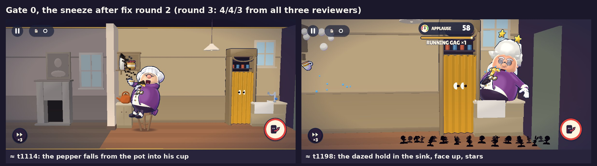

# The 3D slice: Gate 0 and the Prologue in 3D

This page is for the owner. Everything below comes from the build you will install. All shots are 1200 × 540, the
shape of a 20:9 phone held sideways.

> **Owner-check build: the core passes; six small Prologue gags are known weak spots, being reworked next.**

## The build

- **How to get it:** Download the APK from the 'Android preview APK' run for this build:
  https://github.com/Hegazy360/mischief/actions/runs/36963368544 (direct: https://github.com/Hegazy360/mischief/actions/runs/36963368544/artifacts/11208883037 — open it in the phone's browser while signed in to GitHub, not in the GitHub app). On the run's page, scroll to **Artifacts** and tap **mischief-debug-apk**. It comes as
  a zip with `mischief-debug.apk` inside.
- **Install:**
  1. Copy `mischief-debug.apk` to the phone (or download it on the phone) and tap it.
  2. Android asks to allow apps from this source ("install unknown apps"). Allow it, go back, tap **Install**.
  3. If it says "App not installed", uninstall the old Mischief Next Door (the Gate 0 build) first, then try again.
- **What it is:** a debug build, 73.53 MB. Android 7 or later, landscape only. The only permission is vibrate.
- **What opens:** the stage door.

## What to play

| What | Where | What to judge |
|---|---|---|
| **Gate 0: the Sneeze** | Stage door → **Gate 0: the Sneeze**. A 3-icon card shows first: tap the honey, hold to rig, hide. The sneeze comes about 20 s after the curtain rises. In the curtain call, **Again ▶** replays, **Stage door** leaves. | The same set-up → wait → payoff as the 2D Gate 0, now in 3D. Is it clear what to do? Does the sneeze land? |
| **Prologue** | Stage door → **Prologue**. Two pranks: ACHOO-RIA! (the pepper pot over the honey, in the kitchen) and ALLEGRO-GO-GO! (the gramophone lever, in the parlour). It ends with the curtain call. | The first minute: the first laugh comes about 4 s in, about 7 laughs by 60 s. Does it read without the captions? |
| **Cast** | Stage door → **Cast**. **Next** cycles idle → giggle → freeze (the statue) → take. **Turn** turns both characters. | Do you like the two characters? |
| **Hush's head** | Stage door → **Gate 0 · Hush, B's head** and **Gate 0 · Hush, head ×1.2** | The head question, below. |
| **Voice and crowd A/B** | Stage door → **Voice A/B**, **Crowd A/B**, or the four **Gate 0 · voice / crowd** buttons | The same two voices and two crowds as in the Gate 0 build, now in 3D. Nothing changed here. |

**Night 1 and Night 2 are work in progress** and hidden. To look anyway: start Gate 0, tap ⏸ → **Settings** → **Debug**
→ **Night 1/2 previews** → On → **Done**, play to the end, tap **Stage door**. The previews open behind a "Work in
progress" card (**Play anyway**). Many of Bellows' moves there are not made yet: he does his double take or just
stands instead. **Night 1 ▶** at the end of the Prologue opens the same card.

**Tip:** if the phone gets hot or stutters, ⏸ → Settings → Debug → turn **MSAA** off, or set **Render scale** to 0.85.

## Your four complaints: what changed

Strangers who had never seen the game looked at still shots with the captions hidden. The newer tests gave each set
of shots to three strangers and took the middle answer.

**1. "The UI is too crowded."** Only four pieces stay on screen: pause, the Script chip, Clarence and the action
button. Bellows' little window shows only when he is near or a payoff is playing.

- Shown the 2D and the 3D screen side by side, a stranger picked the 3D one **8 of 8** times. Every reason named fewer
  buttons, fewer props or a bigger character.
- Asked "is this screen crowded?", strangers called **1 of 8** shots crowded, and that one was from the Night 1 preview.
  Every Gate 0 and Prologue shot was called calm by all three.

**2. "The characters don't look good — 3D would be more appealing."**

- **Hush:** B's lanky body in A's vinyl-toy style (painted face, beret, stripes). **Bellows:** look A, with a bigger
  face in the bouffant and a readable teacup.
- Both now turn their faces to you on every face moment. Then strangers read their faces right: Bellows **5 of 6**,
  Hush **6 of 6** (six strangers, blind).

**3. "The house is too crowded — simplify it."** Top: the 2D kitchen. Middle: the look you picked. Bottom: the same
kitchen in this build.

- Every room now has at most 5 things you can use, at most 4 pieces of decoration and one hiding place. This is
  checked automatically for every room.
- In the side-by-side test above, the reasons included "a calm, open room", "few room objects" and "a sparse room".

**4. "The actions are not obvious."** Each prank has its own action now. Before, it was one generic "tinker". In
ACHOO-RIA! Hush climbs Bellows' own stool and shakes his pepper pot over the honey.

- A stranger named what she was doing in **7 of 8** shots (sneak, run, reach on the stool, the gramophone, dive,
  statue, bow). The one miss: her squeak looked like "fiddling with something small and yellow".
- Each lit spot shows a picture of its joke. Strangers got what the spot would do to him in **7 of 8** shots. The
  pickle jar still looks like "spring snakes pop out".

## What works well

- **The sneeze:** **4 of 5** for funny and **4 of 5** for readable, from all three strangers, in both Gate 0 and the
  Prologue. "The stool-rocket and sink landing"; "a fuller arc than the stock sneeze". They found the pepper build-up a
  little slow.

  

- **The calm screen:** planning, waiting and the payoff all read as uncrowded (above).
- **2D vs 3D:** the 3D screen was preferred **8 of 8** times.
- **The curtain call** passes: "having the stage itself prank him at his own curtain call is a good button".
- **Fixed just before sending** (not re-scored yet): his double take looked like a broken T-pose and is now a real
  take, hands at his chest ([new take](../r3d-polish-take/p00_relief_take_zoom.jpg)); the curtain-call pelmet seemed
  to hover and now lands on his wig ([pelmet](../r3d-polish-pelmet/hold_f600.jpg)).

## Known weak spots (honest, short)

**Six small Prologue gags** scored under our bar. They are being reworked next, after your feedback:
- **The relief** (he nearly finds her behind the piano): his take read as a "broken T-pose" (fixed now, above), and
  her "phew" puffs read as sweat.
- **The squeak bit:** with the sound off, nothing links her squeak to his cracked note: "nothing happens to him".
- **The vase:** the crash reads, but "the vase is tiny and far from him", and his reaction does not register.
- **The dizzy spin:** it reads as a wild dance: "unclear why the music makes him dance". They liked the notes circling
  his head like stars.
- **The picture:** clear, but "the stock thing-falls-on-head gag".
- **The door-frame bonk:** clear, but "the plain walk-into-the-doorframe gag".

**Also known:**
- **Bellows' tea** reads as an everyday routine, not a gag. Strangers named the teapot, cup and steam, but "nothing
  visibly happens". It is his routine, not one of your pranks. A bigger pour and a held sip are planned.
- **Hush's giggle**, as a tiny silhouette, was once read as "bending down". A stranger named 12 of her 13 poses. In
  play it comes with her face to you and the tee-hee sound.
- **The Night 2 hall** (preview only) is too full of furniture, with less than half the free floor it should have. It
  gets re-spaced next round.
- **Hush's face at B's head size** is a little small for a phone. It reads when she turns to you, but not at a glance
  in between. Head ×1.2 reads both ways.
- **After his double take** he holds the pose still for about half a second. His conductor's baton is still in his
  hand there and sits by the corner of his mouth.
- **The Bellows window:** if you do only the required steps of the Prologue, it is on screen about a third of the time.
- **Phone performance has to be judged on your phone.** Our test machine draws 3D without a graphics card, so its
  frame rate says nothing about a phone. Bellows' animation is around our per-character budget there (just over on
  some runs), and a trim is planned.
- The app icon is still Godot's default.

## Questions for you

- [ ] **Is it uncrowded now, and are the actions clear?** Can you tell what Hush is doing, and what each lit spot will do?
- [ ] **Do you like the two characters in 3D?**
- [ ] **Hush's head: B's size, or 20 % bigger (recommended)?** Try both from the stage door (**Gate 0 · Hush, B's
  head** / **head ×1.2**). Only the head grows; her body stays B's ([side by side](../r3d-cast-hush/head_check.png)).
- [ ] **Is the sneeze funny?**

**If you can:** please send a photo of the performance-probe screen. That is the separate small test app from 30
September; this build does not include it. If you no longer have it, play the Prologue once, then open Stage door →
**Device log** → **Copy log**, and paste it to us.

## Checked before sending (desktop, 2026-10-02)

| Check | Result |
|---|---|
| Automatic tests | **1352 / 1352** passed, 0 failed |
| Content, animation, art and sound checks | All OK. One sound (the fish slap) is a little quiet. |
| Every route played by the solver | 12 runs, 0 failed; on the normal routes the longest quiet gap is about 6 s |
| Gate 0 in 3D | Ends cleanly, 0 missing animations; the CHOO lands on its beat |
| Prologue in 3D, three ways through | All end cleanly, 0 missing animations; 7 laughs by 60 s, the first after 3.8 s |
| All 13 test routes in 3D (with the Night previews) | All end with no errors |
| The APK | Starts and builds a Night in 3D; 73,534,725 bytes; sha256 `36f335200dcb7fa8986121cf424258c435307c6562fe287f67c7b250bc3d7467` |

The copy you download is built by GitHub from the same files, so its contents are the same. Its sha256 differs,
because every debug build is signed fresh. The full test record is in [`../r3d-qa/index.md`](../r3d-qa/index.md).
