# s2-sim review — D1 dead air: visible micro-gag beats + the ⏩ gate

Generated from `solve.sh all --route=all` reports: **before** = the pre-batch tree (Stage-1 content, Stage-1 metric: sim-time dead air and the naive ⏩ weighting), **after** = the tree at the end of batch 1 (s2-content's D1 retune + timed micro-gags, measured with this task's gate). The gate (`dead_air_ff_pct`, `max_gap_ff_s`) is real time with the persona's ⏩ latch (hidden ticks weigh 1/3 only while ⏩ is held; dropped on `prank_fire` / `spot_start` / an entry warning into Hush's room; re-pressed after 0.5 / 1.0 / 2.0 s; the slow persona only after `ghost_ff`) and counts a micro-gag beat as alive only when the player can see it (room / PiP / edge bubble).

## Dead air per route

| episode | route | before: sim | before: ⏩ naive | before: max gap sim / ⏩ | **after: ⏩ gate** [sim] | after: ⏩ naive | **after: max gap ⏩** [sim] | D1 target | beats room/pip/edge (hidden) | edge share |
|---|---|---|---|---|---|---|---|---|---|---|
| g0_sneeze | ideal | (new) | — | — | **8.1 %** [10.5 %] | 7.2 % | **3.9 s** [6.0 s] | ≤ 20 %, gap ≤ 12 s | 1/2/0 (0) | 0.00 |
| n01_throat_tea | ideal | 50.0 % | 37.4 % | 21.0 / 10.0 s | **7.9 %** [14.3 %] | 9.4 % | **4.0 s** [10.6 s] | ≤ 20 %, gap ≤ 12 s | 6/9/0 (0) | 0.00 |
| n01_throat_tea | required | 73.9 % | 57.2 % | 49.9 / 16.9 s | **4.8 %** [5.2 %] | 5.7 % | **5.5 s** [7.0 s] | ≤ 25 %, gap ≤ 12 s | 5/6/2 (0) | 0.22 |
| n01_throat_tea | slow | 63.8 % | 43.6 % | 44.4 / 14.9 s | **2.1 %** [4.6 %] | 2.6 % | **4.4 s** [6.1 s] | ≤ 30 %, gap ≤ 12 s | 6/6/2 (0) | 0.16 |
| n01_throat_tea | caught | (new) | — | — | **5.2 %** [4.6 %] | 5.8 % | **6.2 s** [6.2 s] | scenario (not gated) | 5/7/3 (0) | 0.31 |
| n01_throat_tea | chase | (new) | — | — | **17.6 %** [21.0 %] | 18.1 % | **5.0 s** [13.0 s] | scenario (not gated) | 5/7/0 (0) | 0.00 |
| n01_throat_tea | meltdown | (new) | — | — | **13.9 %** [24.6 %] | 18.0 % | **4.2 s** [11.6 s] | scenario (not gated) | 1/2/0 (0) | 0.00 |
| n02_something_fishy | ideal | 54.6 % | 37.6 % | 39.0 / 13.4 s | **6.9 %** [12.5 %] | 8.1 % | **3.9 s** [10.7 s] | ≤ 20 %, gap ≤ 12 s | 7/11/0 (0) | 0.00 |
| n02_something_fishy | required | 69.6 % | 57.8 % | 44.8 / 15.4 s | **1.9 %** [3.9 %] | 2.5 % | **3.7 s** [7.1 s] | ≤ 25 %, gap ≤ 12 s | 2/6/0 (0) | 0.00 |
| n02_something_fishy | slow | 53.8 % | 38.4 % | 32.6 / 11.6 s | **1.6 %** [3.8 %] | 2.1 % | **4.7 s** [7.1 s] | ≤ 30 %, gap ≤ 12 s | 3/5/0 (0) | 0.00 |
| n02_something_fishy | face_to_face | (new) | — | — | **6.1 %** [9.3 %] | 6.8 % | **4.9 s** [7.7 s] | scenario (not gated) | 5/6/0 (0) | 0.00 |
| n02_something_fishy | face_to_face_lost | (new) | — | — | **12.9 %** [10.7 %] | 14.2 % | **6.1 s** [8.2 s] | scenario (not gated) | 4/6/0 (0) | 0.00 |
| p00_curtain_up | ideal | 31.2 % | 25.1 % | 13.8 / 5.8 s | **3.0 %** [4.3 %] | 3.1 % | **4.1 s** [5.7 s] | ≤ 20 %, gap ≤ 12 s | 2/6/0 (0) | 0.00 |
| p00_curtain_up | required | 39.8 % | 31.7 % | 22.0 / 8.6 s | **1.8 %** [2.7 %] | 2.2 % | **4.1 s** [5.0 s] | ≤ 25 %, gap ≤ 12 s | 2/8/0 (0) | 0.00 |
| p00_curtain_up | slow | 27.8 % | 20.7 % | 13.2 / 5.7 s | **5.9 %** [6.6 %] | 4.3 % | **5.3 s** [5.3 s] | ≤ 30 %, gap ≤ 12 s | 2/6/0 (0) | 0.00 |

## What keeps each route alive (`alive_by`, % of the gate's real time; first reason in this order)

| episode | route | input | laugh | reacting | beat room | beat PiP | beat edge | dead (⏩) | sum |
|---|---|---|---|---|---|---|---|---|---|
| g0_sneeze | ideal | 43.0 | 17.6 | 10.9 | 11.6 | 8.8 | 0.0 | 8.1 | 100.0 |
| n01_throat_tea | ideal | 43.9 | 19.2 | 5.9 | 9.1 | 13.9 | 0.0 | 7.9 | 99.9 |
| n01_throat_tea | required | 43.6 | 16.0 | 5.2 | 7.2 | 16.4 | 6.7 | 4.8 | 99.9 |
| n01_throat_tea | slow | 58.6 | 11.3 | 4.1 | 8.2 | 12.0 | 3.8 | 2.1 | 100.1 |
| n01_throat_tea | caught | 44.9 | 13.2 | 4.5 | 4.5 | 17.8 | 10.0 | 5.2 | 100.1 |
| n01_throat_tea | chase | 22.7 | 4.7 | 0.0 | 25.3 | 29.8 | 0.0 | 17.6 | 100.1 |
| n01_throat_tea | meltdown | 35.5 | 27.7 | 10.0 | 5.0 | 7.9 | 0.0 | 13.9 | 100.0 |
| n02_something_fishy | ideal | 47.8 | 22.3 | 3.5 | 8.6 | 10.8 | 0.0 | 6.9 | 99.9 |
| n02_something_fishy | required | 39.4 | 21.3 | 4.6 | 7.5 | 25.2 | 0.0 | 1.9 | 99.9 |
| n02_something_fishy | slow | 50.7 | 23.4 | 3.7 | 12.4 | 8.2 | 0.0 | 1.6 | 100.0 |
| n02_something_fishy | face_to_face | 31.7 | 8.5 | 2.3 | 18.2 | 33.2 | 0.0 | 6.1 | 100.0 |
| n02_something_fishy | face_to_face_lost | 23.2 | 6.5 | 2.2 | 22.2 | 32.9 | 0.0 | 12.9 | 99.9 |
| p00_curtain_up | ideal | 40.9 | 28.2 | 8.4 | 7.9 | 11.7 | 0.0 | 3.0 | 100.1 |
| p00_curtain_up | required | 37.6 | 26.9 | 7.5 | 7.1 | 19.1 | 0.0 | 1.8 | 100.0 |
| p00_curtain_up | slow | 38.3 | 28.4 | 5.8 | 11.9 | 9.8 | 0.0 | 5.9 | 100.1 |

The beat columns are what D1 adds: without the visible micro-gags those ticks would be dead (or kept alive by a later reason in the order). `edge share` = beat_edge / all beat credit; the pre-gate FAILs a route above ⅓ (ruling L1).

## The ⏩ model: naive vs latched, per persona

| episode | route | real time ⏩ latched | real time ⏩ naive | ⏩ held | dead air latched vs naive |
|---|---|---|---|---|---|
| g0_sneeze | ideal | 14.3 s | 11.5 s | 13.8 s | 8.1 % vs 7.2 % |
| n01_throat_tea | ideal | 86.9 s | 70.3 s | 76.9 s | 7.9 % vs 9.4 % |
| n01_throat_tea | required | 49.6 s | 42.0 s | 44.0 s | 4.8 % vs 5.7 % |
| n01_throat_tea | slow | 63.1 s | 49.9 s | 33.3 s | 2.1 % vs 2.6 % |
| n01_throat_tea | caught | 58.1 s | 51.4 s | 42.9 s | 5.2 % vs 5.8 % |
| n01_throat_tea | chase | 33.0 s | 32.0 s | 74.6 s | 17.6 % vs 18.1 % |
| n01_throat_tea | meltdown | 33.6 s | 24.2 s | 29.1 s | 13.9 % vs 18.0 % |
| n02_something_fishy | ideal | 99.6 s | 81.1 s | 74.5 s | 6.9 % vs 8.1 % |
| n02_something_fishy | required | 37.0 s | 28.4 s | 27.5 s | 1.9 % vs 2.5 % |
| n02_something_fishy | slow | 45.4 s | 33.7 s | 15.9 s | 1.6 % vs 2.1 % |
| n02_something_fishy | face_to_face | 33.8 s | 30.4 s | 49.0 s | 6.1 % vs 6.8 % |
| n02_something_fishy | face_to_face_lost | 34.1 s | 31.1 s | 42.7 s | 12.9 % vs 14.2 % |
| p00_curtain_up | ideal | 35.8 s | 30.4 s | 35.6 s | 3.0 % vs 3.1 % |
| p00_curtain_up | required | 39.9 s | 32.8 s | 41.4 s | 1.8 % vs 2.2 % |
| p00_curtain_up | slow | 51.9 s | 34.1 s | 16.0 s | 5.9 % vs 4.3 % |

The naive (Stage-1) clock weighs every hidden tick ⅓; the latch gives back the press delay and every drop (a prank fire, a "?", an entry warning into her room) at ×1, and never fast-forwards a punchline. The slow first-timer has no ⏩ in the Prologue until `ghost_ff` teaches it, so there its latched real time is longer than the naive one.

## Command feedback: a Prologue excerpt around the climb-in

An eager first-timer taps the honey jar at 1 s, SQUEAK at 2 s and the sink tap at 2.5 s while Hush is still climbing in through the kitchen window (`hush.enter`: 2.7 s + 1.0 s busy). Every tap answers the same tick; the go/moves are held as the one queued command (the newest wins) and it runs the tick the climb-in ends (tick 222). Replay: `tools/scripts/sandbox.sh s2-sim -s res://tools/sim_run.gd -- --cmds=/abs/docs/review/s2-sim/p00_early_taps.cmds.json --dump`.

```
{"detour":false,"e":"b_next","id":"warmup","t":0}
{"e":"b_activity","id":"warmup","t":1}
{"c":"go","e":"cmd_queued","t":60,"target":"kitchen_honey","why":"entering"}
{"c":"squeak","e":"cmd_rejected","t":120,"why":"entering"}
{"activity":"warmup","e":"micro_gag","emote":"smug","id":"admire_reflection_horn","len":60,"room":"parlour","t":121,"vis":"pip","x":1730}
{"e":"director_cue","id":"laugh_vase","t":138}
{"c":"go","e":"cmd_queued","t":150,"target":"kitchen_sink_tap","why":"entering"}
{"e":"director_cue","id":"figgis_psst","t":222}
{"e":"director_cue","id":"ghost_squeak","t":222}
{"e":"hush_go","run":false,"t":222,"target":"kitchen_sink_tap"}
{"e":"hush_arrive","hotspot":"kitchen_sink_tap","t":224}
{"activity":"warmup","e":"micro_gag","emote":"sing","id":"trill","len":48,"room":"parlour","t":421,"vis":"pip","x":1730}
```

(Also `vis: "pip"` on the warm-up beats: Bellows is at the gramophone in the parlour, one doorway from the kitchen — the PiP shows him, so they count.)

## Fuzz (20 runs per bot per episode, tightened rule 9, new rule 12)

```
[fuzz] n01_throat_tea random: 20/20 OK, 115 catches, 49 near misses, 0 soft-lock(s)
[fuzz] n01_throat_tea reckless: 20/20 OK, 265 catches, 155 near misses, 0 soft-lock(s)
[fuzz] n01_throat_tea hider seed=11 FAIL 180.0 s, 82 cmds, 5 catches, 6 near misses, 7 laughs — rule 9: {"c":"go","hotspot":"kitchen_table","run":true} at t=10196 (169.93 s) was queued but did not run
[fuzz] n01_throat_tea hider: 19/20 OK, 154 catches, 67 near misses, 0 soft-lock(s)
[fuzz] n01_throat_tea bait: 20/20 OK, 120 catches, 40 near misses, 0 soft-lock(s)
[fuzz] FAIL: 80 run(s), 1 failed, 2736.9 s
[fuzz] n02_something_fishy random: 20/20 OK, 180 catches, 72 near misses, 0 soft-lock(s)
[fuzz] n02_something_fishy reckless: 20/20 OK, 247 catches, 147 near misses, 0 soft-lock(s)
[fuzz] n02_something_fishy hider: 20/20 OK, 153 catches, 86 near misses, 0 soft-lock(s)
[fuzz] n02_something_fishy bait: 20/20 OK, 160 catches, 0 near misses, 0 soft-lock(s)
[fuzz] OK: 80 run(s), 0 failed, 2098.0 s
[fuzz] p00_curtain_up random: 20/20 OK, 0 catches, 60 near misses, 0 soft-lock(s)
[fuzz] p00_curtain_up reckless: 20/20 OK, 0 catches, 47 near misses, 0 soft-lock(s)
[fuzz] p00_curtain_up hider: 20/20 OK, 0 catches, 26 near misses, 0 soft-lock(s)
[fuzz] p00_curtain_up bait: 20/20 OK, 0 catches, 120 near misses, 0 soft-lock(s)
[fuzz] OK: 80 run(s), 0 failed, 2689.3 s
```

The one red run (N01 hider seed 11) was an invariant false positive in the new rule 9: the go queued behind a POP OUT ran the tick the pop ended (`hush_go` at 10208) and he grabbed her that same tick, so the sampled state was already CAUGHT; `_queued_ran` now accepts a run on any tick of the busy stretch. The seed passes and the N01 hider bot was re-run clean: `[fuzz] n01_throat_tea hider: 20/20 OK, 154 catches, 67 near misses, 0 soft-lock(s)`. Before that, the first fuzz pass also exposed a rule-4 false positive (the Night-1 loop now has a second tea: KETTLE DRUM interrupts it with a resume, a Meltdown at the punchline cancels the resume, and the bubble flips to the paper as he leaves) — rule 4(b) now restarts the 240-tick notice after a punchline / Meltdown / chase / catch inside the window.

`--dump-cmds` wrote 19 command logs (the first run per episode × bot with each of caught / face_to_face / meltdown_start / chase_start): `n01_throat_tea_bait_caught.cmds.json`, `n01_throat_tea_bait_chase_start.cmds.json`, `n01_throat_tea_hider_caught.cmds.json`, `n01_throat_tea_hider_chase_start.cmds.json`, `n01_throat_tea_random_caught.cmds.json`, `n01_throat_tea_random_chase_start.cmds.json`, `n01_throat_tea_reckless_caught.cmds.json`, `n01_throat_tea_reckless_chase_start.cmds.json`, `n01_throat_tea_reckless_meltdown_start.cmds.json`, `n02_something_fishy_bait_caught.cmds.json`, `n02_something_fishy_bait_chase_start.cmds.json`, `n02_something_fishy_hider_caught.cmds.json`, `n02_something_fishy_hider_chase_start.cmds.json`, `n02_something_fishy_hider_face_to_face.cmds.json`, `n02_something_fishy_random_caught.cmds.json`, `n02_something_fishy_random_chase_start.cmds.json`, `n02_something_fishy_reckless_caught.cmds.json`, `n02_something_fishy_reckless_chase_start.cmds.json`, `n02_something_fishy_reckless_meltdown_start.cmds.json`. Each replays through `sim_run.gd --cmds` to its recorded hash.

## Timelines looked at

Rows: Bellows room · Bellows state · Hush room (dark stripes = hidden) · "?" meter · input · laughs · **beats** (room green, PiP blue, edge orange; an invisible beat is a short grey tick) · dead air (the D1 mask) · **FF** (the persona's ⏩ latch: those ticks weigh ⅓) · events.

- `g0_sneeze_ideal.png`

  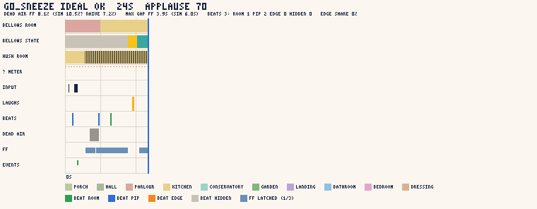

- `n01_throat_tea_caught.png`

  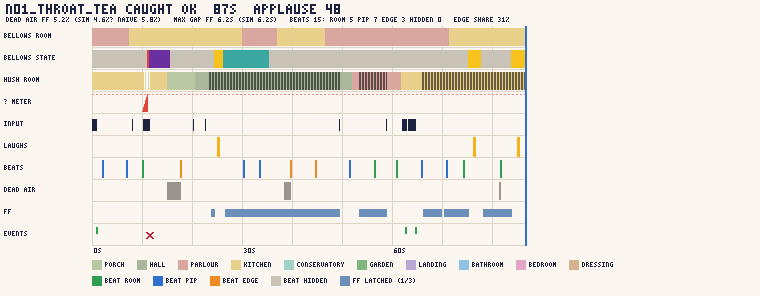

- `n01_throat_tea_chase.png`

  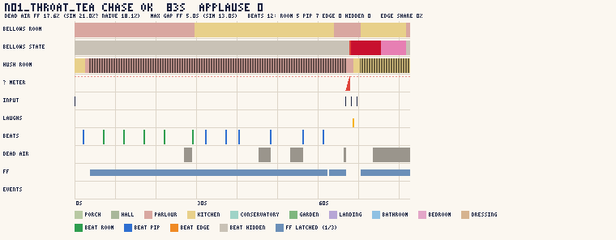

- `n01_throat_tea_ideal.png`

  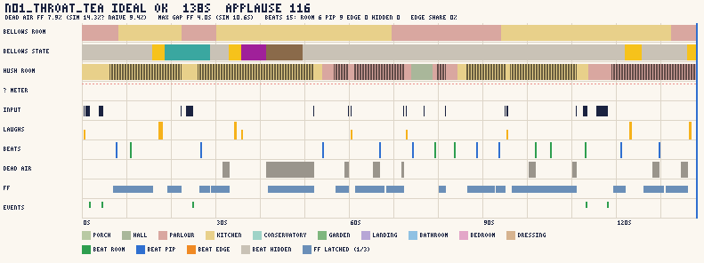

- `n01_throat_tea_meltdown.png`

  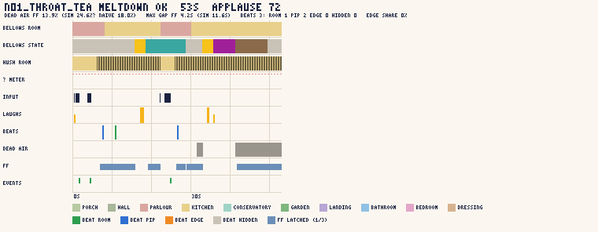

- `n01_throat_tea_required.png`

  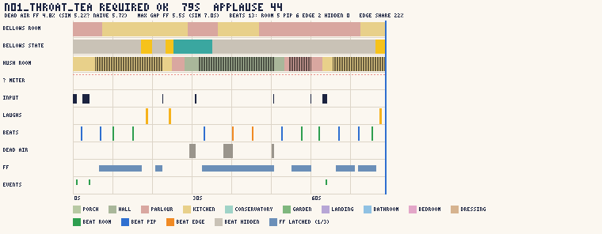

- `n01_throat_tea_slow.png`

  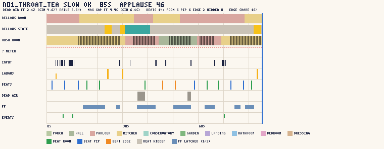

- `n02_something_fishy_face_to_face.png`

  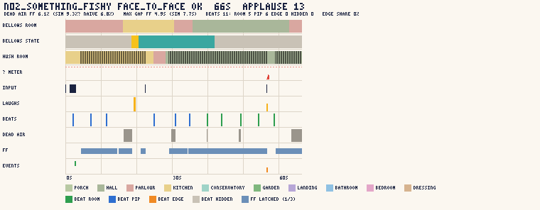

- `n02_something_fishy_face_to_face_lost.png`

  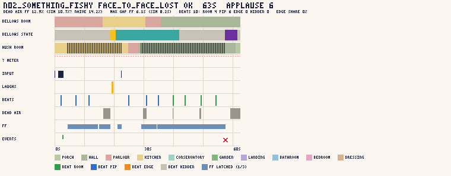

- `n02_something_fishy_ideal.png`

  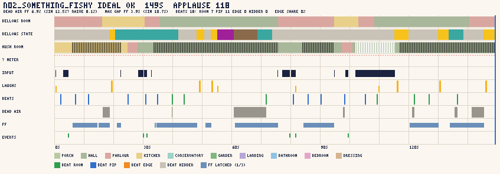

- `n02_something_fishy_required.png`

  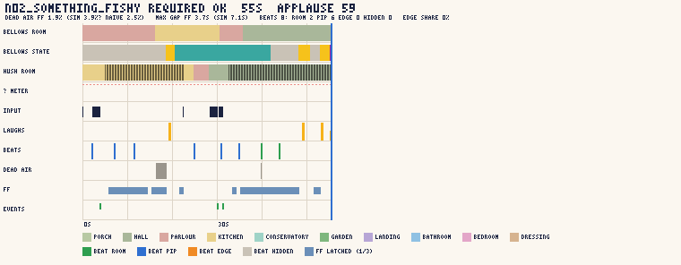

- `n02_something_fishy_slow.png`

  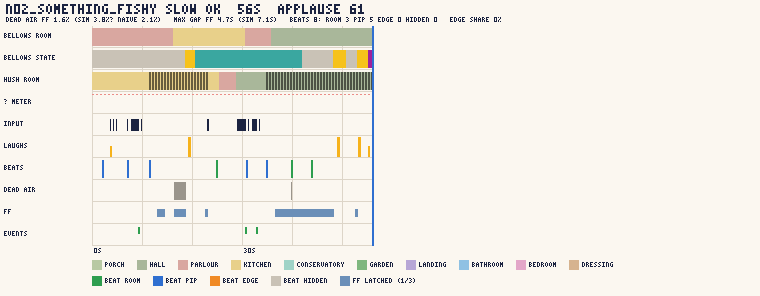

- `p00_curtain_up_ideal.png`

  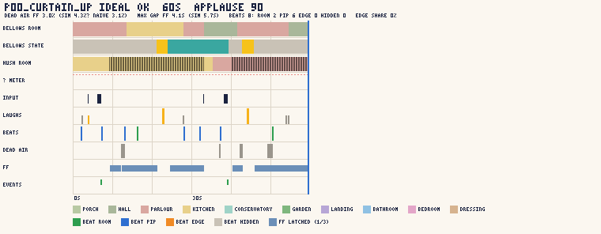

- `p00_curtain_up_required.png`

  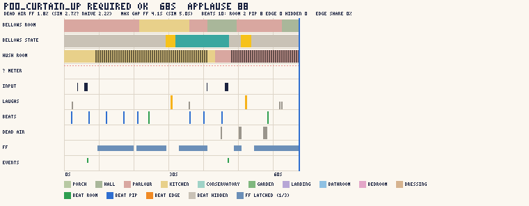

- `p00_curtain_up_slow.png`

  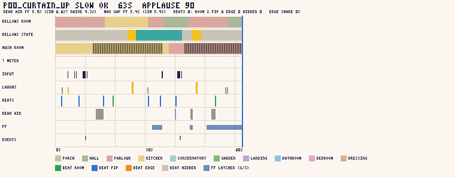

## What the timelines show

- **Where the beats land.** On every slice route the beats fall where they should: a pair per warm-up / tea / paper
  visit (2 s and 7 s in), a walk beat on the long legs, and they are almost all `room` (he is in Hush's room) or `pip`
  (one doorway away, or heading for her room). Edge-bubble beats are rare: only N01 required / slow / caught use them
  (edge share 0.16–0.31, all under the ⅓ ruling-L1 cap). No invisible beats on the slice routes — every gag has an emote.
- **The grey stretches left.** The longest remaining dead patches are (1) Bellows EXHAUSTED after a Meltdown (8 s,
  beats suppressed by design — N01/N02 ideal around 45–70 s), (2) the Prologue slow route's first minute while the
  first-timer dawdles (no ⏩ until the `ghost_ff` cue), and (3) short waits of 3–5 s between a fix-up and the next
  loop activity. None breaks the 12 s ⏩ gap cap (worst 6.2 s on a slice route).
- **⏩.** The FF row shows the latch dropping on every prank fire / "?" / entry warning into her room and coming back
  after the persona's re-press delay; the slow persona's P00 run has no FF before `ghost_ff`.

