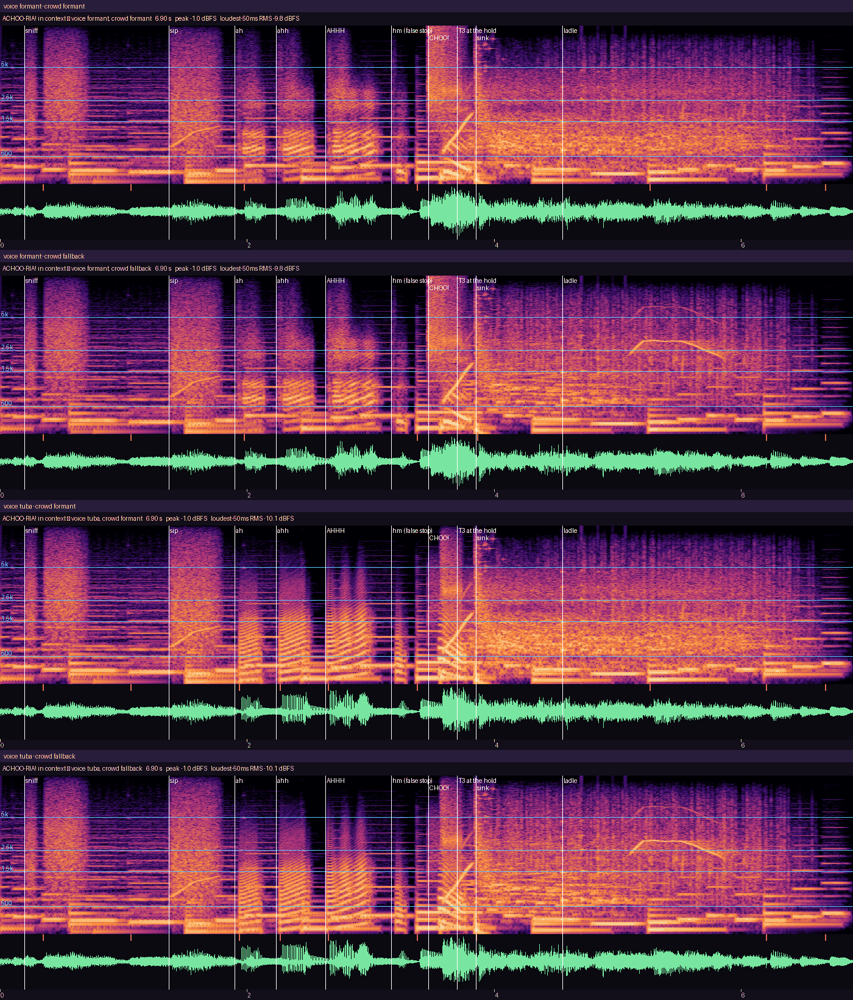
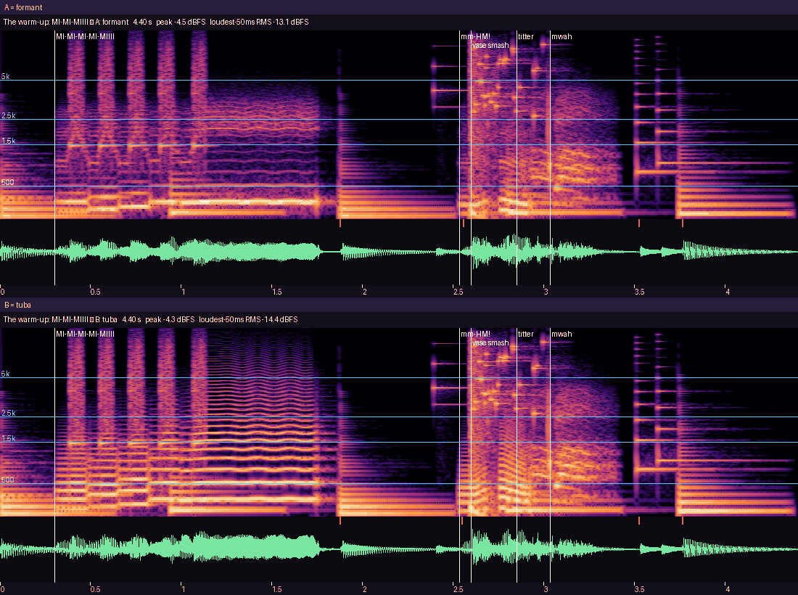
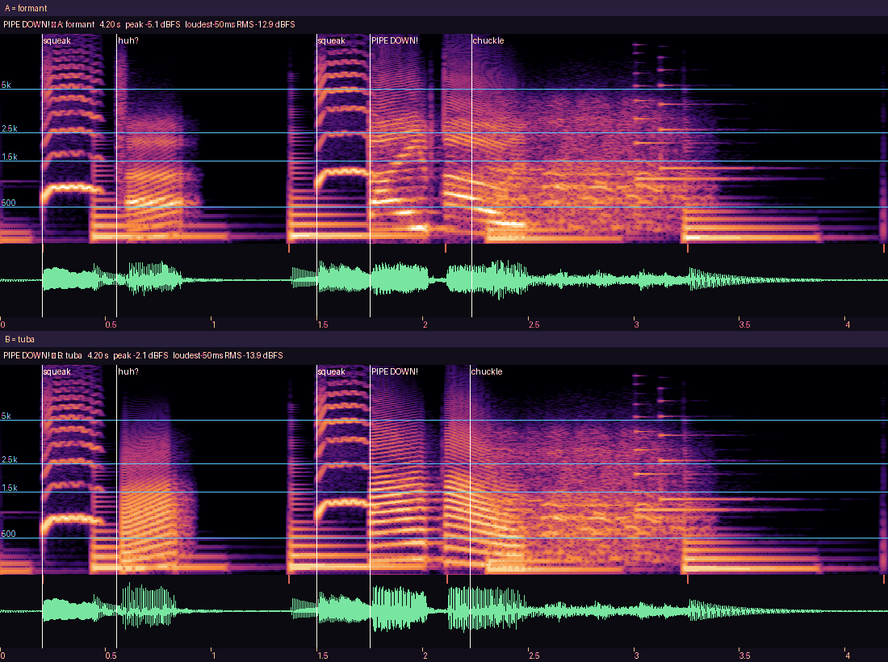
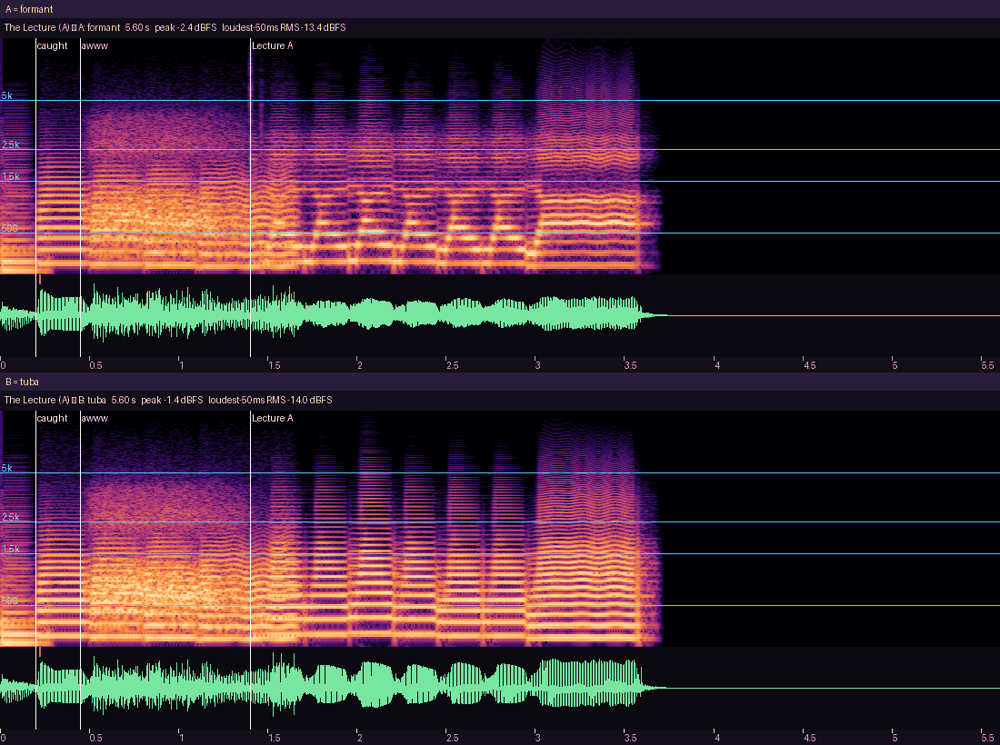
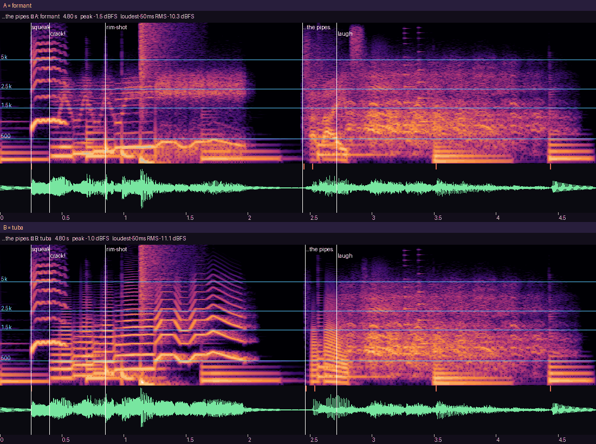
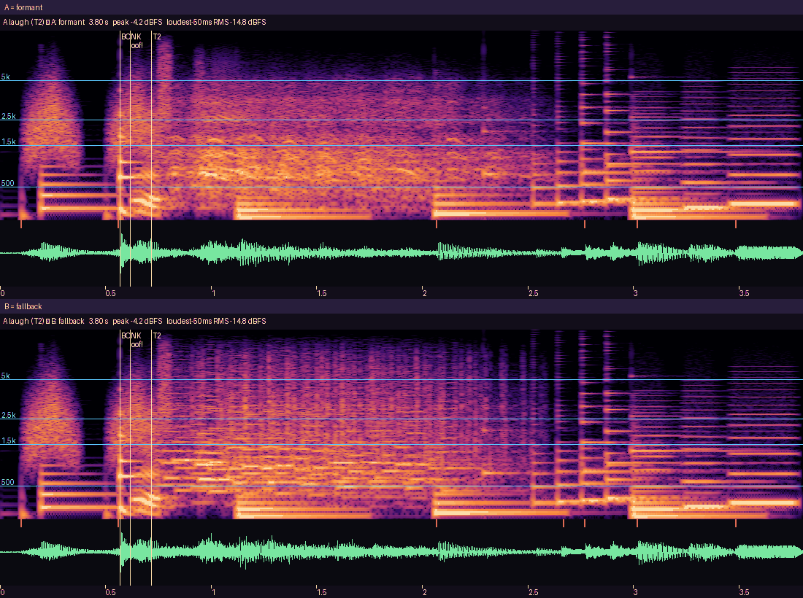
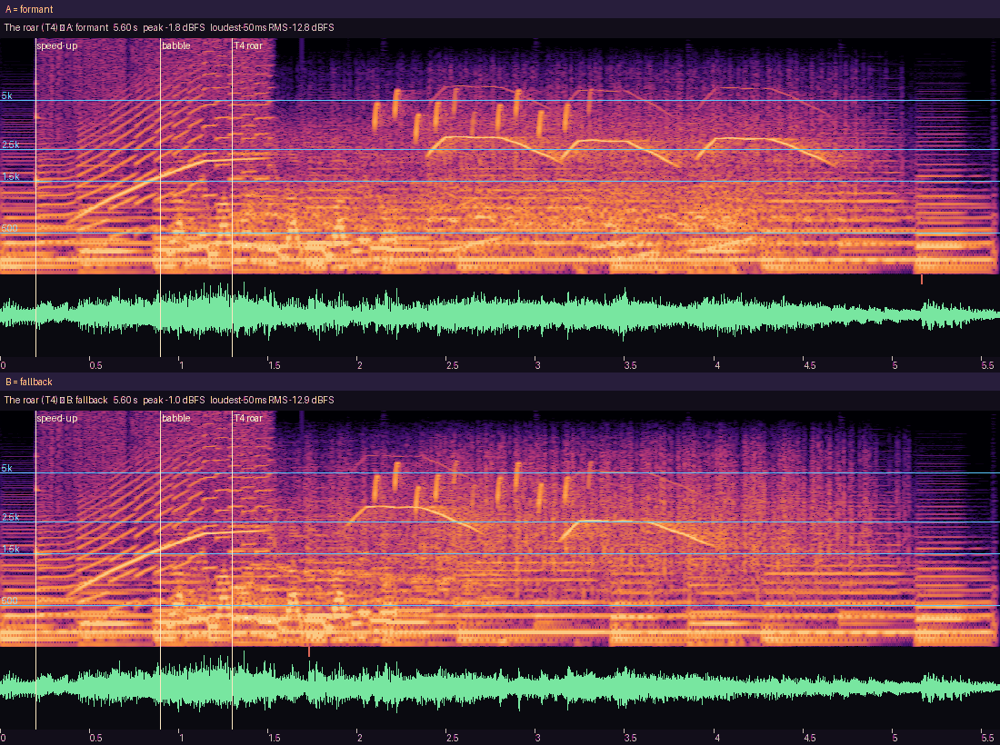
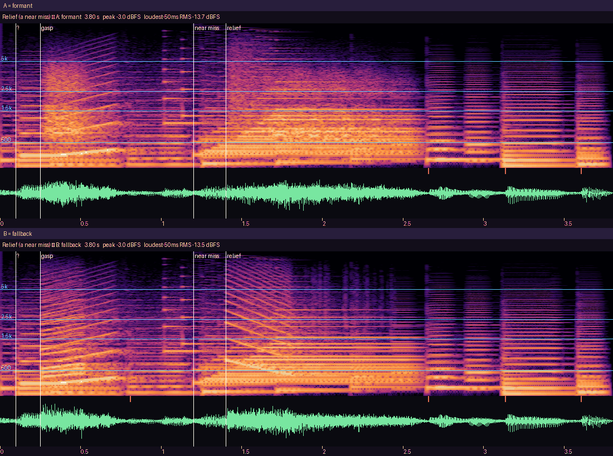
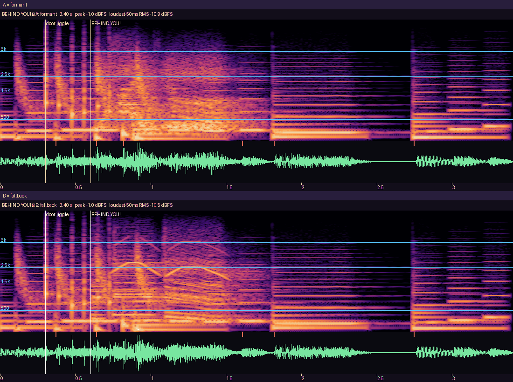

# Gate 0 — voice and crowd A/B, in context

_Generated by `tools/audio/gate0.py` (owner `s2-sound`). Listen on a **phone speaker at half volume** first, then headphones. Every clip is the scene the way the game plays it: the clip sounds at their frames (`docs/review/s2-sound/clip_events.md`), the event-level crowd and stingers from `cues.json`, the pit's sneak loop underneath, the Settings default volumes, the crowd ducking −6 dB under his voice, the master limiter. A and B differ only in the one style being judged._

**On the phone:** the stage door's **Play Gate 0 with voice A / B** and **… crowd A / B** set `voice_style` / `crowd_style` and launch `g0_sneeze` (the whole scene in that style); the pair buttons play each line alone with `Audio.preview(id, style)` (`game/data/audio/ab.json`).

## The sneeze — every voice × crowd combination

| | crowd A (formant) | crowd B (fallback) |
|---|---|---|
| **voice A** (formant baritone) | [sneeze_voice-formant_crowd-formant.wav](sneeze_voice-formant_crowd-formant.wav) — -18.3 LUFS · peak -0.7 dBTP | [sneeze_voice-formant_crowd-fallback.wav](sneeze_voice-formant_crowd-fallback.wav) — -18.1 LUFS · peak -0.7 dBTP |
| **voice B** (talking tuba) | [sneeze_voice-tuba_crowd-formant.wav](sneeze_voice-tuba_crowd-formant.wav) — -18.7 LUFS · peak -0.9 dBTP | [sneeze_voice-tuba_crowd-fallback.wav](sneeze_voice-tuba_crowd-fallback.wav) — -18.5 LUFS · peak -0.9 dBTP |

Listen for: the three 'ah's **climbing** in pitch and loudness (f0 / f20 / f44), a relieved 'hm.' and near-silence in the false stop (f74–94), the **CHOO** on f94 as the loudest hit, the stool scrape + the slide whistle rising over the flight, the sink **crash on f112 → 300 ms of dead silence → one ladle spinning to rest → drips**, and the Stalls' laugh + applause starting at the hold, never on top of the CHOO.

Sound timeline of the formant/formant mix (seconds from the start of the file; 5-f hit-stop after f94):

| t (s) | id | file |
|---|---|---|
| 0.200 | tea_sniff | tea_sniff |
| 1.367 | tea_slurp | tea_slurp |
| 1.900 | vo_bellows_sneeze_ah1 | vo_bellows_sneeze_ah1 |
| 2.233 | vo_bellows_sneeze_ah2 | vo_bellows_sneeze_ah2 |
| 2.633 | vo_bellows_sneeze_ah3 | vo_bellows_sneeze_ah3 |
| 3.167 | vo_bellows_sneeze_hm | vo_bellows_sneeze_hm |
| 3.467 | vo_bellows_sneeze_choo | vo_bellows_sneeze_choo_1 |
| 3.567 | stool_scrape | stool_scrape |
| 3.583 | slide_up_flight | slide_up_flight |
| 3.700 | crowd_t3 | crowd_t3_1 |
| 3.850 | sink_crash | sink_crash |
| 4.550 | ladle_spin | ladle_spin |

## Voice A/B — formant baritone (A) vs talking tuba (B)

### The warm-up: MI-MI-MIIII

- A: [voice_warmup_a_formant.wav](voice_warmup_a_formant.wav) — -19.7 LUFS · peak -4.4 dBTP
- B: [voice_warmup_b_tuba.wav](voice_warmup_b_tuba.wav) — -20.0 LUFS · peak -4.0 dBTP
- **Listen for:** the sung phrase over the pit: is he a pompous baritone you'd laugh at (A) or a muted tuba 'singing' (B)? Each note should nudge the vase audibly, and 'mm-HM!' must read as smug.

### The sneeze: ah... ahh... AHHH... hm. CHOO!

See the sneeze grid above (rows = voice).

### PIPE DOWN!

- A: [voice_pipe_down_a_formant.wav](voice_pipe_down_a_formant.wav) — -18.8 LUFS · peak -5.1 dBTP
- B: [voice_pipe_down_b_tuba.wav](voice_pipe_down_b_tuba.wav) — -18.9 LUFS · peak -2.1 dBTP
- **Listen for:** a shout that's angry but not scary; the words must be understood over the music on a phone speaker.

### The Lecture (A)

- A: [voice_lecture_a_a_formant.wav](voice_lecture_a_a_formant.wav) — -17.5 LUFS · peak -2.4 dBTP
- B: [voice_lecture_a_b_tuba.wav](voice_lecture_a_b_tuba.wav) — -17.6 LUFS · peak -1.4 dBTP
- **Listen for:** a sung scolding with a finger-wag rhythm; with the tuba, can you still tell he's scolding?

### ...the pipes.

- A: [voice_the_pipes_a_formant.wav](voice_the_pipes_a_formant.wav) — -20.2 LUFS · peak -1.4 dBTP
- B: [voice_the_pipes_b_tuba.wav](voice_the_pipes_b_tuba.wav) — -19.4 LUFS · peak -0.7 dBTP
- **Listen for:** the crack into a yodel is the joke; '…the pipes' should be small, hoarse and self-pitying.

## Crowd A/B — formant Stalls (A) vs fallback crowd (B)

### A laugh (T2)

- A: [crowd_t2_a_formant.wav](crowd_t2_a_formant.wav) — -22.2 LUFS · peak -4.1 dBTP
- B: [crowd_t2_b_fallback.wav](crowd_t2_b_fallback.wav) — -21.6 LUFS · peak -4.1 dBTP
- **Listen for:** a warm, human room laugh with one standout 'HA!' (A) vs applause + kazoo 'ha-ha' choir (B): which never sounds creepy?

### The sneeze's laugh + applause (T3)

See the sneeze grid above (columns = crowd).

### The roar (T4)

- A: [crowd_t4_a_formant.wav](crowd_t4_a_formant.wav) — -16.7 LUFS · peak -1.7 dBTP
- B: [crowd_t4_b_fallback.wav](crowd_t4_b_fallback.wav) — -17.2 LUFS · peak -0.8 dBTP
- **Listen for:** the room on its feet — whistles, stamping; it should feel like winning, over the Mountain King.

### Relief (a near miss)

- A: [crowd_relief_a_formant.wav](crowd_relief_a_formant.wav) — -19.6 LUFS · peak -3.0 dBTP
- B: [crowd_relief_b_fallback.wav](crowd_relief_b_fallback.wav) — -19.5 LUFS · peak -3.0 dBTP
- **Listen for:** a collective exhale + titter after the harp; it must read as 'phew', not as a laugh at you.

### BEHIND YOU!

- A: [crowd_behind_you_a_formant.wav](crowd_behind_you_a_formant.wav) — -18.9 LUFS · peak -0.7 dBTP
- B: [crowd_behind_you_b_fallback.wav](crowd_behind_you_b_fallback.wav) — -18.6 LUFS · peak -0.7 dBTP
- **Listen for:** the panto warning: urgent and fun. The fallback (kazoo choir) has no words — can you still hear 'behind you'?

## Does every voice / crowd sound of the Gate-0 scene exist in both styles?

The phone A/B runs the whole `g0_sneeze` scene in one style, so every voice line and crowd kind it can play must have its B take. The Gate-0 clip events + the `cues.json` events that fire there:

| id | where | both styles | B plays |
|---|---|---|---|
| vo_bellows_sneeze_ah1 | bellows/rx_sneeze_blast_a | yes | vo_bellows_tuba_sneeze_ah1 |
| vo_bellows_sneeze_ah2 | bellows/rx_sneeze_blast_a | yes | vo_bellows_tuba_sneeze_ah2 |
| vo_bellows_sneeze_ah3 | bellows/rx_sneeze_blast_a | yes | vo_bellows_tuba_sneeze_ah3 |
| vo_bellows_sneeze_hm | bellows/rx_sneeze_blast_a | yes | vo_bellows_tuba_sneeze_hm |
| vo_bellows_sneeze_choo | bellows/rx_sneeze_blast_a | yes | vo_bellows_tuba_sneeze_choo_1 |
| vo_bellows_warmup_1 | bellows/act_warmup | yes | vo_bellows_tuba_warmup_1 |
| vo_bellows_warmup_3 | bellows/act_warmup | yes | vo_bellows_tuba_warmup_3 |
| vo_bellows_smug | bellows/mg_admire_reflection_horn | yes | vo_bellows_tuba_smug_1 |
| vo_bellows_trill | bellows/mg_trill | yes | vo_bellows_tuba_trill |
| vo_bellows_hum | bellows/mg_hum | yes | vo_bellows_tuba_hum_1 |
| vo_bellows_bliss | bellows/mg_pinkie_up | yes | vo_bellows_tuba_bliss |
| vo_bellows_ahem | bellows/beat_dignity_fail | yes | vo_bellows_tuba_ahem_1 |
| vo_bellows_oof | bellows/cue_doorframe_bonk | yes | vo_bellows_tuba_oof_1 |
| crowd t0 | cues rigged | yes | crowd_fb_t0_1 |
| crowd gasp | cues hide | yes | crowd_fb_gasp_1 |
| crowd behind_you | cues entry_warning | yes | crowd_fb_behind_you_1 |
| crowd relief | cues near_miss | yes | crowd_fb_relief_1 |
| vo_bellows_hmph | cues b_detour | yes | vo_bellows_tuba_hmph_1 |
| vo_bellows_huh | cues ear_pip | yes | vo_bellows_tuba_huh_1 |
| vo_bellows_pipe_down | cues lure_fatigue | yes | vo_bellows_tuba_pipe_down_1 |
| crowd t1 | cues bump | yes | crowd_fb_t1_1 |
| vo_bellows_pardon | cues bump | yes | vo_bellows_tuba_pardon_1 |
| crowd cheer | cues night_end | yes | crowd_fb_cheer_1 |
| crowd t2 | laugh path | yes | crowd_fb_t2_1 |
| crowd t3 | laugh path | yes | crowd_fb_t3_1 |
| crowd shh | the Stalls shush (climb-in) | **no** — the formant take plays | crowd_shh_1 |

25 of 26 exist in both styles. The rest (crowd shh) contain no voice / no laughter (the shush is breath), so the fallback keeps the formant file on purpose (Stage-1 deviation 6).

## Loudness of every mix

Integrated loudness (BS.1770 K-weighted, gated) and 4× oversampled true peak after the bus gains and the −1 dBFS master limiter.

| file | s | LUFS-I | max short-term | true peak dBTP |
|---|---|---|---|---|
| sneeze_voice-formant_crowd-formant.wav | 6.9 | -18.3 | -11.7 | -0.71 |
| sneeze_voice-formant_crowd-fallback.wav | 6.9 | -18.1 | -11.7 | -0.71 |
| sneeze_voice-tuba_crowd-formant.wav | 6.9 | -18.7 | -12.9 | -0.88 |
| sneeze_voice-tuba_crowd-fallback.wav | 6.9 | -18.5 | -12.9 | -0.88 |
| voice_warmup_a_formant.wav | 4.4 | -19.7 | -16.1 | -4.4 |
| voice_warmup_b_tuba.wav | 4.4 | -20.0 | -16.2 | -4.02 |
| voice_pipe_down_a_formant.wav | 4.2 | -18.8 | -15.3 | -5.12 |
| voice_pipe_down_b_tuba.wav | 4.2 | -18.9 | -15.6 | -2.09 |
| voice_lecture_a_a_formant.wav | 5.6 | -17.5 | -16.0 | -2.4 |
| voice_lecture_a_b_tuba.wav | 5.6 | -17.6 | -16.0 | -1.35 |
| voice_the_pipes_a_formant.wav | 4.8 | -20.2 | -15.3 | -1.37 |
| voice_the_pipes_b_tuba.wav | 4.8 | -19.4 | -15.2 | -0.69 |
| crowd_t2_a_formant.wav | 3.8 | -22.2 | -19.5 | -4.14 |
| crowd_t2_b_fallback.wav | 3.8 | -21.6 | -18.9 | -4.14 |
| crowd_t4_a_formant.wav | 5.6 | -16.7 | -14.3 | -1.73 |
| crowd_t4_b_fallback.wav | 5.6 | -17.2 | -14.3 | -0.85 |
| crowd_relief_a_formant.wav | 3.8 | -19.6 | -16.1 | -2.98 |
| crowd_relief_b_fallback.wav | 3.8 | -19.5 | -15.5 | -3.01 |
| crowd_behind_you_a_formant.wav | 3.4 | -18.9 | -15.0 | -0.71 |
| crowd_behind_you_b_fallback.wav | 3.4 | -18.6 | -14.5 | -0.69 |
